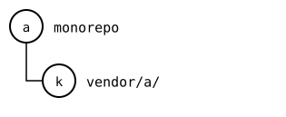
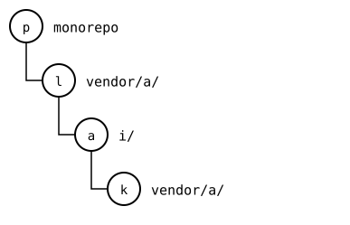
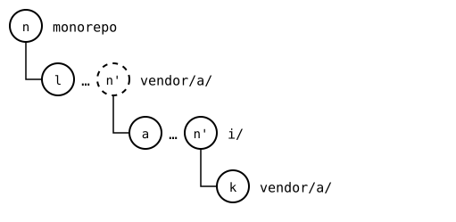

# Scenario: cycle

The upstream of `vendor/a/` splices in the monorepo, so the monorepo
would contain a copy of itself, which contains a copy of itself, and so
on: a *cycle*. A package manager can allow cycles, since it installs
each package once. A splice contains its files, though, and a
[nested](../../../03-concepts/04-nesting.md) `.splice` is one of them, so
a cycle is an endless tree of folders, one level deeper on every pull.

```text
      M ──> A
      ^     │
      └─────┘   A's upstream splices M in at i/
```

So `clone`, `merge` and `pull` refuse a splice whose upstream, or a
splice inside it, is one of the monorepo's remotes, and `push` refuses
to push to one. Two URLs are the same if they are equal as Git reaches
them, after `url.<base>.insteadOf`.

- **Monorepo** (remote `origin`, `https://git.example.com/m.git`):
  `vendor/a/`, a splice of the upstream below.
- **Upstream of `vendor/a/`** (`https://git.example.com/a.git`): `seed`,
  then `add i`, which spliced the monorepo in at `i/`, with `vendor/a/`
  in it.

## Output

<!--
```scrut {fail_fast: true, output_stream: combined}
$ source "$TESTDIR/../../readme-setup.sh"
```
-->

[`setup.bash`](setup.bash) builds this state:

```scrut
$ build_scenario scenario_cycle
```

As a tree: the monorepo at *a* (`add vendor/a`), and `vendor/a/` at
*k* (`seed`):



<!--
```scrut
$ check_drawing "$TESTDIR/cycle-start.drawio.svg" a=HEAD k="$(git config --file vendor/a/.splice splice.commit)"
ok   cycle-start.drawio.svg: a tree of 2 rows
```
-->

### The pull refuses

The upstream's new commit, *l* (`add i`), has `i/`, a splice of the
monorepo's `origin`:

```scrut
$ git splice pull vendor/a
ok   vendor/a fetched (main moved bde4164..885fc31)
!!   vendor/a: its upstream splices this monorepo back in, at vendor/a/i from https://git.example.com/m.git, remote origin here -- each pull would nest another copy
!!   Failed: vendor/a
[1]
```

The tree stays as it was:


<!--
```scrut
$ check_drawing "$TESTDIR/cycle-start.drawio.svg" a=HEAD k="$(git config --file vendor/a/.splice splice.commit)"
ok   cycle-start.drawio.svg: a tree of 2 rows
```
-->

### Without the remote, every pull nests one more copy

A monorepo that doesn't have its URL as a remote, or has it spelled
otherwise, e.g. over SSH where the splice says HTTPS, isn't recognized:

```scrut
$ git remote remove origin
```

The pull brings in the upstream's `i/`, a copy of the monorepo with
`vendor/a/` in it:

```scrut
$ git splice pull -m "p: pull vendor/a" vendor/a
ok   vendor/a fetched
ok   vendor/a: pulled 885fc31
ok   vendor/a/i fetched
ok   vendor/a/i/vendor/a fetched
```



<!--
```scrut
$ check_drawing "$TESTDIR/cycle-nested.drawio.svg" p=HEAD a=HEAD~1 l=refs/splices/a/heads/main k="$(git config --file vendor/a/i/vendor/a/.splice splice.commit)"
ok   cycle-nested.drawio.svg: a tree of 4 rows
```
-->

```scrut
$ git grep 'id = ' -- '*/.splice' | tr '\t' ' '
vendor/a/.splice: id = 224f2c2563d3b6f7
vendor/a/i/.splice: id = 0ceff458bb3bb1f7
vendor/a/i/vendor/a/.splice: id = 224f2c2563d3b6f7
```

`vendor/a/i/vendor/a/` has the
[id](../../../03-concepts/03-splice-identity.md) of `vendor/a/`, above
it: the cycle. `pull --all` goes down the tree, pulling each splice
below the one above it, and stops at a copy of a splice it's inside:
pulling `vendor/a/i/vendor/a/` would bring in another copy below it, and
that one the next. So the pull ends, and the tree stays as deep as it
is:

```scrut
$ git splice pull --all
ok   vendor/a fetched
ok   vendor/a/i fetched
ok   vendor/a/i/vendor/a fetched
ok   vendor/a: nothing to pull
ok   vendor/a/i: nothing to pull
ok   vendor/a/i/vendor/a: a copy of vendor/a, which it's inside -- not pulled
```

Once the monorepo is pushed, the `i/` splices sync with a version that
has every level so far, so a pull nests them all once more. The copies
of the nested `.splice` files then conflict, as both sides pulled them
to different commits
([nested conflicts](../01-nested-splices/02-three-levels/every-level-conflicts.md)).

### The monorepo pushes to itself

`vendor/a/i/` is a splice of the monorepo's own upstream. Its push
would send a copy of the monorepo, from when the upstream of `vendor/a/`
last pulled it, to the monorepo's `main`. A change in the copy:

```scrut
$ echo "note" >vendor/a/i/note.txt &&
>   git add vendor/a/i/note.txt &&
>   git commit -q -m "n: note in i"
```

With the remote back, the push refuses:

```scrut
$ git remote add origin https://git.example.com/m.git
```

```scrut
$ git splice push vendor/a/i
!!   vendor/a/i: https://git.example.com/m.git is this monorepo's own, remote origin here -- pushing it would replace the monorepo's branch with an older copy
!!   Failed: vendor/a/i
[1]
```

Without it, the push goes through. Nobody pushed the monorepo since the
setup, so it's a fast-forward:

```scrut
$ git remote remove origin
```

```scrut
$ git splice push vendor/a/i
ok   vendor/a/i: pushed 2450677 to main
```

`i/` has *n'*, the copy of *n*, on its upstream now, the monorepo's own:



<!--
```scrut
$ check_drawing "$TESTDIR/cycle-end.drawio.svg" n=HEAD a=HEAD~2 l=refs/splices/a/heads/main k="$(git config --file vendor/a/i/vendor/a/.splice splice.commit)"
ok   cycle-end.drawio.svg: a tree of 4 rows
```
-->

That copy is the monorepo's `main` now, which is neither the monorepo's
history nor its tree:

```scrut
$ git -C "$UPSTREAM-m" log --format=%s main
n: note in i
add vendor/a
initial commit
```

```scrut
$ git -C "$UPSTREAM-m" ls-tree --name-only main
note.txt
vendor
```

```scrut
$ git ls-tree --name-only HEAD
vendor
```

And the monorepo's own push is rejected:

```scrut
$ git push -q https://git.example.com/m.git main
To $UPSTREAM-m
 ! [rejected]        main -> main (non-fast-forward)
error: failed to push some refs to '$UPSTREAM-m'
hint: Updates were rejected because the tip of your current branch is behind
hint: its remote counterpart. If you want to integrate the remote changes,
hint: use 'git pull' before pushing again.
hint: See the 'Note about fast-forwards' in 'git push --help' for details.
[1]
```
