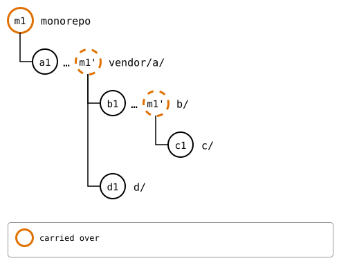
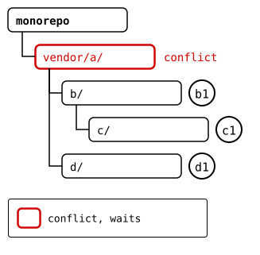

# Scenario: a recursive pull

`git splice pull --recursive` updates nested splices
[the way this chapter describes](../README.md): the splice above first,
then each one inside it, down the tree. The first conflict stops the
pull. Once it's resolved and committed, the same command again goes on
from there: the splices pulled already have nothing left to pull. When
it's done, the monorepo gets one commit for the whole pull: the change
to `vendor/a/`, with everything below it.

## The tree

Every upstream moved on, and the one above `vendor/a/` added a splice,
`e/`. The monorepo changed `vendor/a/` and `b/` in it, so two merges
conflict: the monorepo's and `a`'s upstream's change to `file.txt`, and
`b`'s upstream's and `c`'s upstream's change to `c/file.txt`. The other
merges don't, and `d/`, which no one but its upstream changed, only
moves forward.

## Output

<!--
```scrut {fail_fast: true, output_stream: combined}
$ source "$TESTDIR/../../../readme-setup.sh" && export GIT_CONFIG_COUNT=8 GIT_CONFIG_KEY_0="url.$UPSTREAM-a.git.insteadOf" GIT_CONFIG_VALUE_0=https://git.example.com/a.git GIT_CONFIG_KEY_1="url.$UPSTREAM-b.git.insteadOf" GIT_CONFIG_VALUE_1=https://git.example.com/b.git GIT_CONFIG_KEY_2="url.$UPSTREAM-c.git.insteadOf" GIT_CONFIG_VALUE_2=https://git.example.com/c.git GIT_CONFIG_KEY_3="url.$UPSTREAM-d.git.insteadOf" GIT_CONFIG_VALUE_3=https://git.example.com/d.git GIT_CONFIG_KEY_4="url.$UPSTREAM-e.git.insteadOf" GIT_CONFIG_VALUE_4=https://git.example.com/e.git GIT_CONFIG_KEY_5=user.name GIT_CONFIG_VALUE_5=Test GIT_CONFIG_KEY_6=user.email GIT_CONFIG_VALUE_6=test@example.com GIT_CONFIG_KEY_7=core.editor GIT_CONFIG_VALUE_7=true
```
-->

[`setup.bash`](setup.bash) builds this state:

```scrut
$ build_scenario scenario_recursive_pull
```

Each upstream moves on. `b`'s changes the `file.txt` in its `c/` too:

```scrut
$ git clone -q https://git.example.com/c.git ../c-work &&
>   echo "c upstream" >>../c-work/file.txt &&
>   git -C ../c-work commit -q -am "c2: c upstream" &&
>   git -C ../c-work push -q origin main
```

```scrut
$ git clone -q https://git.example.com/b.git ../b-work &&
>   echo "b upstream" >>../b-work/file.txt &&
>   echo "c in b's upstream" >>../b-work/c/file.txt &&
>   git -C ../b-work commit -q -am "b2: b upstream" &&
>   git -C ../b-work push -q origin main
```

```scrut
$ git clone -q https://git.example.com/d.git ../d-work &&
>   echo "d upstream" >>../d-work/file.txt &&
>   git -C ../d-work commit -q -am "d2: d upstream" &&
>   git -C ../d-work push -q origin main
```

`a`'s splices `e` in, at *e1*, in the same commit:

```scrut
$ git clone -q https://git.example.com/a.git ../a-work &&
>   cd ../a-work &&
>   git splice clone https://git.example.com/e.git e &&
>   echo "a upstream" >>file.txt &&
>   git commit -q --amend -am "a2: a upstream, and e spliced in" &&
>   git push -q origin main &&
>   cd ../monorepo
===  e: fetching https://git.example.com/e.git
ok   e: cloned ad47a17 from main
```

The monorepo changes `vendor/a/` and, in it, `b/`:

```scrut
$ echo "a in the monorepo" >>vendor/a/file.txt &&
>   echo "b in the monorepo" >>vendor/a/b/notes.txt &&
>   git add vendor/a &&
>   git commit -q -m "m1: a and b in the monorepo"
```



<!--
```scrut
$ check_drawing "$TESTDIR/tree-before.drawio.svg"
ok   tree-before.drawio.svg: a tree of 5 rows
```
-->

## 1. The first run: a conflict in `vendor/a/`

The pull fetches each upstream, and merges `vendor/a/` first, which
conflicts: *a2* meets the monorepo's own change to it, *m1'*:

```scrut
$ git splice pull --recursive vendor/a
ok   vendor/a fetched (main moved 764d9c4..6d12ed8)
ok   vendor/a/b fetched (main moved f815a3c..be68b59)
ok   vendor/a/b/c fetched (main moved 8c169b6..94cad5e)
ok   vendor/a/d fetched (main moved 2c64d15..36c850e)
Auto-merging vendor/a/file.txt
CONFLICT (content): Merge conflict in vendor/a/file.txt
!!   vendor/a: conflict -- resolve it, then 'git commit' (or 'git cherry-pick --abort' to give up)
!!   vendor/a: pull failed
!!   Not pulled yet: vendor/a/b vendor/a/b/c vendor/a/d -- resolve the conflict, run 'git commit', then re-run pull
!!   Failed: vendor/a
[1]
```



<!--
```scrut
$ check_drawing "$TESTDIR/tree-a-conflicts.drawio.svg"
ok   tree-a-conflicts.drawio.svg: a tree of 5 rows
```
-->

```scrut
$ printf 'a seed\na in the monorepo\na upstream\n' >vendor/a/file.txt &&
>   git add vendor/a/file.txt &&
>   git commit -q --no-edit
```

## 2. The second run: a conflict in `c/`

`vendor/a/` has nothing left to pull. Its pull brought in `e/`, a splice
now, at *e1*, the newest commit of its upstream. `b/` merges cleanly,
and `c/` conflicts:

```scrut
$ git splice pull --recursive vendor/a
ok   vendor/a fetched
ok   vendor/a/b fetched
ok   vendor/a/b/c fetched
ok   vendor/a/d fetched
ok   vendor/a/e fetched
ok   vendor/a: nothing to pull
ok   vendor/a/b: pulled be68b59
Auto-merging vendor/a/b/c/file.txt
CONFLICT (content): Merge conflict in vendor/a/b/c/file.txt
!!   vendor/a/b/c: conflict -- resolve it, then 'git commit' (or 'git cherry-pick --abort' to give up)
!!   vendor/a/b/c: pull failed
!!   Not pulled yet: vendor/a/d vendor/a/e -- resolve the conflict, run 'git commit', then re-run pull
!!   Failed: vendor/a/b/c
[1]
```

In `c/`, b's upstream's change, the copy *b2'*, meets *c2*:


<!--
```scrut
$ check_drawing "$TESTDIR/tree-c-conflicts.drawio.svg" pb=HEAD "b2'=$(git splice rebuild vendor/a/b/c)"
ok   tree-c-conflicts.drawio.svg: a tree of 6 rows
```
-->

```scrut
$ printf "c1: c seed\nc in b's upstream\nc upstream\n" >vendor/a/b/c/file.txt &&
>   git add vendor/a/b/c/file.txt &&
>   git commit -q --no-edit
```

## 3. The third run: the rest

`d/`, which no one but its upstream changed, only moves forward:

```scrut
$ git splice pull --recursive vendor/a
ok   vendor/a fetched
ok   vendor/a/b fetched
ok   vendor/a/b/c fetched
ok   vendor/a/d fetched
ok   vendor/a/e fetched
ok   vendor/a: nothing to pull
ok   vendor/a/b: nothing to pull
ok   vendor/a/b/c: nothing to pull
ok   vendor/a/d: pulled 36c850e
ok   vendor/a/e: nothing to pull
ok   vendor/a: 4 pulls made one commit, 9252b9b
```


<!--
```scrut
$ check_drawing "$TESTDIR/tree-pulled.drawio.svg" p=HEAD
ok   tree-pulled.drawio.svg: a tree of 6 rows
```
-->

## 4. The result

One commit for the whole pull: the message of `vendor/a`'s own pull,
then of each pull below it:

```scrut
$ git log --format=%B
splice: pull vendor/a from main at 6d12ed8

splice: pull vendor/a/b from main at be68b59
splice: pull vendor/a/b/c from main at 94cad5e
splice: pull vendor/a/d from main at 36c850e

m1: a and b in the monorepo

add vendor/a

initial commit

```

```scrut
$ git splice status
On branch main

  ahead 2     vendor/a
  ahead 2     vendor/a/b
  ahead 1     vendor/a/b/c

  up to date  vendor/a/d
  up to date  vendor/a/e
```

```scrut
$ git splice push --all
ok   vendor/a/b/c: pushed 6b6b08c to main
ok   vendor/a/b: pushed 9acbcb5 to main
ok   vendor/a/d: nothing to push
ok   vendor/a/e: nothing to push
ok   vendor/a: pushed ed012a8 to main
```
