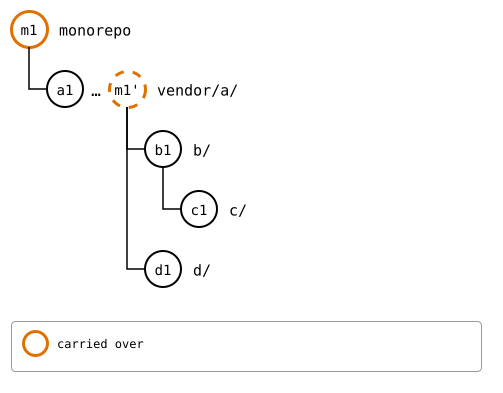
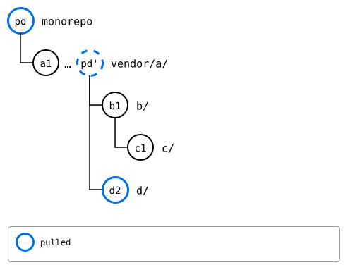
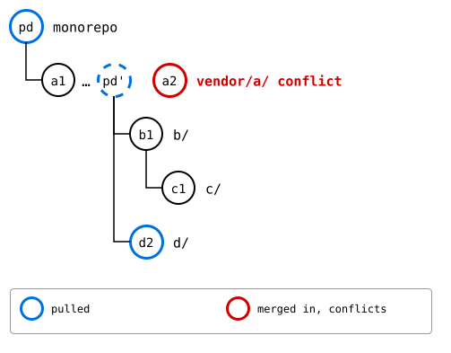
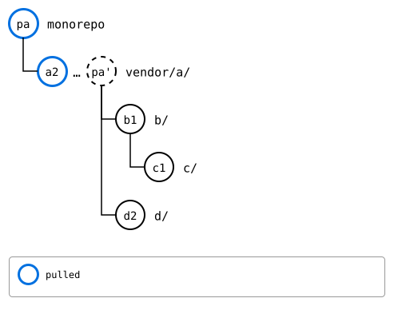

# Scenario: a recursive pull, a conflict in an update

Updating a splice from its upstream sounds like a fast-forward: the
upstream has new commits, and the splice takes them. That holds for a
splice with nothing of its own. Once the monorepo has changed the
splice too, an update is a merge of two lines of work, as `git pull` is
in a clone with local commits, and it can conflict like one.

Here, `d/` has nothing of its own, and `vendor/a/` has the monorepo's
commit *m1*, on the same lines `a`'s upstream changed in *a2*.

## Output

<!--
```scrut {fail_fast: true, output_stream: combined}
$ source "$TESTDIR/../../../readme-setup.sh" && export GIT_CONFIG_COUNT=8 GIT_CONFIG_KEY_0="url.$UPSTREAM-a.git.insteadOf" GIT_CONFIG_VALUE_0=https://git.example.com/a.git GIT_CONFIG_KEY_1="url.$UPSTREAM-b.git.insteadOf" GIT_CONFIG_VALUE_1=https://git.example.com/b.git GIT_CONFIG_KEY_2="url.$UPSTREAM-c.git.insteadOf" GIT_CONFIG_VALUE_2=https://git.example.com/c.git GIT_CONFIG_KEY_3="url.$UPSTREAM-d.git.insteadOf" GIT_CONFIG_VALUE_3=https://git.example.com/d.git GIT_CONFIG_KEY_4="url.$UPSTREAM-e.git.insteadOf" GIT_CONFIG_VALUE_4=https://git.example.com/e.git GIT_CONFIG_KEY_5=user.name GIT_CONFIG_VALUE_5=Test GIT_CONFIG_KEY_6=user.email GIT_CONFIG_VALUE_6=test@example.com GIT_CONFIG_KEY_7=core.editor GIT_CONFIG_VALUE_7=true
```
-->

[`setup.bash`](setup.bash) builds this state:

```scrut
$ build_scenario scenario_recursive_pull
```

```scrut
$ git clone -q https://git.example.com/d.git ../d-work &&
>   echo "d upstream" >>../d-work/file.txt &&
>   git -C ../d-work commit -q -am "d2: d upstream" &&
>   git -C ../d-work push -q origin main
```

```scrut
$ git clone -q https://git.example.com/a.git ../a-work &&
>   echo "a upstream" >>../a-work/file.txt &&
>   git -C ../a-work commit -q -am "a2: a upstream" &&
>   git -C ../a-work push -q origin main
```

```scrut
$ echo "a in the monorepo" >>vendor/a/file.txt &&
>   git commit -q -am "m1: a in the monorepo"
```



<!--
```scrut
$ check_drawing "$TESTDIR/update-before.drawio.svg"
ok   update-before.drawio.svg: a tree of 5 rows
```
-->

## A fast-forward

`d/` takes *d2*, and that's all:

```scrut
$ git splice pull vendor/a/d
ok   vendor/a/d fetched (main moved 2c64d15..36c850e)
ok   vendor/a/d: pulled 36c850e
```

*d2* is `d/`'s synced commit now, and `vendor/a/`, which contains `d/`,
gets the copy of that pull, *pd'*, on top of its own:



<!--
```scrut
$ check_drawing "$TESTDIR/update-fast-forward.drawio.svg" pd=HEAD
ok   update-fast-forward.drawio.svg: a tree of 5 rows
```
-->

## A merge

`vendor/a/`'s head isn't its synced commit *a1* any more: its history
has the copies of *m1* and of the pull of `d/`, *pd'*, on top. *a2*
merges into it, from *a1*, the base, and *m1* and *a2* changed the same
line of `file.txt`:

```scrut
$ git splice pull vendor/a
ok   vendor/a fetched (main moved 764d9c4..4936f17)
ok   vendor/a/b fetched
ok   vendor/a/b/c fetched
ok   vendor/a/d fetched
Auto-merging vendor/a/file.txt
CONFLICT (content): Merge conflict in vendor/a/file.txt
!!   vendor/a: conflict -- resolve it, then 'git commit' (or 'git cherry-pick --abort' to give up)
!!   vendor/a: pull failed
!!   Failed: vendor/a
[1]
```



<!--
```scrut
$ check_drawing "$TESTDIR/update-conflicts.drawio.svg" pd=HEAD
ok   update-conflicts.drawio.svg: a tree of 5 rows
```
-->

```scrut
$ git diff vendor/a/file.txt
diff --cc vendor/a/file.txt
index b63060e,106bfed..0000000
--- a/vendor/a/file.txt
+++ b/vendor/a/file.txt
@@@ -1,2 -1,2 +1,6 @@@
  a seed
++<<<<<<< HEAD
 +a in the monorepo
++=======
+ a upstream
++>>>>>>> 21988c5 (splice: pull vendor/a from main at 4936f17)
```

Resolved, the merge is a commit like any other. `vendor/a/` is at
*a2* now, with its own commits on top, and `d/` at *d2*, with none:

```scrut
$ printf 'a seed\na in the monorepo\na upstream\n' >vendor/a/file.txt &&
>   git add vendor/a/file.txt &&
>   git commit -q --no-edit
```



<!--
```scrut
$ check_drawing "$TESTDIR/update-after.drawio.svg" pa=HEAD
ok   update-after.drawio.svg: a tree of 5 rows
```
-->

A splice's head can also differ from its synced commit by what its
parent's upstream changed in its folder: in
[the recursive pull](README.md), `b`'s upstream's change to `c/` meets
`c`'s upstream's in the same way.
