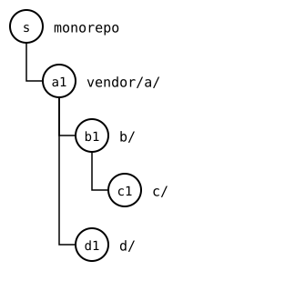
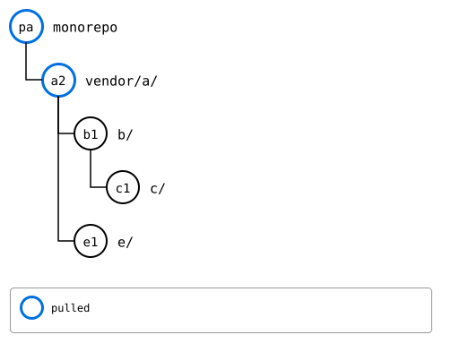
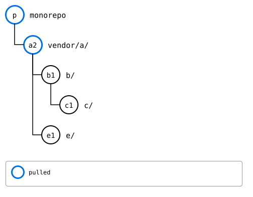

# Scenario: a recursive pull, discovered top-down

A splice's upstream decides which splices are inside it. When it
removes one, adds one, or puts another at the same folder, the tree the
monorepo knew before its pull is gone. So a pull has to go top-down:
only after the splice above is pulled is it known what's below it.

Here, `a`'s upstream drops `d/` and splices `e/` in, in one commit,
*a2*. `d`'s and `e`'s own upstreams move on all the same.

## Output

<!--
```scrut {fail_fast: true, output_stream: combined}
$ source "$TESTDIR/../../../readme-setup.sh" && export GIT_CONFIG_COUNT=8 GIT_CONFIG_KEY_0="url.$UPSTREAM-a.git.insteadOf" GIT_CONFIG_VALUE_0=https://git.example.com/a.git GIT_CONFIG_KEY_1="url.$UPSTREAM-b.git.insteadOf" GIT_CONFIG_VALUE_1=https://git.example.com/b.git GIT_CONFIG_KEY_2="url.$UPSTREAM-c.git.insteadOf" GIT_CONFIG_VALUE_2=https://git.example.com/c.git GIT_CONFIG_KEY_3="url.$UPSTREAM-d.git.insteadOf" GIT_CONFIG_VALUE_3=https://git.example.com/d.git GIT_CONFIG_KEY_4="url.$UPSTREAM-e.git.insteadOf" GIT_CONFIG_VALUE_4=https://git.example.com/e.git GIT_CONFIG_KEY_5=user.name GIT_CONFIG_VALUE_5=Test GIT_CONFIG_KEY_6=user.email GIT_CONFIG_VALUE_6=test@example.com GIT_CONFIG_KEY_7=core.editor GIT_CONFIG_VALUE_7=true
```
-->

[`setup.bash`](setup.bash) builds this state:

```scrut
$ build_scenario scenario_recursive_pull
```



<!--
```scrut
$ check_drawing "$TESTDIR/removed-before.drawio.svg" s=HEAD
ok   removed-before.drawio.svg: a tree of 5 rows
```
-->

`a`'s upstream drops `d/` and splices `e/` in, at *e1*:

```scrut
$ git clone -q https://git.example.com/a.git ../a-work &&
>   cd ../a-work &&
>   git rm -q -r d &&
>   git commit -q -m "drop d" &&
>   git splice clone https://git.example.com/e.git e >/dev/null &&
>   git reset -q --soft HEAD~2 &&
>   git commit -q -m "a2: d dropped, e spliced in" &&
>   git push -q origin main &&
>   cd ../monorepo
```

Then `d`'s upstream moves on to *d2*, and `e`'s to *e2*:

```scrut
$ git clone -q https://git.example.com/d.git ../d-work &&
>   echo "d upstream" >>../d-work/file.txt &&
>   git -C ../d-work commit -q -am "d2: d upstream" &&
>   git -C ../d-work push -q origin main
```

```scrut
$ git clone -q https://git.example.com/e.git ../e-work &&
>   echo "e upstream" >>../e-work/file.txt &&
>   git -C ../e-work commit -q -am "e2: e upstream" &&
>   git -C ../e-work push -q origin main
```

## Naming a splice and one inside it

`pull vendor/a vendor/a/d` names `vendor/a/d` as the monorepo knows it
now, but `a`'s pull decides whether it's still there, and what is. The
command refuses:

```scrut
$ git splice pull vendor/a vendor/a/d
!!   vendor/a/d is inside vendor/a, whose pull decides what's there -- pull vendor/a with --recursive, or vendor/a/d in a command of its own
[1]
```

## The step in between: `a`'s pull

`vendor/a`'s pull alone:

```scrut
$ git splice pull vendor/a
ok   vendor/a fetched (main moved 764d9c4..04072ca)
ok   vendor/a/b fetched
ok   vendor/a/b/c fetched
ok   vendor/a/d fetched (main moved 2c64d15..36c850e)
ok   vendor/a: pulled 04072ca
ok   vendor/a/e fetched
```

`d/` is gone. `e/` is a splice now, at *e1*, the commit `a`'s upstream
records for it, and no farther: *e2* takes a pull of `vendor/a/e` too,
which this command wasn't asked for.

The pull fetched `e`'s upstream, though, as it does for every splice
its merge brings in, so `status` knows what's left:

```scrut
$ git splice status vendor/a/e
On branch main

  behind 1  vendor/a/e
```



<!--
```scrut
$ check_drawing "$TESTDIR/removed-step.drawio.svg" pa=HEAD
ok   removed-step.drawio.svg: a tree of 5 rows
```
-->

## A recursive pull

Back at the commit before it, on a branch, `pull --recursive vendor/a`
takes that step, then reads what's inside
`vendor/a` from its result: `e/` is fetched and pulled, up to *e2*, and
`d/`, selected while it was still there, was removed by the pull of
`vendor/a`. The two pulls make one commit, *p*:

```scrut
$ git switch -q -c recursive HEAD~1 &&
>   git splice pull --recursive --branch main vendor/a
ok   vendor/a fetched
ok   vendor/a/b fetched
ok   vendor/a/b/c fetched
ok   vendor/a/d fetched
ok   vendor/a: pulled 04072ca
ok   vendor/a/e fetched
ok   vendor/a/e: pulled 68b88a4
ok   vendor/a/b: nothing to pull
ok   vendor/a/b/c: nothing to pull
ok   vendor/a/d: removed by the pull of vendor/a
ok   2 pulls made one commit, d95b8f5
```



<!--
```scrut
$ check_drawing "$TESTDIR/removed-after.drawio.svg" p=HEAD
ok   removed-after.drawio.svg: a tree of 5 rows
```
-->

`vendor/a/` has *p'* on top of *a2* now: the pull of `e/` inside it,
which its upstream doesn't have yet.
