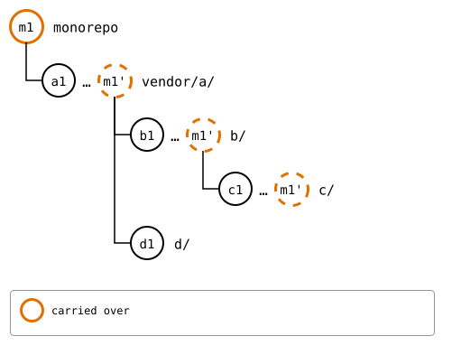
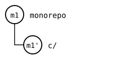
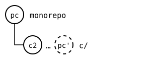

# Scenario: a failed push below

The rebuild of a splice records each splice inside it at its own
rebuild: the commit that splice's upstream gets with the same push. If
that push fails, `push --all` stops before the splice above; pushed on
its own anyway, the upstream above gets the record of a commit the
upstream below doesn't have. A clone of the upstream above has
everything that commit is made of, so it makes it again, and counts what
the upstream below lacks as its own: a plain pull merges it.

## Output

<!--
```scrut {fail_fast: true, output_stream: combined}
$ source "$TESTDIR/../../../readme-setup.sh" && export GIT_CONFIG_COUNT=8 GIT_CONFIG_KEY_0="url.$UPSTREAM-a.git.insteadOf" GIT_CONFIG_VALUE_0=https://git.example.com/a.git GIT_CONFIG_KEY_1="url.$UPSTREAM-b.git.insteadOf" GIT_CONFIG_VALUE_1=https://git.example.com/b.git GIT_CONFIG_KEY_2="url.$UPSTREAM-c.git.insteadOf" GIT_CONFIG_VALUE_2=https://git.example.com/c.git GIT_CONFIG_KEY_3="url.$UPSTREAM-d.git.insteadOf" GIT_CONFIG_VALUE_3=https://git.example.com/d.git GIT_CONFIG_KEY_4="url.$UPSTREAM-e.git.insteadOf" GIT_CONFIG_VALUE_4=https://git.example.com/e.git GIT_CONFIG_KEY_5=user.name GIT_CONFIG_VALUE_5=Test GIT_CONFIG_KEY_6=user.email GIT_CONFIG_VALUE_6=test@example.com GIT_CONFIG_KEY_7=core.editor GIT_CONFIG_VALUE_7=true
```
-->


[`setup.bash`](setup.bash) builds this state:

```scrut
$ build_scenario scenario_recursive_pull
```

The monorepo changes `c/`, in *m1*:

```scrut
$ echo "c in the monorepo" >>vendor/a/b/c/file.txt &&
>   git commit -q -am "m1: c in the monorepo"
```

*m1* is in each rebuild above `c/`, as the copy *m1'*:



<!--
```scrut
$ check_drawing "$TESTDIR/failed-push-before.drawio.svg" 
ok   failed-push-before.drawio.svg: a tree of 5 rows
```
-->

Meanwhile `c`'s upstream gets *c2*:

```scrut
$ git clone -q https://git.example.com/c.git ../c-work &&
>   echo "c upstream" >>../c-work/other.txt &&
>   git -C ../c-work add other.txt &&
>   git -C ../c-work commit -q -m "c2: c upstream" &&
>   git -C ../c-work push -q origin main
```

`push --all` stops at `c`, whose upstream moved on, and doesn't push the
splices around it:

```scrut
$ git splice push --all
To $UPSTREAM-c.git
 ! [rejected]        30bd30abe9a17ddfcf3e4f0626dedab790bc0e07 -> main (fetch first)
error: failed to push some refs to '$UPSTREAM-c.git'
hint: Updates were rejected because the remote contains work that you do not
hint: have locally. This is usually caused by another repository pushing to
hint: the same ref. If you want to integrate the remote changes, use
hint: 'git pull' before pushing again.
hint: See the 'Note about fast-forwards' in 'git push --help' for details.
!!   vendor/a/b/c: push failed
!!   vendor/a/b: not pushed, since vendor/a/b/c below it failed
ok   vendor/a/d: nothing to push
!!   vendor/a: not pushed, since vendor/a/b/c below it failed
!!   Failed: vendor/a/b/c vendor/a/b vendor/a
[1]
```

Pushed anyway, `b`'s upstream records `c` at `30bd30a`, the copy of *m1*
in `c`'s rebuild, which `c`'s upstream doesn't have:

```scrut
$ git splice push vendor/a/b
ok   vendor/a/b: pushed e879cb1 to main
```

```scrut
$ git -C "$UPSTREAM-b.git" show main:c/.splice | git config --file - splice.commit | cut -c1-7
30bd30a
```

```scrut
$ git -C "$UPSTREAM-c.git" log --format="%h %s" main
5f049ad c2: c upstream
8c169b6 c1: c seed
```

## In a clone of `b`'s upstream

```scrut
$ git clone -q https://git.example.com/b.git ../b-work &&
>   cd ../b-work &&
>   git config user.name "Colleague" &&
>   git config user.email "colleague@example.com" &&
>   git splice fetch c
ok   c fetched
```

Its `HEAD` is `b`'s commit `m1: c in the monorepo`, which records `c/` at *m1'*, `30bd30a`, the copy that never reached `c`'s upstream:



<!--
```scrut
$ check_drawing "$TESTDIR/failed-push-clone.drawio.svg" m1\'=$(git
[2]
```
-->

It can't fetch `30bd30a`, but it makes it again: the commit of `b`'s that
recorded it, on the record before it, *c1*, gives the same hash. Only a
copy of its own history comes out the same, so what `c`'s upstream lacks
is its own:

```scrut
$ git splice status
??   c: synced commit 30bd30a isn't on main -- made it again here: 8c169b6 and 1 commit of this branch's own
On branch main

  ahead 1, behind 1  c
```

```scrut
$ git splice log c
??   c: synced commit 30bd30a isn't on main -- made it again here: 8c169b6 and 1 commit of this branch's own
===  c (main)
< 30bd30a m1: c in the monorepo  (Test <test@example.com>)
> 5f049ad c2: c upstream  (Test <test@example.com>)
```

`pull --rebase` refuses: the commit of `b`'s that made the record is the
last sync itself, so the rebase would replay it, and the record in it
would meet the pull's. Keeping the pull's record, also when a conflict
interrupts the rebase, needs a pull that carries its state from one run
to the next
([#446](https://github.com/roschaefer/git-splice/pull/446)):

```scrut
$ git splice pull --rebase c
ok   c fetched
??   c: synced commit 30bd30a isn't on main -- made it again here: 8c169b6 and 1 commit of this branch's own
!!   c: synced commit 30bd30a was made again here -- --rebase doesn't replay what's above 8c169b6; pull without --rebase
!!   Failed: c
[1]
```

A plain pull merges instead:

```scrut
$ git splice pull c
ok   c fetched
??   c: synced commit 30bd30a isn't on main -- made it again here: 8c169b6 and 1 commit of this branch's own
ok   c: pulled 5f049ad
```

The pull, *pc*, records *c2*, and `c/` has *m1*'s line on top, as this branch's own, in its rebuild *pc'*:



<!--
```scrut
$ check_drawing "$TESTDIR/failed-push-clone-pulled.drawio.svg" pc=HEAD c2=$(git
[2]
```
-->

```scrut
$ cat c/file.txt c/other.txt
c1: c seed
c in the monorepo
c upstream
```

