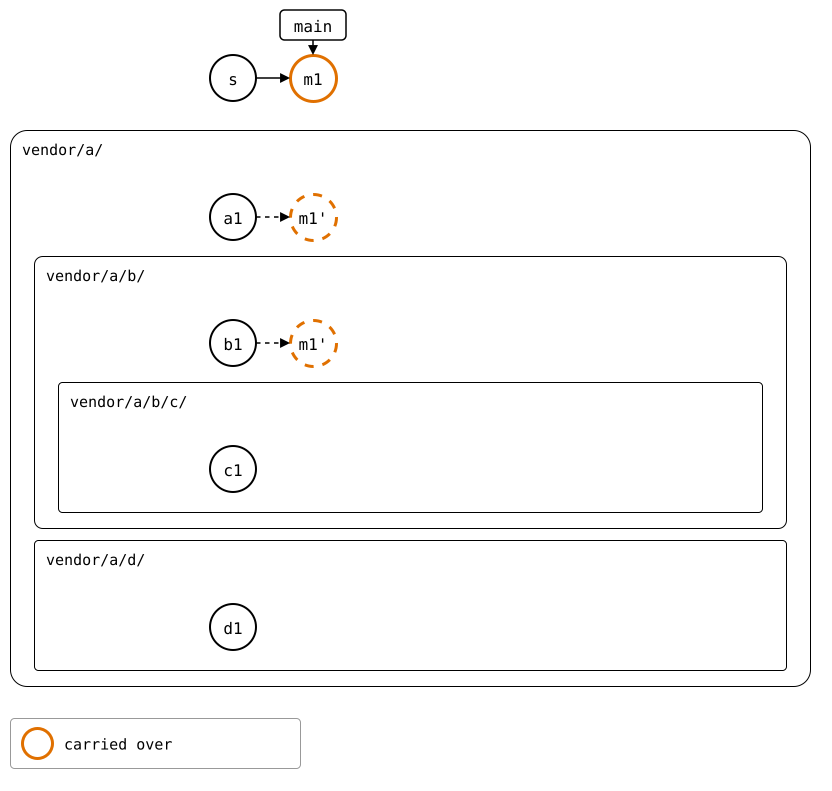

# Scenario: a recursive pull, rebased

The [recursive pull](README.md), with `--rebase`: the same tree, the
same upstreams, and the same two conflicts. `pull --rebase --recursive`
pulls at the last pull in the tree, with `HEAD` detached there, top-down
as without `--rebase`, and makes one commit of the pulls, *p*. Then it
rebases the monorepo's own commits since, here *m1*, onto *p*, once.
Rebasing onto each splice's pull instead would replay the pulls of the
splices above it too.

## Output

<!--
```scrut {fail_fast: true, output_stream: combined}
$ source "$TESTDIR/../../../readme-setup.sh" && export GIT_CONFIG_COUNT=8 GIT_CONFIG_KEY_0="url.$UPSTREAM-a.git.insteadOf" GIT_CONFIG_VALUE_0=https://git.example.com/a.git GIT_CONFIG_KEY_1="url.$UPSTREAM-b.git.insteadOf" GIT_CONFIG_VALUE_1=https://git.example.com/b.git GIT_CONFIG_KEY_2="url.$UPSTREAM-c.git.insteadOf" GIT_CONFIG_VALUE_2=https://git.example.com/c.git GIT_CONFIG_KEY_3="url.$UPSTREAM-d.git.insteadOf" GIT_CONFIG_VALUE_3=https://git.example.com/d.git GIT_CONFIG_KEY_4="url.$UPSTREAM-e.git.insteadOf" GIT_CONFIG_VALUE_4=https://git.example.com/e.git GIT_CONFIG_KEY_5=user.name GIT_CONFIG_VALUE_5=Test GIT_CONFIG_KEY_6=user.email GIT_CONFIG_VALUE_6=test@example.com GIT_CONFIG_KEY_7=core.editor GIT_CONFIG_VALUE_7=true
```
-->

[`setup.bash`](setup.bash) builds this state:

```scrut
$ build_scenario scenario_recursive_pull
```

Each upstream moves on. `b`'s changes the `file.txt` in its `c/` too:

```scrut
$ git clone -q https://git.example.com/c.git ../c-work &&
>   echo "c upstream" >>../c-work/file.txt &&
>   git -C ../c-work commit -q -am "c2: c upstream" &&
>   git -C ../c-work push -q origin main
```

```scrut
$ git clone -q https://git.example.com/b.git ../b-work &&
>   echo "b upstream" >>../b-work/file.txt &&
>   echo "c in b's upstream" >>../b-work/c/file.txt &&
>   git -C ../b-work commit -q -am "b2: b upstream" &&
>   git -C ../b-work push -q origin main
```

```scrut
$ git clone -q https://git.example.com/d.git ../d-work &&
>   echo "d upstream" >>../d-work/file.txt &&
>   git -C ../d-work commit -q -am "d2: d upstream" &&
>   git -C ../d-work push -q origin main
```

`a`'s splices `e` in, in the same commit:

```scrut
$ git clone -q https://git.example.com/a.git ../a-work &&
>   cd ../a-work &&
>   git splice clone https://git.example.com/e.git e &&
>   echo "a upstream" >>file.txt &&
>   git commit -q --amend -am "a2: a upstream, and e spliced in" &&
>   git push -q origin main &&
>   cd ../monorepo
===  e: fetching https://git.example.com/e.git
ok   e: cloned ad47a17 from main
```

The monorepo changes `vendor/a/` and, in it, `b/`:

```scrut
$ echo "a in the monorepo" >>vendor/a/file.txt &&
>   echo "b in the monorepo" >>vendor/a/b/notes.txt &&
>   git add vendor/a &&
>   git commit -q -m "m1: a and b in the monorepo"
```

Before the pull, *m1* is on top of each splice it changed, as the copy
*m1'*, which the rebuild carries over:



<!--
```scrut
$ check_drawing "$TESTDIR/rebased-before.drawio.svg" s=HEAD~1
ok   rebased-before.drawio.svg: 8 commits, 4 arrows, 1 boxes, 4 lanes
```
-->

## The pull

`c/` conflicts in its own pull, as a merge with what `b`'s upstream has
in `c/`. The branch `main` is still at *m1*:

```scrut
$ git splice pull --rebase --recursive vendor/a
ok   vendor/a fetched (main moved 764d9c4..6d12ed8)
ok   vendor/a/b fetched (main moved f815a3c..be68b59)
ok   vendor/a/b/c fetched (main moved 8c169b6..94cad5e)
ok   vendor/a/d fetched (main moved 2c64d15..36c850e)
ok   vendor/a: pulled 6d12ed8
ok   vendor/a/e fetched
ok   vendor/a/e: nothing to pull
ok   vendor/a/b: pulled be68b59
Auto-merging vendor/a/b/c/file.txt
CONFLICT (content): Merge conflict in vendor/a/b/c/file.txt
!!   vendor/a/b/c: conflict -- resolve it, then 'git commit' (or 'git cherry-pick --abort' to give up)
!!   vendor/a/b/c: pull failed
!!   Not pulled yet: vendor/a/d -- resolve the conflict, run 'git commit', then re-run pull
!!   Failed: vendor/a/b/c
!!   The pulls are on a detached HEAD, 'main' is as it was -- re-run pull to go on, or 'git switch main' to give up
[1]
```

```scrut
$ printf "c1: c seed\nc in b's upstream\nc upstream\n" >vendor/a/b/c/file.txt &&
>   git add vendor/a/b/c/file.txt &&
>   git commit -q --no-edit
```

The pulls are done, and make *p*. `a`'s conflict comes up when *m1* is
rebased onto it:

```scrut
$ git splice pull --rebase --recursive vendor/a
ok   vendor/a fetched
ok   vendor/a/b fetched
ok   vendor/a/b/c fetched
ok   vendor/a/d fetched
ok   vendor/a/e fetched
ok   vendor/a: nothing to pull
ok   vendor/a/b: nothing to pull
ok   vendor/a/b/c: nothing to pull
ok   vendor/a/d: pulled 36c850e
ok   vendor/a/e: nothing to pull
ok   vendor/a: 4 pulls made one commit, 4695060
Auto-merging vendor/a/file.txt
CONFLICT (content): Merge conflict in vendor/a/file.txt
error: could not apply 74d923b... m1: a and b in the monorepo
Could not apply 74d923b... # m1: a and b in the monorepo
!!   conflict while rebasing onto the pull -- resolve it, then 'git rebase --continue' (or 'git rebase --abort' to give up)
[1]
```

```scrut
$ printf 'a seed\na in the monorepo\na upstream\n' >vendor/a/file.txt &&
>   git add vendor/a/file.txt &&
>   git rebase --continue >/dev/null
```

```scrut
$ git log --format=%s
m1: a and b in the monorepo
splice: pull vendor/a from main at 6d12ed8
add vendor/a
initial commit
```

![The monorepo's history s, p, m1, main at m1; p outlined blue, p and m1 filled red: each stopped at a conflict. Below, each lane continues from its upstream's main with dashed copies: vendor/a/ a1, a2, then p', m1'; vendor/a/b/ b1, b2, then p', m1'; vendor/a/b/c/ c1, c2, then p'; vendor/a/d/ d1, d2 and nothing more; vendor/a/e/ e1. The upstream commits that came in are outlined blue, and so are the copies of p that move a synced commit, in vendor/a/ and vendor/a/b/, and m1' in vendor/a/, which records b/ at its own copy of m1](rebased-pulled.drawio.svg)

<!--
```scrut
$ check_drawing "$TESTDIR/rebased-pulled.drawio.svg" s=main~2 p=main~1
!!   m1' is a commit that records a pull: outline it blue, #0070E0
!!   m1' is a commit that records a pull: outline it blue, #0070E0
[1]
```
-->
