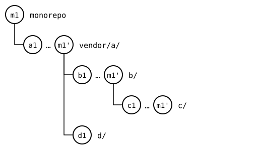

# Scenario: status and push through the tree

A pull goes down the tree: a splice's upstream decides which splices are
inside it, so the parent goes first. A push goes up: a parent's upstream
has a `.splice` for each child, which records a commit of the child's
upstream. The rebuild of the parent writes into it the rebuild of the
child, the commit the child's push sends, so one `push --all` leaves
every upstream recording what the one inside it has, without a commit
in the monorepo in between. `status` looks at each splice on its own,
and so it can.

Here, the monorepo changed `vendor/a/`, `b/` in it and `c/` in that.

## Output

<!--
```scrut {fail_fast: true, output_stream: combined}
$ source "$TESTDIR/../../../readme-setup.sh" && export GIT_CONFIG_COUNT=8 GIT_CONFIG_KEY_0="url.$UPSTREAM-a.git.insteadOf" GIT_CONFIG_VALUE_0=https://git.example.com/a.git GIT_CONFIG_KEY_1="url.$UPSTREAM-b.git.insteadOf" GIT_CONFIG_VALUE_1=https://git.example.com/b.git GIT_CONFIG_KEY_2="url.$UPSTREAM-c.git.insteadOf" GIT_CONFIG_VALUE_2=https://git.example.com/c.git GIT_CONFIG_KEY_3="url.$UPSTREAM-d.git.insteadOf" GIT_CONFIG_VALUE_3=https://git.example.com/d.git GIT_CONFIG_KEY_4="url.$UPSTREAM-e.git.insteadOf" GIT_CONFIG_VALUE_4=https://git.example.com/e.git GIT_CONFIG_KEY_5=user.name GIT_CONFIG_VALUE_5=Test GIT_CONFIG_KEY_6=user.email GIT_CONFIG_VALUE_6=test@example.com GIT_CONFIG_KEY_7=core.editor GIT_CONFIG_VALUE_7=true
```
-->

[`setup.bash`](setup.bash) builds this state:

```scrut
$ build_scenario scenario_recursive_pull
```

```scrut
$ echo "a in the monorepo" >>vendor/a/file.txt &&
>   echo "b in the monorepo" >>vendor/a/b/notes.txt &&
>   echo "c in the monorepo" >>vendor/a/b/c/file.txt &&
>   git add vendor/a &&
>   git commit -q -m "m1: a, b and c in the monorepo"
```


<!--
```scrut
$ check_drawing "$TESTDIR/push-before.drawio.svg"
ok   push-before.drawio.svg: a tree of 5 rows
```
-->

## Status

Each splice with commits of its own is ahead of its upstream:

```scrut
$ git splice status
On branch main

  ahead 1     vendor/a
  ahead 1     vendor/a/b
  ahead 1     vendor/a/b/c

  up to date  vendor/a/d
```

## One push

Bottom-up, `c` first, and each push records the one below it:

```scrut
$ git splice push --all
ok   vendor/a/b/c: pushed c36e473 to main
ok   vendor/a/b: pushed 5302c23 to main
ok   vendor/a/d: nothing to push
ok   vendor/a: pushed 04ebbea to main
```

`b`'s upstream records the commit `c`'s upstream has now:

```scrut
$ git -C "$UPSTREAM-b.git" show main:c/.splice | git config --file - splice.commit | cut -c1-7 &&
>   git -C "$UPSTREAM-c.git" rev-parse --short main
c36e473
c36e473
```

And `a`'s upstream the one `b`'s upstream has:

```scrut
$ git -C "$UPSTREAM-a.git" show main:b/.splice | git config --file - splice.commit | cut -c1-7 &&
>   git -C "$UPSTREAM-b.git" rev-parse --short main
5302c23
5302c23
```

```scrut
$ git splice status
On branch main

  up to date  vendor/a
  up to date  vendor/a/b
  up to date  vendor/a/b/c
  up to date  vendor/a/d
```

The monorepo keeps its own records: its `vendor/a/b/c/.splice` still
names *c1*, and each rebuild writes the new commit on the way out. So
each splice has the commit it pushed above its synced commit:



<!--
```scrut
$ check_drawing "$TESTDIR/push-pushed.drawio.svg" m1=HEAD
ok   push-pushed.drawio.svg: a tree of 5 rows
```
-->

## Another change

The monorepo changes all three again, in *m2*, and pushes once more:

```scrut
$ echo "a again" >>vendor/a/file.txt &&
>   echo "b again" >>vendor/a/b/notes.txt &&
>   echo "c again" >>vendor/a/b/c/file.txt &&
>   git commit -q -am "m2: a, b and c again"
```

```scrut
$ git splice push --all
ok   vendor/a/b/c: pushed cb1574f to main
ok   vendor/a/b: pushed ca809d5 to main
ok   vendor/a/d: nothing to push
ok   vendor/a: pushed 54b9072 to main
```

```scrut
$ git -C "$UPSTREAM-b.git" show main:c/.splice | git config --file - splice.commit | cut -c1-7 &&
>   git -C "$UPSTREAM-c.git" rev-parse --short main
cb1574f
cb1574f
```

```scrut
$ git -C "$UPSTREAM-a.git" show main:b/.splice | git config --file - splice.commit | cut -c1-7 &&
>   git -C "$UPSTREAM-b.git" rev-parse --short main
ca809d5
ca809d5
```

```scrut
$ git splice status
On branch main

  up to date  vendor/a
  up to date  vendor/a/b
  up to date  vendor/a/b/c
  up to date  vendor/a/d
```

