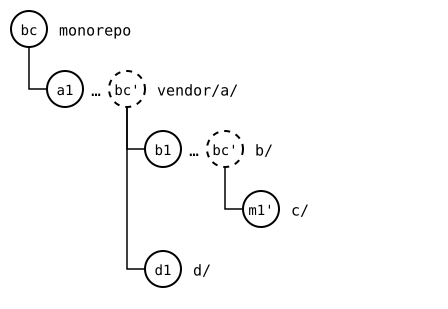
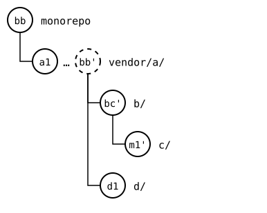
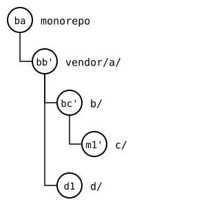
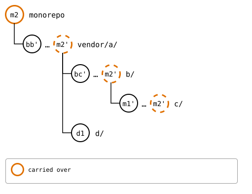
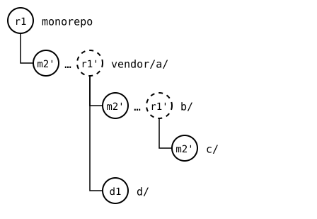
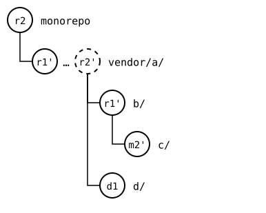
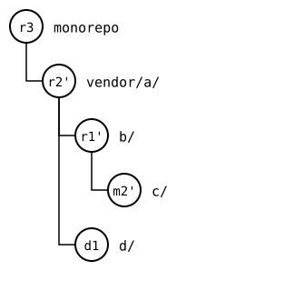

# Scenario: status and push through the tree

> **Known bug, [#458](https://github.com/roschaefer/git-splice/issues/458).** This page shows what `git-splice` does today, bug included. See [all known bugs](../../../99-known-bugs.md).

A pull goes down the tree: a splice's upstream decides which splices are
inside it, so the parent goes first. A push goes up. A parent's upstream
has a `.splice` for each child, which records a commit of the child's
upstream, and that commit only exists once the child is pushed. So the
child goes first, then the monorepo records the commit it pushed, with
`pull --bump`, a change in the parent's folder, and then the parent is
pushed with it. And `status` looks at each splice on its own, not at
what the upstreams record of each other.

Here, the monorepo changed `vendor/a/`, `b/` in it and `c/` in that.

## Output

<!--
```scrut {fail_fast: true, output_stream: combined}
$ source "$TESTDIR/../../../readme-setup.sh" && export GIT_CONFIG_COUNT=8 GIT_CONFIG_KEY_0="url.$UPSTREAM-a.git.insteadOf" GIT_CONFIG_VALUE_0=https://git.example.com/a.git GIT_CONFIG_KEY_1="url.$UPSTREAM-b.git.insteadOf" GIT_CONFIG_VALUE_1=https://git.example.com/b.git GIT_CONFIG_KEY_2="url.$UPSTREAM-c.git.insteadOf" GIT_CONFIG_VALUE_2=https://git.example.com/c.git GIT_CONFIG_KEY_3="url.$UPSTREAM-d.git.insteadOf" GIT_CONFIG_VALUE_3=https://git.example.com/d.git GIT_CONFIG_KEY_4="url.$UPSTREAM-e.git.insteadOf" GIT_CONFIG_VALUE_4=https://git.example.com/e.git GIT_CONFIG_KEY_5=user.name GIT_CONFIG_VALUE_5=Test GIT_CONFIG_KEY_6=user.email GIT_CONFIG_VALUE_6=test@example.com GIT_CONFIG_KEY_7=core.editor GIT_CONFIG_VALUE_7=true
```
-->

[`setup.bash`](setup.bash) builds this state:

```scrut
$ build_scenario scenario_recursive_pull
```

```scrut
$ echo "a in the monorepo" >>vendor/a/file.txt &&
>   echo "b in the monorepo" >>vendor/a/b/notes.txt &&
>   echo "c in the monorepo" >>vendor/a/b/c/file.txt &&
>   git add vendor/a &&
>   git commit -q -m "m1: a, b and c in the monorepo"
```


<!--
```scrut
$ check_drawing "$TESTDIR/push-before.drawio.svg"
ok   push-before.drawio.svg: a tree of 5 rows
```
-->

## Status

Each splice with commits of its own is ahead of its upstream:

```scrut
$ git splice status
On branch main

  ahead 1     vendor/a
  ahead 1     vendor/a/b
  ahead 1     vendor/a/b/c

  up to date  vendor/a/d
```

## A push, one level at a time

### `c`

`c`'s upstream gets *m1'*, the copy of *m1*:

```scrut
$ git splice push vendor/a/b/c
ok   vendor/a/b/c: pushed c36e473 to main
```

```scrut
$ git -C "$UPSTREAM-c.git" log --format=%s main
m1: a, b and c in the monorepo
c1: c seed
```

The monorepo records it as the synced commit of `c/`, in *bc*. That's a
change in `b/`, so `b/` has *bc'* to push now:

```scrut
$ git splice pull --bump vendor/a/b/c
ok   vendor/a/b/c fetched
ok   vendor/a/b/c: bumped the synced commit to c36e473
```



<!--
```scrut
$ check_drawing "$TESTDIR/push-bumped-c.drawio.svg" bc=HEAD
ok   push-bumped-c.drawio.svg: a tree of 5 rows
```
-->

### `b`

`b`'s upstream gets *m1'* and *bc'*, which records *m1'* in its `c/`:

```scrut
$ git splice push vendor/a/b
ok   vendor/a/b: pushed a9ebde4 to main
```

```scrut
$ git -C "$UPSTREAM-b.git" log --format=%s main
splice: bump vendor/a/b/c from main at c36e473
m1: a, b and c in the monorepo
b1: add c
b seed
```

```scrut
$ git splice pull --bump vendor/a/b
ok   vendor/a/b fetched
ok   vendor/a/b/c fetched
ok   vendor/a/b: bumped the synced commit to a9ebde4
```



<!--
```scrut
$ check_drawing "$TESTDIR/push-bumped-b.drawio.svg" bc=HEAD~1 bb=HEAD
ok   push-bumped-b.drawio.svg: a tree of 5 rows
```
-->

### `a`

```scrut
$ git splice push vendor/a
ok   vendor/a: pushed 6b14e59 to main
```

```scrut
$ git -C "$UPSTREAM-a.git" log --format=%s main
splice: bump vendor/a/b from main at a9ebde4
splice: bump vendor/a/b/c from main at c36e473
m1: a, b and c in the monorepo
a1: add d
add b
a seed
```

```scrut
$ git splice pull --bump vendor/a
ok   vendor/a fetched
ok   vendor/a/b fetched
ok   vendor/a/b/c fetched
ok   vendor/a/d fetched
ok   vendor/a: bumped the synced commit to 6b14e59
```



<!--
```scrut
$ check_drawing "$TESTDIR/push-bumped-a.drawio.svg" bc=HEAD~2 bb=HEAD~1 ba=HEAD
ok   push-bumped-a.drawio.svg: a tree of 5 rows
```
-->

Every upstream now records the commit the one inside it has. `b`'s
upstream records *m1'* for `c/`, the commit `c`'s upstream has:

```scrut
$ git -C "$UPSTREAM-b.git" show main:c/.splice | git config --file - splice.commit | cut -c1-7 &&
>   git -C "$UPSTREAM-c.git" rev-parse --short main
c36e473
c36e473
```

And `a`'s upstream records *bc'* for `b/`:

```scrut
$ git -C "$UPSTREAM-a.git" show main:b/.splice | git config --file - splice.commit | cut -c1-7 &&
>   git -C "$UPSTREAM-b.git" rev-parse --short main
a9ebde4
a9ebde4
```

A recursive push would be these steps: one pass, from the innermost
splice out.

## Everything at once

`push --all` goes bottom-up too, but records nothing in between
([#458](https://github.com/roschaefer/git-splice/issues/458)). There,
the order only matters when a push fails: it stops the pushes of the
splices around it, so no upstream gets a change in a folder before that
folder's own upstream has it.

The monorepo changes all three again, in *m2*:

```scrut
$ echo "a again" >>vendor/a/file.txt &&
>   echo "b again" >>vendor/a/b/notes.txt &&
>   echo "c again" >>vendor/a/b/c/file.txt &&
>   git commit -q -am "m2: a, b and c again"
```



<!--
```scrut
$ check_drawing "$TESTDIR/all-before.drawio.svg" bc=HEAD~3 bb=HEAD~2 ba=HEAD~1
ok   all-before.drawio.svg: a tree of 5 rows
```
-->

```scrut
$ git splice push --all
ok   vendor/a/b/c: pushed cb1574f to main
ok   vendor/a/b: pushed a93646e to main
ok   vendor/a/d: nothing to push
ok   vendor/a: pushed 4670b0f to main
```

`b`'s upstream has `c`'s change in `c/`, but its `c/.splice` still
records *m1'*, not *m2'*, which `c`'s upstream has now:

```scrut
$ git -C "$UPSTREAM-b.git" show main:c/.splice | git config --file - splice.commit | cut -c1-7 &&
>   git -C "$UPSTREAM-c.git" rev-parse --short main
c36e473
cb1574f
```

And `status` says nothing about it: it compares each splice with its own
upstream, and each has what the monorepo has.

```scrut
$ git splice status
On branch main

  up to date  vendor/a
  up to date  vendor/a/b
  up to date  vendor/a/b/c
  up to date  vendor/a/d
```

A recursive status would compare each edge as well: what a parent's
upstream records against what the child's upstream has.

### Recording it afterwards

Each bump is a change in the folder of the splice around it, which then
has to be pushed, and recorded in turn: one round of `pull --bump` and
`push` per level. The first round records the three copies of *m2*, in
*r1*:

```scrut
$ git splice pull --bump --all
ok   vendor/a fetched
ok   vendor/a/b fetched
ok   vendor/a/b/c fetched
ok   vendor/a/d fetched
ok   vendor/a: bumped the synced commit to 4670b0f
ok   vendor/a/b: bumped the synced commit to a93646e
ok   vendor/a/b/c: bumped the synced commit to cb1574f
ok   vendor/a/d: nothing to bump -- already synced at 2c64d15
ok   vendor/a: 3 pulls made one commit, 08dbc6f
```



<!--
```scrut
$ check_drawing "$TESTDIR/all-bumped-1.drawio.svg" r1=HEAD
ok   all-bumped-1.drawio.svg: a tree of 5 rows
```
-->

```scrut
$ git splice push --all
ok   vendor/a/b/c: nothing to push
ok   vendor/a/b: pushed 5f2e171 to main
ok   vendor/a/d: nothing to push
ok   vendor/a: pushed 1389aac to main
```

The second records the copies of *r1*, in *r2*:

```scrut
$ git splice pull --bump --all
ok   vendor/a fetched
ok   vendor/a/b fetched
ok   vendor/a/b/c fetched
ok   vendor/a/d fetched
ok   vendor/a: bumped the synced commit to 1389aac
ok   vendor/a/b: bumped the synced commit to 5f2e171
ok   vendor/a/b/c: nothing to bump -- already synced at cb1574f
ok   vendor/a/d: nothing to bump -- already synced at 2c64d15
ok   vendor/a: 2 pulls made one commit, e5ba180
```



<!--
```scrut
$ check_drawing "$TESTDIR/all-bumped-2.drawio.svg" r1=HEAD~1 r2=HEAD
ok   all-bumped-2.drawio.svg: a tree of 5 rows
```
-->

```scrut
$ git splice push --all
ok   vendor/a/b/c: nothing to push
ok   vendor/a/b: nothing to push
ok   vendor/a/d: nothing to push
ok   vendor/a: pushed 8a87708 to main
```

The third records *r2'*, which only `vendor/a/` got, in *r3*:

```scrut
$ git splice pull --bump --all
ok   vendor/a fetched
ok   vendor/a/b fetched
ok   vendor/a/b/c fetched
ok   vendor/a/d fetched
ok   vendor/a: bumped the synced commit to 8a87708
ok   vendor/a/b: nothing to bump -- already synced at 5f2e171
ok   vendor/a/b/c: nothing to bump -- already synced at cb1574f
ok   vendor/a/d: nothing to bump -- already synced at 2c64d15
```



<!--
```scrut
$ check_drawing "$TESTDIR/all-bumped-3.drawio.svg" r1=HEAD~2 r2=HEAD~1 r3=HEAD
ok   all-bumped-3.drawio.svg: a tree of 5 rows
```
-->

```scrut
$ git splice push --all
ok   vendor/a/b/c: nothing to push
ok   vendor/a/b: nothing to push
ok   vendor/a/d: nothing to push
ok   vendor/a: nothing to push
```

Then every upstream records what the one inside it has again:

```scrut
$ git -C "$UPSTREAM-b.git" show main:c/.splice | git config --file - splice.commit | cut -c1-7 &&
>   git -C "$UPSTREAM-c.git" rev-parse --short main
cb1574f
cb1574f
```

```scrut
$ git -C "$UPSTREAM-a.git" show main:b/.splice | git config --file - splice.commit | cut -c1-7 &&
>   git -C "$UPSTREAM-b.git" rev-parse --short main
5f2e171
5f2e171
```

