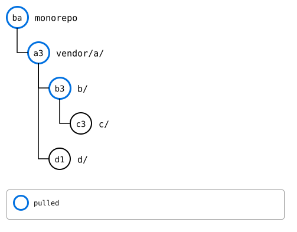

# Scenario: status and push through the tree

A pull goes down the tree: a splice's upstream decides which splices are
inside it, so the parent goes first. A push goes up: a parent's upstream
records the commit its child's upstream has, so the child goes first,
and the parent records what the child's upstream has now, before it's
pushed itself. And `status` looks at each splice on its own, not at what
the upstreams record of each other.

Here, the monorepo changed `vendor/a/`, `b/` in it and `c/` in that.

## Output

<!--
```scrut {fail_fast: true, output_stream: combined}
$ source "$TESTDIR/../../../readme-setup.sh" && export GIT_CONFIG_COUNT=8 GIT_CONFIG_KEY_0="url.$UPSTREAM-a.git.insteadOf" GIT_CONFIG_VALUE_0=https://git.example.com/a.git GIT_CONFIG_KEY_1="url.$UPSTREAM-b.git.insteadOf" GIT_CONFIG_VALUE_1=https://git.example.com/b.git GIT_CONFIG_KEY_2="url.$UPSTREAM-c.git.insteadOf" GIT_CONFIG_VALUE_2=https://git.example.com/c.git GIT_CONFIG_KEY_3="url.$UPSTREAM-d.git.insteadOf" GIT_CONFIG_VALUE_3=https://git.example.com/d.git GIT_CONFIG_KEY_4="url.$UPSTREAM-e.git.insteadOf" GIT_CONFIG_VALUE_4=https://git.example.com/e.git GIT_CONFIG_KEY_5=user.name GIT_CONFIG_VALUE_5=Test GIT_CONFIG_KEY_6=user.email GIT_CONFIG_VALUE_6=test@example.com GIT_CONFIG_KEY_7=core.editor GIT_CONFIG_VALUE_7=true
```
-->

[`setup.bash`](setup.bash) builds this state:

```scrut
$ build_scenario scenario_recursive_pull
```

```scrut
$ echo "a in the monorepo" >>vendor/a/file.txt &&
>   echo "b in the monorepo" >>vendor/a/b/notes.txt &&
>   echo "c in the monorepo" >>vendor/a/b/c/file.txt &&
>   git add vendor/a &&
>   git commit -q -m "m1: a, b and c in the monorepo"
```


<!--
```scrut
$ check_drawing "$TESTDIR/push-before.drawio.svg"
ok   push-before.drawio.svg: a tree of 5 rows
```
-->

## Status

Each splice with commits of its own is ahead of its upstream:

```scrut
$ git splice status
On branch main

  ahead 1     vendor/a
  ahead 1     vendor/a/b
  ahead 1     vendor/a/b/c

  up to date  vendor/a/d
```

## A push, one level at a time

Bottom-up: `c` first, then the monorepo records what `c`'s upstream has
now, its synced commit, with `pull --bump`. That's a change in `b/`,
which `b`'s push then sends, and so on up:

```scrut
$ for splice in vendor/a/b/c vendor/a/b vendor/a; do
>   git splice push "$splice" &&
>     git splice pull --bump "$splice" | grep -v fetched
> done
ok   vendor/a/b/c: pushed c36e473 to main
ok   vendor/a/b/c: bumped the synced commit to c36e473
ok   vendor/a/b: pushed a9ebde4 to main
ok   vendor/a/b: bumped the synced commit to a9ebde4
ok   vendor/a: pushed 6b14e59 to main
ok   vendor/a: bumped the synced commit to 6b14e59
```

Every upstream now records the commit the one inside it has:

```scrut
$ for edge in "a b" "b c"; do
>   set -- $edge
>   echo "$1's upstream records $2 at $(git -C "$UPSTREAM-$1.git" show "main:$2/.splice" | git config --file - splice.commit | cut -c1-7), $2's upstream is at $(git -C "$UPSTREAM-$2.git" rev-parse --short main)"
> done
a's upstream records b at a9ebde4, b's upstream is at a9ebde4
b's upstream records c at c36e473, c's upstream is at c36e473
```



<!--
```scrut
$ check_drawing "$TESTDIR/push-one-pass.drawio.svg" ba=HEAD a3=refs/splices/a/heads/main b3=refs/splices/b/heads/main c3=refs/splices/c/heads/main
ok   push-one-pass.drawio.svg: a tree of 5 rows
```
-->

A recursive push would be that loop: one pass, from the innermost splice
out.

## Everything at once

`push --all` goes bottom-up too, but records nothing in between
([#458](https://github.com/roschaefer/git-splice/issues/458)). After
another change in all three:

```scrut
$ echo "a again" >>vendor/a/file.txt &&
>   echo "b again" >>vendor/a/b/notes.txt &&
>   echo "c again" >>vendor/a/b/c/file.txt &&
>   git commit -q -am "m2: a, b and c again" &&
>   git splice push --all
ok   vendor/a/b/c: pushed cb1574f to main
ok   vendor/a/b: pushed a93646e to main
ok   vendor/a/d: nothing to push
ok   vendor/a: pushed 4670b0f to main
```

`b`'s upstream has `c`'s change in `c/`, but its `c/.splice` still names
the commit from before, not what `c`'s upstream has now:

```scrut
$ for edge in "a b" "b c"; do
>   set -- $edge
>   echo "$1's upstream records $2 at $(git -C "$UPSTREAM-$1.git" show "main:$2/.splice" | git config --file - splice.commit | cut -c1-7), $2's upstream is at $(git -C "$UPSTREAM-$2.git" rev-parse --short main)"
> done
a's upstream records b at a9ebde4, b's upstream is at a93646e
b's upstream records c at c36e473, c's upstream is at cb1574f
```

And `status` says nothing about it: it compares each splice with its own
upstream, and each has what the monorepo has.

```scrut
$ git splice status
On branch main

  up to date  vendor/a
  up to date  vendor/a/b
  up to date  vendor/a/b/c
  up to date  vendor/a/d
```

A recursive status would compare each edge as well: what a parent's
upstream records against what the child's upstream has.

Recording it now takes one round of `pull --bump` and `push` per level:
each bump is a change in the folder of the splice around it, which then
has to be pushed, and recorded in turn.

```scrut
$ for round in 1 2 3; do
>   git splice pull --bump --all | grep bumped
>   git splice push --all | grep pushed || true
> done
ok   vendor/a: bumped the synced commit to 4670b0f
ok   vendor/a/b: bumped the synced commit to a93646e
ok   vendor/a/b/c: bumped the synced commit to cb1574f
ok   vendor/a/b: pushed 883a06a to main
ok   vendor/a: pushed b870bf3 to main
ok   vendor/a: bumped the synced commit to b870bf3
ok   vendor/a/b: bumped the synced commit to 883a06a
ok   vendor/a: pushed d919382 to main
ok   vendor/a: bumped the synced commit to d919382
```

Then every upstream records what the one inside it has again:

```scrut
$ for edge in "a b" "b c"; do
>   set -- $edge
>   echo "$1's upstream records $2 at $(git -C "$UPSTREAM-$1.git" show "main:$2/.splice" | git config --file - splice.commit | cut -c1-7), $2's upstream is at $(git -C "$UPSTREAM-$2.git" rev-parse --short main)"
> done
a's upstream records b at 883a06a, b's upstream is at 883a06a
b's upstream records c at cb1574f, c's upstream is at cb1574f
```
