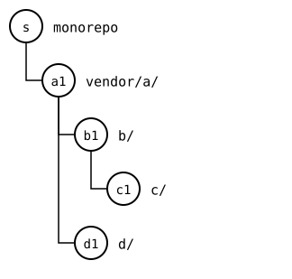
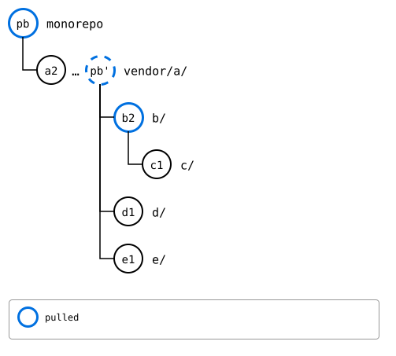
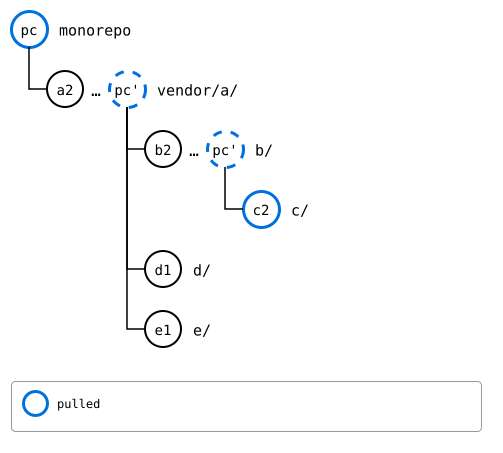
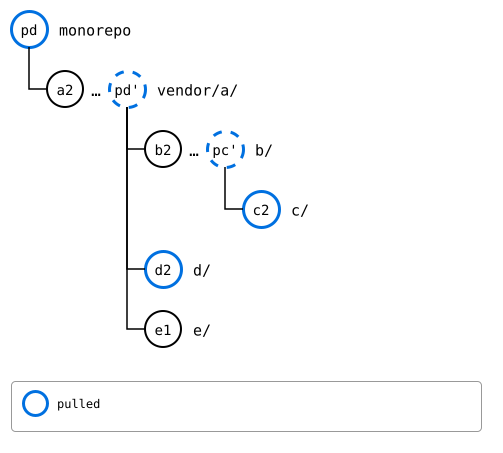

# Scenario: a recursive pull, step by step

One `git splice pull --recursive` does a lot between its start and its
end: it fetches every upstream, merges one splice after another, top-down,
and makes one commit of it all. This page stops the pull after each
step, checks the tree, and runs the same pull again to take the next one.

No merge conflicts here: the monorepo has no commits of its own, and
each upstream changed only its own files.

## Output

<!--
```scrut {fail_fast: true, output_stream: combined}
$ source "$TESTDIR/../../../readme-setup.sh" && export GIT_CONFIG_COUNT=8 GIT_CONFIG_KEY_0="url.$UPSTREAM-a.git.insteadOf" GIT_CONFIG_VALUE_0=https://git.example.com/a.git GIT_CONFIG_KEY_1="url.$UPSTREAM-b.git.insteadOf" GIT_CONFIG_VALUE_1=https://git.example.com/b.git GIT_CONFIG_KEY_2="url.$UPSTREAM-c.git.insteadOf" GIT_CONFIG_VALUE_2=https://git.example.com/c.git GIT_CONFIG_KEY_3="url.$UPSTREAM-d.git.insteadOf" GIT_CONFIG_VALUE_3=https://git.example.com/d.git GIT_CONFIG_KEY_4="url.$UPSTREAM-e.git.insteadOf" GIT_CONFIG_VALUE_4=https://git.example.com/e.git GIT_CONFIG_KEY_5=user.name GIT_CONFIG_VALUE_5=Test GIT_CONFIG_KEY_6=user.email GIT_CONFIG_VALUE_6=test@example.com GIT_CONFIG_KEY_7=core.editor GIT_CONFIG_VALUE_7=true
```
-->

[`setup.bash`](setup.bash) builds this state:

```scrut
$ build_scenario scenario_recursive_pull
```



<!--
```scrut
$ check_drawing "$TESTDIR/step-0.drawio.svg" s=HEAD
ok   step-0.drawio.svg: a tree of 5 rows
```
-->

Each upstream moves on, and `a`'s splices `e` in:

```scrut
$ for x in b c d; do
>   git clone -q "https://git.example.com/$x.git" "../$x-work" &&
>     echo "$x upstream" >>"../$x-work/file.txt" &&
>     git -C "../$x-work" commit -q -am "${x}2: $x upstream" &&
>     git -C "../$x-work" push -q origin main
> done
```

```scrut
$ git clone -q https://git.example.com/a.git ../a-work &&
>   cd ../a-work &&
>   git splice clone https://git.example.com/e.git e >/dev/null &&
>   echo "a upstream" >>file.txt &&
>   git commit -q --amend -am "a2: a upstream, and e spliced in" &&
>   git push -q origin main &&
>   cd ../monorepo
```

## Step by step

The `--exec` hook `test "$GIT_SPLICE_EVENT" != <event>` fails at that
event, which stops the pull with what it did so far applied. Run again,
the pull fetches again, finds the splices it merged up to date, and goes
on with the next one. Each step commits on `main` what a plain
`git splice pull` of that one splice would, on top of the step before.
The commits stay until the end, where the pull folds them into one: it
remembers where it started, in `SPLICE_PULL_START`.

### 1. Discover

The fetches move the refs of the upstreams, and nothing else. The tree
records what the monorepo has, so it doesn't change yet:

```scrut
$ git splice pull --recursive vendor/a --exec 'test "$GIT_SPLICE_EVENT" != after-fetch'
ok   vendor/a fetched (main moved 764d9c4..6d12ed8)
ok   vendor/a/b fetched (main moved f815a3c..59ed2fb)
ok   vendor/a/b/c fetched (main moved 8c169b6..94cad5e)
ok   vendor/a/d fetched (main moved 2c64d15..36c850e)
!!   --exec stopped pull at after-fetch, what it did so far stays -- re-run pull to go on
[1]
```

### 2. Merge `vendor/a/`

The pull starts, and merges `a`'s upstream first. Its *a2* brings `e/`
in, a splice now:

```scrut
$ git splice pull --recursive vendor/a --exec 'test "$GIT_SPLICE_EVENT" != after-merge'
ok   vendor/a fetched
ok   vendor/a/b fetched
ok   vendor/a/b/c fetched
ok   vendor/a/d fetched
ok   vendor/a: pulled 6d12ed8
!!   --exec stopped pull at after-merge of vendor/a, what it did so far stays -- re-run pull to go on
[1]
```


<!--
```scrut
$ check_drawing "$TESTDIR/step-a.drawio.svg" pa=HEAD "e1=$(git config --file vendor/a/e/.splice splice.commit)"
ok   step-a.drawio.svg: a tree of 6 rows
```
-->

### 3. Merge `b/`

`e/` is fetched, now that it's known, and has nothing to merge. `b`'s
upstream merges into `vendor/a/`'s folder, which gets a commit of its
own, *pb'*:

```scrut
$ git splice pull --recursive vendor/a --exec 'test "$GIT_SPLICE_EVENT" != after-merge'
ok   vendor/a fetched
ok   vendor/a/b fetched
ok   vendor/a/b/c fetched
ok   vendor/a/d fetched
ok   vendor/a/e fetched
ok   vendor/a: nothing to pull
ok   vendor/a/b: pulled 59ed2fb
!!   --exec stopped pull at after-merge of vendor/a/b, what it did so far stays -- re-run pull to go on
[1]
```

<!--
A plain pull of `b/` from *pa* makes *pb*, files and message:

```scrut
$ git worktree add -q -B plain ../plain HEAD~1 &&
>   (cd ../plain && git splice pull --branch main vendor/a/b >/dev/null) &&
>   git diff --quiet plain HEAD &&
>   test "$(git log -1 --format=%B plain)" = "$(git log -1 --format=%B HEAD)" &&
>   echo 'same as pb' &&
>   git worktree remove ../plain && git branch -q -D plain
same as pb
```
-->



<!--
```scrut
$ check_drawing "$TESTDIR/step-b.drawio.svg" pb=HEAD
ok   step-b.drawio.svg: a tree of 6 rows
```
-->

### 4. Merge `c/`

`c/` is inside `b/`, inside `vendor/a/`: both get the copy *pc'*.

```scrut
$ git splice pull --recursive vendor/a --exec 'test "$GIT_SPLICE_EVENT" != after-merge'
ok   vendor/a fetched
ok   vendor/a/b fetched
ok   vendor/a/b/c fetched
ok   vendor/a/d fetched
ok   vendor/a/e fetched
ok   vendor/a: nothing to pull
ok   vendor/a/b: nothing to pull
ok   vendor/a/b/c: pulled 94cad5e
!!   --exec stopped pull at after-merge of vendor/a/b/c, what it did so far stays -- re-run pull to go on
[1]
```



<!--
```scrut
$ check_drawing "$TESTDIR/step-c.drawio.svg" pc=HEAD
ok   step-c.drawio.svg: a tree of 6 rows
```
-->

### 5. Merge `d/`

```scrut
$ git splice pull --recursive vendor/a --exec 'test "$GIT_SPLICE_EVENT" != after-merge'
ok   vendor/a fetched
ok   vendor/a/b fetched
ok   vendor/a/b/c fetched
ok   vendor/a/d fetched
ok   vendor/a/e fetched
ok   vendor/a: nothing to pull
ok   vendor/a/b: nothing to pull
ok   vendor/a/b/c: nothing to pull
ok   vendor/a/d: pulled 36c850e
!!   --exec stopped pull at after-merge of vendor/a/d, what it did so far stays -- re-run pull to go on
[1]
```



<!--
```scrut
$ check_drawing "$TESTDIR/step-d.drawio.svg" pd=HEAD pc=HEAD~1
ok   step-d.drawio.svg: a tree of 6 rows
```
-->

### 6. One commit

Before folding, all four merges are there:

```scrut
$ git splice pull --recursive vendor/a --exec 'test "$GIT_SPLICE_EVENT" != before-fold'
ok   vendor/a fetched
ok   vendor/a/b fetched
ok   vendor/a/b/c fetched
ok   vendor/a/d fetched
ok   vendor/a/e fetched
ok   vendor/a: nothing to pull
ok   vendor/a/b: nothing to pull
ok   vendor/a/b/c: nothing to pull
ok   vendor/a/d: nothing to pull
ok   vendor/a/e: nothing to pull
!!   --exec stopped pull at before-fold, what it did so far stays -- re-run pull to go on
[1]
```

`main` has a commit for each: *pa*, *pb*, *pc*, *pd*. The copies in the
splices pile up the same way: `vendor/a/` has *pb'*, *pc'* and *pd'*,
one for each change to a record inside it, and `b/` has *pc'*. *pa*
moved `vendor/a/` to *a2* and changed nothing else in it, so it has no
copy:


<!--
```scrut
$ check_drawing "$TESTDIR/step-lanes-unfolded.drawio.svg" s=HEAD~4 pa=HEAD~3 pb=HEAD~2 pc=HEAD~1 pd=HEAD
ok   step-lanes-unfolded.drawio.svg: 18 commits, 18 arrows, 6 boxes, 5 lanes
```
-->

The four pulls become one commit, *p*. Each splice's history has the copy
*p'* where it had *pb'*, *pc'* or *pd'*:

```scrut
$ git splice pull --recursive vendor/a --exec 'test "$GIT_SPLICE_EVENT" != after-fold'
ok   vendor/a fetched
ok   vendor/a/b fetched
ok   vendor/a/b/c fetched
ok   vendor/a/d fetched
ok   vendor/a/e fetched
ok   vendor/a: nothing to pull
ok   vendor/a/b: nothing to pull
ok   vendor/a/b/c: nothing to pull
ok   vendor/a/d: nothing to pull
ok   vendor/a/e: nothing to pull
ok   vendor/a: 4 pulls made one commit, 9b51e79
!!   --exec stopped pull at after-fold, what it did so far stays -- re-run pull to go on
[1]
```

*p* has the files of *pd*, and the subjects of all four in its message:

```scrut
$ git diff --quiet HEAD@{1} HEAD && git log -1 --format=%B
splice: pull vendor/a from main at 6d12ed8

splice: pull vendor/a/b from main at 59ed2fb
splice: pull vendor/a/b/c from main at 94cad5e
splice: pull vendor/a/d from main at 36c850e

```

The tree is the final one:


<!--
```scrut
$ check_drawing "$TESTDIR/step-folded.drawio.svg" p=HEAD
ok   step-folded.drawio.svg: a tree of 6 rows
```
-->

The pull still remembers where it started. A last run finds nothing to
pull and ends it:

```scrut
$ git splice pull --recursive vendor/a
ok   vendor/a fetched
ok   vendor/a/b fetched
ok   vendor/a/b/c fetched
ok   vendor/a/d fetched
ok   vendor/a/e fetched
ok   vendor/a: nothing to pull
ok   vendor/a/b: nothing to pull
ok   vendor/a/b/c: nothing to pull
ok   vendor/a/d: nothing to pull
ok   vendor/a/e: nothing to pull
```

```scrut
$ git rev-parse --quiet --verify SPLICE_PULL_START || echo 'pull ended'
pull ended
```

## The history it leaves

The monorepo's history has *p* only: *pa*, *pb*, *pc* and *pd* were
steps on the way, and the fold replaced them. `vendor/a/` and `b/` each
get the copy *p'*, for the records of the splices inside them. `c/`,
`d/` and `e/` get none: their files are their upstream's, *c2*, *d2*
and *e1*.


<!--
```scrut
$ check_drawing "$TESTDIR/step-lanes.drawio.svg" s=HEAD~1 p=HEAD
ok   step-lanes.drawio.svg: 13 commits, 13 arrows, 6 boxes, 5 lanes
```
-->
