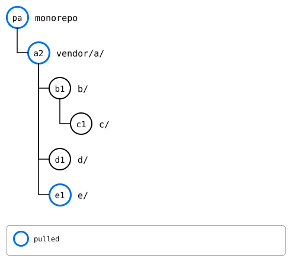
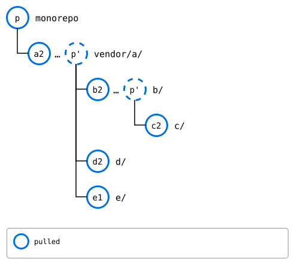

# Scenario: a recursive pull, step by step

One `git splice pull --recursive` does a lot between its start and its
end: it fetches every upstream, merges one splice after another, top-down,
and makes one commit of it all. This page interrupts the real operation at
checkpoints and resumes it in separate CLI processes, with the checked tree
after each step. A pause exits with status 75 and saves pending work; it
does not run that work in the background.

No merge conflicts here: the monorepo has no commits of its own, and
each upstream changed only its own files.

## Output

<!--
```scrut {fail_fast: true, output_stream: combined}
$ source "$TESTDIR/../../../readme-setup.sh" && export GIT_CONFIG_COUNT=8 GIT_CONFIG_KEY_0="url.$UPSTREAM-a.git.insteadOf" GIT_CONFIG_VALUE_0=https://git.example.com/a.git GIT_CONFIG_KEY_1="url.$UPSTREAM-b.git.insteadOf" GIT_CONFIG_VALUE_1=https://git.example.com/b.git GIT_CONFIG_KEY_2="url.$UPSTREAM-c.git.insteadOf" GIT_CONFIG_VALUE_2=https://git.example.com/c.git GIT_CONFIG_KEY_3="url.$UPSTREAM-d.git.insteadOf" GIT_CONFIG_VALUE_3=https://git.example.com/d.git GIT_CONFIG_KEY_4="url.$UPSTREAM-e.git.insteadOf" GIT_CONFIG_VALUE_4=https://git.example.com/e.git GIT_CONFIG_KEY_5=user.name GIT_CONFIG_VALUE_5=Test GIT_CONFIG_KEY_6=user.email GIT_CONFIG_VALUE_6=test@example.com GIT_CONFIG_KEY_7=core.editor GIT_CONFIG_VALUE_7=true
```
-->

[`setup.bash`](setup.bash) builds this state:

```scrut
$ build_scenario scenario_recursive_pull
```


<!--
```scrut
$ check_drawing "$TESTDIR/step-0.drawio.svg" s=HEAD
ok   step-0.drawio.svg: a tree of 5 rows
```
-->

Each upstream moves on, and `a`'s splices `e` in:

```scrut
$ for x in b c d; do
>   git clone -q "https://git.example.com/$x.git" "../$x-work" &&
>     echo "$x upstream" >>"../$x-work/file.txt" &&
>     git -C "../$x-work" commit -q -am "${x}2: $x upstream" &&
>     git -C "../$x-work" push -q origin main
> done
```

```scrut
$ git clone -q https://git.example.com/a.git ../a-work &&
>   cd ../a-work &&
>   git splice clone https://git.example.com/e.git e >/dev/null &&
>   echo "a upstream" >>file.txt &&
>   git commit -q --amend -am "a2: a upstream, and e spliced in" &&
>   git push -q origin main &&
>   cd ../monorepo
```

## Step by step

Each continuation consumes its saved checkpoint before looking for the next
one. The original paths and merge options stay in the file. Keep HEAD,
fetched refs, tracked files, index and Git configuration unchanged while
inspecting; continuation rejects a changed repository.

### 1. Discover

The fetches move the refs of the upstreams, and nothing else. The tree
records what the monorepo has, so it doesn't change yet:

```scrut
$ git splice pull --recursive vendor/a --pause-after after-fetch --save-to ../pull.json
ok   vendor/a fetched (main moved 764d9c4..6d12ed8)
ok   vendor/a/b fetched (main moved f815a3c..59ed2fb)
ok   vendor/a/b/c fetched (main moved 8c169b6..94cad5e)
ok   vendor/a/d fetched (main moved 2c64d15..36c850e)
ok   pull paused; continue with 'git splice pull --continue-from ../pull.json'
[75]
```

### 2. Merge `vendor/a/`

The pull starts, and merges `a`'s upstream first. Its *a2* brings `e/`
in, a splice now:

```scrut
$ git splice pull --continue-from ../pull.json --pause-after after-merge
ok   vendor/a: pulled 6d12ed8
ok   pull paused; continue with 'git splice pull --continue-from ../pull.json'
[75]
```



<!--
```scrut
$ check_drawing "$TESTDIR/step-a.drawio.svg" pa=HEAD "e1=$(git config --file vendor/a/e/.splice splice.commit)"
ok   step-a.drawio.svg: a tree of 6 rows
```
-->

### 3. Merge `b/`

`e/` is fetched, now that it's known, and has nothing to merge. `b`'s
upstream merges into `vendor/a/`'s folder, which gets a commit of its
own, *pb'*:

```scrut
$ git splice pull --continue-from ../pull.json --pause-after after-merge
ok   vendor/a/e fetched
ok   vendor/a/e: nothing to pull
ok   vendor/a/b: pulled 59ed2fb
ok   pull paused; continue with 'git splice pull --continue-from ../pull.json'
[75]
```


<!--
```scrut
$ check_drawing "$TESTDIR/step-b.drawio.svg" pb=HEAD
ok   step-b.drawio.svg: a tree of 6 rows
```
-->

### 4. Merge `c/`

`c/` is inside `b/`, inside `vendor/a/`: both get the copy *pc'*.

```scrut
$ git splice pull --continue-from ../pull.json --pause-after after-merge
ok   vendor/a/b/c: pulled 94cad5e
ok   pull paused; continue with 'git splice pull --continue-from ../pull.json'
[75]
```


<!--
```scrut
$ check_drawing "$TESTDIR/step-c.drawio.svg" pc=HEAD
ok   step-c.drawio.svg: a tree of 6 rows
```
-->

### 5. Merge `d/`

```scrut
$ git splice pull --continue-from ../pull.json --pause-after after-merge
ok   vendor/a/d: pulled 36c850e
ok   pull paused; continue with 'git splice pull --continue-from ../pull.json'
[75]
```


<!--
```scrut
$ check_drawing "$TESTDIR/step-d.drawio.svg" pd=HEAD pc=HEAD~1
ok   step-d.drawio.svg: a tree of 6 rows
```
-->

### 6. One commit

Before folding, all four merges are present, with cleanup still pending:

```scrut
$ git splice pull --continue-from ../pull.json --pause-after before-fold
ok   pull paused; continue with 'git splice pull --continue-from ../pull.json'
[75]
```

The four pulls become one commit, *p*. Cleanup follows after the fold
checkpoint. Each splice's history has the copy *p'* where it had *pb'*,
*pc'* or *pd'*:

```scrut
$ git splice pull --continue-from ../pull.json --pause-after after-fold
ok   vendor/a: 4 pulls made one commit, 9b51e79
ok   pull paused; continue with 'git splice pull --continue-from ../pull.json'
[75]
```

The fold checkpoint has the final tree, before cleanup:



<!--
```scrut
$ check_drawing "$TESTDIR/step-folded.drawio.svg" p=HEAD
ok   step-folded.drawio.svg: a tree of 6 rows
```
-->

Continue once more to finish cleanup. The saved checkpoint is consumed, so
another attempt to use that file is rejected:

```scrut
$ git splice pull --continue-from ../pull.json
```

```scrut
$ test ! -e ../pull.json && echo 'continuation consumed'
continuation consumed
```
