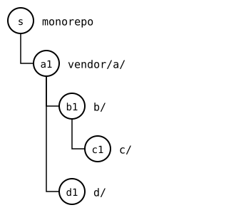
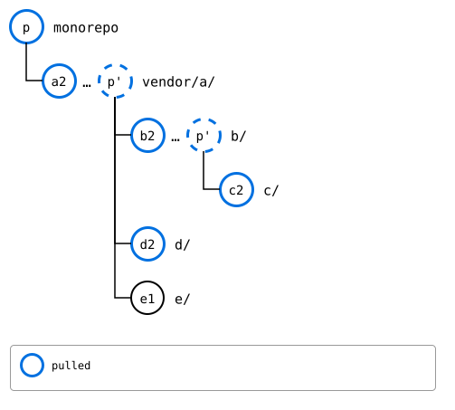
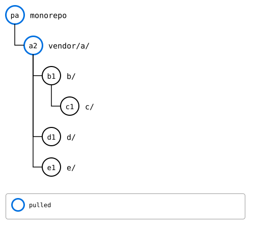
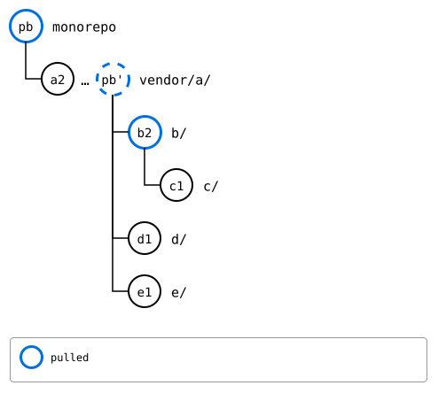
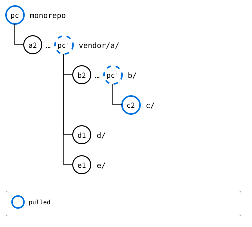
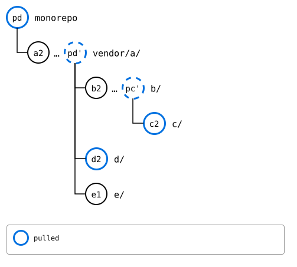

# Scenario: a recursive pull, step by step

One `git splice pull --recursive` does a lot between its start and its
end: it fetches every upstream, merges one splice after another, top-down,
and makes one commit of it all. This page runs it once, records each ref
it moves, then winds the monorepo back and replays the record, one step
at a time, with the tree after each.

No merge conflicts here: the monorepo has no commits of its own, and
each upstream changed only its own files.

## Output

<!--
```scrut {fail_fast: true, output_stream: combined}
$ source "$TESTDIR/../../../readme-setup.sh" && export GIT_CONFIG_COUNT=8 GIT_CONFIG_KEY_0="url.$UPSTREAM-a.git.insteadOf" GIT_CONFIG_VALUE_0=https://git.example.com/a.git GIT_CONFIG_KEY_1="url.$UPSTREAM-b.git.insteadOf" GIT_CONFIG_VALUE_1=https://git.example.com/b.git GIT_CONFIG_KEY_2="url.$UPSTREAM-c.git.insteadOf" GIT_CONFIG_VALUE_2=https://git.example.com/c.git GIT_CONFIG_KEY_3="url.$UPSTREAM-d.git.insteadOf" GIT_CONFIG_VALUE_3=https://git.example.com/d.git GIT_CONFIG_KEY_4="url.$UPSTREAM-e.git.insteadOf" GIT_CONFIG_VALUE_4=https://git.example.com/e.git GIT_CONFIG_KEY_5=user.name GIT_CONFIG_VALUE_5=Test GIT_CONFIG_KEY_6=user.email GIT_CONFIG_VALUE_6=test@example.com GIT_CONFIG_KEY_7=core.editor GIT_CONFIG_VALUE_7=true
```
-->

[`setup.bash`](setup.bash) builds this state, and has the helpers
that record, rewind and replay:

```scrut
$ build_scenario scenario_recursive_pull
```



<!--
```scrut
$ check_drawing "$TESTDIR/step-0.drawio.svg" s=HEAD
ok   step-0.drawio.svg: a tree of 5 rows
```
-->

Each upstream moves on, and `a`'s splices `e` in:

```scrut
$ for x in b c d; do
>   git clone -q "https://git.example.com/$x.git" "../$x-work" &&
>     echo "$x upstream" >>"../$x-work/file.txt" &&
>     git -C "../$x-work" commit -q -am "${x}2: $x upstream" &&
>     git -C "../$x-work" push -q origin main
> done
```

```scrut
$ git clone -q https://git.example.com/a.git ../a-work &&
>   cd ../a-work &&
>   git splice clone https://git.example.com/e.git e >/dev/null &&
>   echo "a upstream" >>file.txt &&
>   git commit -q --amend -am "a2: a upstream, and e spliced in" &&
>   git push -q origin main &&
>   cd ../monorepo
```

## The whole pull

```scrut
$ record_refs ../refs.log git splice pull --recursive vendor/a
ok   vendor/a fetched (main moved 764d9c4..6d12ed8)
ok   vendor/a/b fetched (main moved f815a3c..59ed2fb)
ok   vendor/a/b/c fetched (main moved 8c169b6..94cad5e)
ok   vendor/a/d fetched (main moved 2c64d15..36c850e)
ok   vendor/a: pulled 6d12ed8
ok   vendor/a/e fetched
ok   vendor/a/e: nothing to pull
ok   vendor/a/b: pulled 59ed2fb
ok   vendor/a/b/c: pulled 94cad5e
ok   vendor/a/d: pulled 36c850e
ok   vendor/a: 4 pulls made one commit, 9b51e79
```



<!--
```scrut
$ check_drawing "$TESTDIR/step-folded.drawio.svg" p=HEAD
ok   step-folded.drawio.svg: a tree of 6 rows
```
-->

## Step by step

Wound back to before the pull, the tree is as it was:

```scrut
$ rewind_refs ../refs.log
```

### 1. Discover

The fetches move the refs of the upstreams, and nothing else. The tree
records what the monorepo has, so it doesn't change yet:

```scrut
$ replay_refs ../refs.log refs/splices/
refs/splices/a/heads/main
refs/splices/b/heads/main
refs/splices/c/heads/main
refs/splices/d/heads/main
```

### 2. Merge `vendor/a/`

The pull starts, and merges `a`'s upstream first. Its *a2* brings `e/`
in, a splice now:

```scrut
$ replay_refs ../refs.log refs/heads/main
SPLICE_PULL_START
refs/heads/main
```



<!--
```scrut
$ check_drawing "$TESTDIR/step-a.drawio.svg" pa=HEAD
ok   step-a.drawio.svg: a tree of 6 rows
```
-->

### 3. Merge `b/`

`e/` is fetched, now that it's known, and has nothing to merge. `b`'s
upstream merges into `vendor/a/`'s folder, which gets a commit of its
own, *pb'*:

```scrut
$ replay_refs ../refs.log refs/heads/main
refs/heads/main
refs/splices/e/heads/main
```



<!--
```scrut
$ check_drawing "$TESTDIR/step-b.drawio.svg" pb=HEAD
ok   step-b.drawio.svg: a tree of 6 rows
```
-->

### 4. Merge `c/`

`c/` is inside `b/`, inside `vendor/a/`: both get the copy *pc'*.

```scrut
$ replay_refs ../refs.log refs/heads/main
refs/heads/main
```



<!--
```scrut
$ check_drawing "$TESTDIR/step-c.drawio.svg" pc=HEAD
ok   step-c.drawio.svg: a tree of 6 rows
```
-->

### 5. Merge `d/`

```scrut
$ replay_refs ../refs.log refs/heads/main
refs/heads/main
```



<!--
```scrut
$ check_drawing "$TESTDIR/step-d.drawio.svg" pd=HEAD pc=HEAD~1
ok   step-d.drawio.svg: a tree of 6 rows
```
-->

### 6. One commit

The four pulls become one commit, *p*, and the pull is done: the mark
where it started is gone. Each splice's history has the copy *p'* where
it had *pb'*, *pc'* or *pd'*:

```scrut
$ replay_refs ../refs.log SPLICE_PULL_START
SPLICE_PULL_START
refs/heads/main
```

That's the tree the whole pull ended with, above:

<!--
```scrut
$ check_drawing "$TESTDIR/step-folded.drawio.svg" p=HEAD
ok   step-folded.drawio.svg: a tree of 6 rows
```
-->
