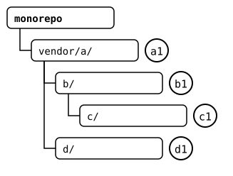
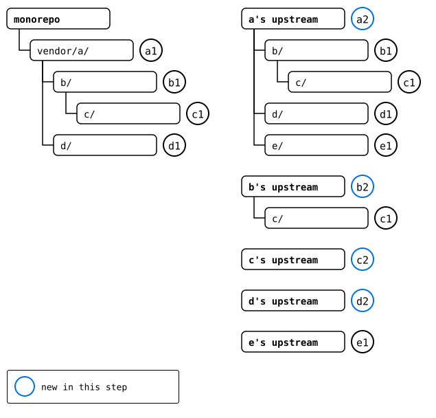
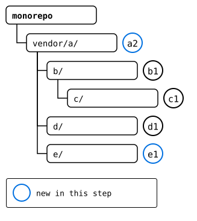
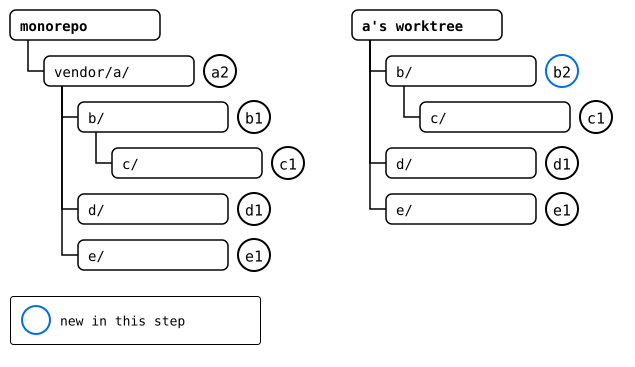
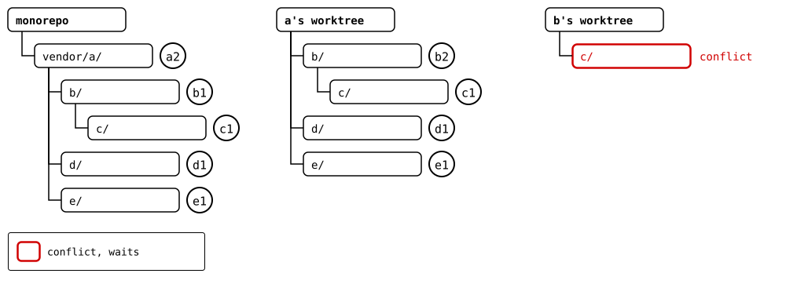
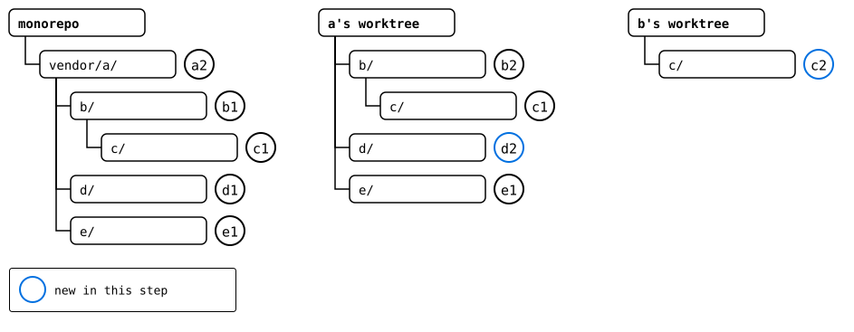
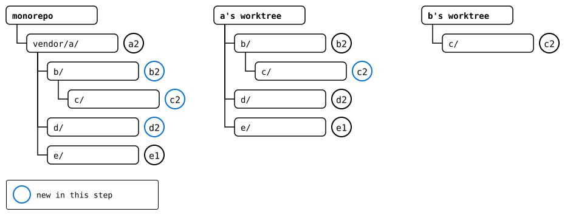

# Scenario: a recursive pull, by hand

The pages here do by hand, with worktrees and plain Git, what a
recursive pull through nested splices is meant to do one day: each
splice is updated as if its upstream were cloned on its own, and each
new commit then travels up. When `git-splice` does it, their code
blocks shrink to one command, and their drawings show what changed.

A splice and the splices inside it form a tree. Its root is the
monorepo, every other node a splice, and the edge from a parent to a
child is the child's `.splice` in the parent's folder: which upstream
the child comes from, and at which commit, its synced commit. A pull
goes through the tree three times:

| Pass | Does | Order | Conflicts |
|---|---|---|---|
| discover | fetches each upstream, and reads the `.splice` files in it for the ones inside | parent before its children | none |
| merge | merges each upstream into its parent's version of the folder | parent before its children | at most one per node |
| take up | puts each new commit into its parent's folder | children before their parent | none |

The parent goes first in the merge, since its upstream records a version
of each child: a newer base for the child's merge, which then doesn't
ask a question the parent's merge already answered. The first conflict
stops the pull, until it's resolved. A take-up can't conflict: the
parent's folder hasn't changed since the child's merge started from it,
which each take-up below checks.

## The tree



Each box is a folder, and the circle next to it the synced commit its
parent's `.splice` records for it.

Every upstream moved on, and the one above `vendor/a/` added a splice,
`e/`. The monorepo changed `vendor/a/` and `b/` in it, so two merges
conflict: the monorepo's and `a`'s upstream's change to `file.txt`, and
`b`'s upstream's and `c`'s upstream's change to `c/file.txt`. The other
merges don't, and `d/`, which no one but its upstream changed, only
moves forward.

## Output

<!--
```scrut {fail_fast: true, output_stream: combined}
$ source "$TESTDIR/../../readme-setup.sh" && export GIT_CONFIG_COUNT=8 GIT_CONFIG_KEY_0="url.$UPSTREAM-a.git.insteadOf" GIT_CONFIG_VALUE_0=https://git.example.com/a.git GIT_CONFIG_KEY_1="url.$UPSTREAM-b.git.insteadOf" GIT_CONFIG_VALUE_1=https://git.example.com/b.git GIT_CONFIG_KEY_2="url.$UPSTREAM-c.git.insteadOf" GIT_CONFIG_VALUE_2=https://git.example.com/c.git GIT_CONFIG_KEY_3="url.$UPSTREAM-d.git.insteadOf" GIT_CONFIG_VALUE_3=https://git.example.com/d.git GIT_CONFIG_KEY_4="url.$UPSTREAM-e.git.insteadOf" GIT_CONFIG_VALUE_4=https://git.example.com/e.git GIT_CONFIG_KEY_5=user.name GIT_CONFIG_VALUE_5=Test GIT_CONFIG_KEY_6=user.email GIT_CONFIG_VALUE_6=test@example.com GIT_CONFIG_KEY_7=core.editor GIT_CONFIG_VALUE_7=true
```
-->

[`setup.bash`](setup.bash) builds this state:

```scrut
$ build_scenario scenario_recursive_pull
```

Each upstream moves on. `b`'s changes the `file.txt` in its `c/` too:

```scrut
$ git clone -q https://git.example.com/c.git ../c-work &&
>   echo "c upstream" >>../c-work/file.txt &&
>   git -C ../c-work commit -q -am "c2: c upstream" &&
>   git -C ../c-work push -q origin main
```

```scrut
$ git clone -q https://git.example.com/b.git ../b-work &&
>   echo "b upstream" >>../b-work/file.txt &&
>   echo "c in b's upstream" >>../b-work/c/file.txt &&
>   git -C ../b-work commit -q -am "b2: b upstream" &&
>   git -C ../b-work push -q origin main
```

```scrut
$ git clone -q https://git.example.com/d.git ../d-work &&
>   echo "d upstream" >>../d-work/file.txt &&
>   git -C ../d-work commit -q -am "d2: d upstream" &&
>   git -C ../d-work push -q origin main
```

`a`'s splices `e` in, at *e1*:

```scrut
$ git clone -q https://git.example.com/a.git ../a-work &&
>   cd ../a-work &&
>   git splice clone https://git.example.com/e.git e &&
>   echo "a upstream" >>file.txt &&
>   git commit -q -am "a2: a upstream" &&
>   git push -q origin main &&
>   cd ../monorepo
===  e: fetching https://git.example.com/e.git
ok   e: cloned ad47a17 from main
```

The monorepo changes `vendor/a/` and, in it, `b/`:

```scrut
$ echo "a in the monorepo" >>vendor/a/file.txt &&
>   echo "b in the monorepo" >>vendor/a/b/notes.txt &&
>   git add vendor/a &&
>   git commit -q -m "m1: a and b in the monorepo"
```

## 1. Discover

Each upstream fetched:

```scrut
$ git splice fetch --all
ok   vendor/a fetched (main moved 764d9c4..48a4171)
ok   vendor/a/b fetched (main moved f815a3c..be68b59)
ok   vendor/a/b/c fetched (main moved 8c169b6..94cad5e)
ok   vendor/a/d fetched (main moved 2c64d15..36c850e)
```

What they have now:

```scrut
$ for x in a b c d; do git log -1 --format="$x: %s" "refs/splices/$x/heads/main"; done
a: a2: a upstream
b: b2: b upstream
c: c2: c upstream
d: d2: d upstream
```

`a`'s upstream has a new splice, `e/`. Its `.splice` says where it comes
from:

```scrut
$ git ls-tree -r --name-only refs/splices/a/heads/main | grep '\.splice$'
b/.splice
b/c/.splice
d/.splice
e/.splice
```

```scrut
$ git show refs/splices/a/heads/main:e/.splice
[splice]
	id = 6e204572c6004f25
	commit = ad47a174fc75bf37498c8ef724e53a069a846589
[upstream "origin"]
	url = https://git.example.com/e.git
```



## 2. Merge `vendor/a/` into the monorepo: a conflict

```scrut
$ git splice pull vendor/a
ok   vendor/a fetched
ok   vendor/a/b fetched
ok   vendor/a/b/c fetched
ok   vendor/a/d fetched
Auto-merging vendor/a/file.txt
CONFLICT (content): Merge conflict in vendor/a/file.txt
!!   vendor/a: conflict -- resolve it, then 'git commit' (or 'git cherry-pick --abort' to give up)
!!   vendor/a: pull failed
!!   Failed: vendor/a
[1]
```


The pull stops until the conflict is resolved:

```scrut
$ printf 'a seed\na in the monorepo\na upstream\n' >vendor/a/file.txt &&
>   git add vendor/a/file.txt &&
>   git commit -q --no-edit
```

`vendor/a/e/` is a splice now. The pull stopped at the conflict before
it fetched it, so that happens here. A recursive pull would have fetched
it in the discover pass already
([#429](https://github.com/roschaefer/git-splice/issues/429)).

```scrut
$ git splice fetch vendor/a/e
ok   vendor/a/e fetched
```



## 3. Merge `b/` into `a`

The rebuild of `vendor/a/`, `from/a`, checked out in a worktree: `a`'s repository,
as the monorepo has it now. `b`'s upstream merges cleanly into it:

```scrut
$ git branch from/a "$(git splice rebuild vendor/a)" &&
>   git worktree add -q -b layer/a ../a-layer from/a &&
>   cd ../a-layer &&
>   git splice pull --branch main b
ok   b fetched
ok   b/c fetched
ok   b: pulled be68b59
```



## 4. Merge `c/` into `b`: a conflict

The rebuild of `b/` in `a`'s worktree, `from/b`, checked out in one of its own:

```scrut
$ git branch from/b "$(git splice rebuild b)" &&
>   git worktree add -q -b layer/b ../b-layer from/b &&
>   cd ../b-layer &&
>   git splice pull --branch main c
ok   c fetched
Auto-merging c/file.txt
CONFLICT (content): Merge conflict in c/file.txt
!!   c: conflict -- resolve it, then 'git commit' (or 'git cherry-pick --abort' to give up)
!!   c: pull failed
!!   Failed: c
[1]
```



```scrut
$ printf "c1: c seed\nc in b's upstream\nc upstream\n" >c/file.txt &&
>   git add c/file.txt &&
>   git commit -q --no-edit
```

## 5. Merge `d/` into `a`

`a` never changed `d/`, so its upstream's new commit only moves it
forward:

```scrut
$ cd ../a-layer &&
>   git splice pull --branch main d
ok   d fetched
ok   d: pulled 36c850e
```

`e/` came in with *e1*, the newest commit of its upstream, so it has
nothing to merge. The merge pass is done.



## 6. Take up

`c`'s new commit goes into `a`'s worktree. `b/` there is what `b`'s
worktree started from:

```scrut
$ git diff --quiet from/b HEAD:b -- . ':!.splice' && echo "b/ unchanged"
b/ unchanged
```

```scrut
$ git splice merge --rebuilt-commit layer/b b
ok   b: merged 120838f
```

`a`'s new commit goes into the monorepo, whose `vendor/a/` is what `a`'s
worktree started from:

```scrut
$ cd ../monorepo &&
>   git diff --quiet from/a HEAD:vendor/a -- . ':!.splice' && echo "vendor/a/ unchanged"
vendor/a/ unchanged
```

```scrut
$ git splice merge --rebuilt-commit layer/a vendor/a
ok   vendor/a: merged 212b29a
```



## 7. The result

```scrut
$ git log --format=%s
splice: merge 212b29a into vendor/a
splice: pull vendor/a from main at 48a4171
m1: a and b in the monorepo
add vendor/a
initial commit
```

```scrut
$ git splice status
On branch main

  ahead 2, behind 1  vendor/a/b/c
  ahead 3            vendor/a
  ahead 2            vendor/a/b

  up to date         vendor/a/d
  up to date         vendor/a/e
```

Every merge result arrived, but `c/` reads as behind its upstream, and
isn't pushed. The last take-up moved the synced commits of `b/` and
`c/` in one commit, and the rebuild of `c/` then takes its history from
`b`'s upstream, the outer one, which wins a tie. That upstream doesn't
have *c2* yet, so the rebuild lacks it. A recursive pull takes up all
of a level's merges in one commit, so this gap has to be fixed first
([#428](https://github.com/roschaefer/git-splice/issues/428)):

```scrut
$ git splice push vendor/a/b/c
!!   vendor/a/b/c: upstream has commits this branch lacks
!!   Failed: vendor/a/b/c
[1]
```
