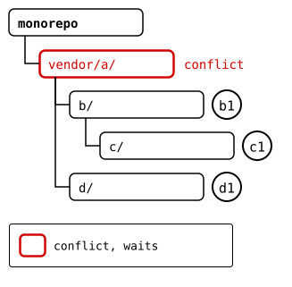
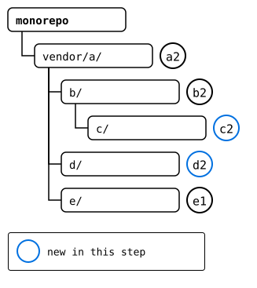

# Scenario: a recursive pull

`git splice pull --recursive` updates nested splices as if each
splice's upstream were cloned on its own: the splice above first, then
each one inside it, down the tree.

A splice and the splices inside it form a tree. Its root is the
monorepo, every other node a splice, and the edge from a parent to a
child is the child's `.splice` in the parent's folder: which upstream
the child comes from, and at which commit, its synced commit. A pull
goes through the tree twice:

| Pass | Does | Order | Conflicts |
|---|---|---|---|
| discover | fetches each upstream, and reads the `.splice` files in it for the ones inside | parent before its children | none |
| merge | merges each upstream into its parent's version of the folder | parent before its children | at most one per node |

The parent goes first, since its upstream records a version of each
child: a newer base for the child's merge, which then doesn't ask a
question the parent's merge already answered. Each merge is a commit of
the monorepo, where the parent's folder holds the child's: its new
commit is in the parent at once, and nothing has to travel up. The
first conflict stops the pull. Once it's resolved and committed, the
same command again goes on from there: the splices pulled already have
nothing left to pull.

## The tree


Each box is a folder, and the circle next to it the synced commit its
parent's `.splice` records for it.

Every upstream moved on, and the one above `vendor/a/` added a splice,
`e/`. The monorepo changed `vendor/a/` and `b/` in it, so two merges
conflict: the monorepo's and `a`'s upstream's change to `file.txt`, and
`b`'s upstream's and `c`'s upstream's change to `c/file.txt`. The other
merges don't, and `d/`, which no one but its upstream changed, only
moves forward.

## Output

<!--
```scrut {fail_fast: true, output_stream: combined}
$ source "$TESTDIR/../../readme-setup.sh" && export GIT_CONFIG_COUNT=8 GIT_CONFIG_KEY_0="url.$UPSTREAM-a.git.insteadOf" GIT_CONFIG_VALUE_0=https://git.example.com/a.git GIT_CONFIG_KEY_1="url.$UPSTREAM-b.git.insteadOf" GIT_CONFIG_VALUE_1=https://git.example.com/b.git GIT_CONFIG_KEY_2="url.$UPSTREAM-c.git.insteadOf" GIT_CONFIG_VALUE_2=https://git.example.com/c.git GIT_CONFIG_KEY_3="url.$UPSTREAM-d.git.insteadOf" GIT_CONFIG_VALUE_3=https://git.example.com/d.git GIT_CONFIG_KEY_4="url.$UPSTREAM-e.git.insteadOf" GIT_CONFIG_VALUE_4=https://git.example.com/e.git GIT_CONFIG_KEY_5=user.name GIT_CONFIG_VALUE_5=Test GIT_CONFIG_KEY_6=user.email GIT_CONFIG_VALUE_6=test@example.com GIT_CONFIG_KEY_7=core.editor GIT_CONFIG_VALUE_7=true
```
-->

[`setup.bash`](setup.bash) builds this state:

```scrut
$ build_scenario scenario_recursive_pull
```

Each upstream moves on. `b`'s changes the `file.txt` in its `c/` too:

```scrut
$ git clone -q https://git.example.com/c.git ../c-work &&
>   echo "c upstream" >>../c-work/file.txt &&
>   git -C ../c-work commit -q -am "c2: c upstream" &&
>   git -C ../c-work push -q origin main
```

```scrut
$ git clone -q https://git.example.com/b.git ../b-work &&
>   echo "b upstream" >>../b-work/file.txt &&
>   echo "c in b's upstream" >>../b-work/c/file.txt &&
>   git -C ../b-work commit -q -am "b2: b upstream" &&
>   git -C ../b-work push -q origin main
```

```scrut
$ git clone -q https://git.example.com/d.git ../d-work &&
>   echo "d upstream" >>../d-work/file.txt &&
>   git -C ../d-work commit -q -am "d2: d upstream" &&
>   git -C ../d-work push -q origin main
```

`a`'s splices `e` in, at *e1*:

```scrut
$ git clone -q https://git.example.com/a.git ../a-work &&
>   cd ../a-work &&
>   git splice clone https://git.example.com/e.git e &&
>   echo "a upstream" >>file.txt &&
>   git commit -q -am "a2: a upstream" &&
>   git push -q origin main &&
>   cd ../monorepo
===  e: fetching https://git.example.com/e.git
ok   e: cloned ad47a17 from main
```

The monorepo changes `vendor/a/` and, in it, `b/`:

```scrut
$ echo "a in the monorepo" >>vendor/a/file.txt &&
>   echo "b in the monorepo" >>vendor/a/b/notes.txt &&
>   git add vendor/a &&
>   git commit -q -m "m1: a and b in the monorepo"
```

## 1. The first run: a conflict in `vendor/a/`

The pull fetches each upstream, and the `.splice` files in them say what
they have now:


Then it merges `vendor/a/` first, which conflicts:

```scrut
$ git splice pull --recursive vendor/a
ok   vendor/a fetched (main moved 764d9c4..48a4171)
ok   vendor/a/b fetched (main moved f815a3c..be68b59)
ok   vendor/a/b/c fetched (main moved 8c169b6..94cad5e)
ok   vendor/a/d fetched (main moved 2c64d15..36c850e)
Auto-merging vendor/a/file.txt
CONFLICT (content): Merge conflict in vendor/a/file.txt
!!   vendor/a: conflict -- resolve it, then 'git commit' (or 'git cherry-pick --abort' to give up)
!!   vendor/a: pull failed
!!   Not pulled yet: vendor/a/b vendor/a/b/c vendor/a/d -- resolve the conflict, run 'git commit', then re-run pull
!!   Failed: vendor/a
[1]
```



```scrut
$ printf 'a seed\na in the monorepo\na upstream\n' >vendor/a/file.txt &&
>   git add vendor/a/file.txt &&
>   git commit -q --no-edit
```

## 2. The second run: a conflict in `c/`

`vendor/a/` has nothing left to pull. Its pull brought in `e/`, a splice
now, at *e1*, the newest commit of its upstream. `b/` merges cleanly,
and `c/` conflicts:

```scrut
$ git splice pull --recursive vendor/a
ok   vendor/a fetched
ok   vendor/a/b fetched
ok   vendor/a/b/c fetched
ok   vendor/a/d fetched
ok   vendor/a/e fetched
ok   vendor/a: nothing to pull
ok   vendor/a/b: pulled be68b59
Auto-merging vendor/a/b/c/file.txt
CONFLICT (content): Merge conflict in vendor/a/b/c/file.txt
!!   vendor/a/b/c: conflict -- resolve it, then 'git commit' (or 'git cherry-pick --abort' to give up)
!!   vendor/a/b/c: pull failed
!!   Not pulled yet: vendor/a/d vendor/a/e -- resolve the conflict, run 'git commit', then re-run pull
!!   Failed: vendor/a/b/c
[1]
```


```scrut
$ printf "c1: c seed\nc in b's upstream\nc upstream\n" >vendor/a/b/c/file.txt &&
>   git add vendor/a/b/c/file.txt &&
>   git commit -q --no-edit
```

## 3. The third run: the rest

`d/`, which no one but its upstream changed, only moves forward:

```scrut
$ git splice pull --recursive vendor/a
ok   vendor/a fetched
ok   vendor/a/b fetched
ok   vendor/a/b/c fetched
ok   vendor/a/d fetched
ok   vendor/a/e fetched
ok   vendor/a: nothing to pull
ok   vendor/a/b: nothing to pull
ok   vendor/a/b/c: nothing to pull
ok   vendor/a/d: pulled 36c850e
ok   vendor/a/e: nothing to pull
```



## 4. The result

One commit per splice pulled:

```scrut
$ git log --format=%s
splice: pull vendor/a/d from main at 36c850e
splice: pull vendor/a/b/c from main at 94cad5e
splice: pull vendor/a/b from main at be68b59
splice: pull vendor/a from main at 48a4171
m1: a and b in the monorepo
add vendor/a
initial commit
```

```scrut
$ git splice status
On branch main

  ahead 5     vendor/a
  ahead 3     vendor/a/b
  ahead 2     vendor/a/b/c

  up to date  vendor/a/d
  up to date  vendor/a/e
```

```scrut
$ git splice push --all
ok   vendor/a/b/c: pushed fe91e6c to main
ok   vendor/a/b: pushed d9079b7 to main
ok   vendor/a/d: nothing to push
ok   vendor/a/e: nothing to push
ok   vendor/a: pushed b5e2028 to main
```
