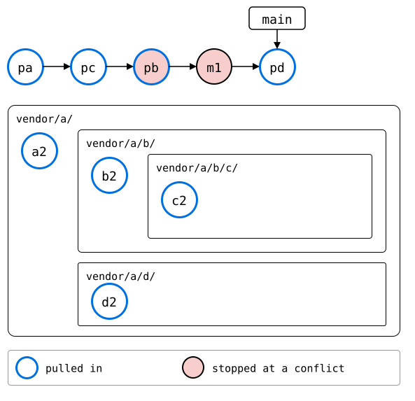
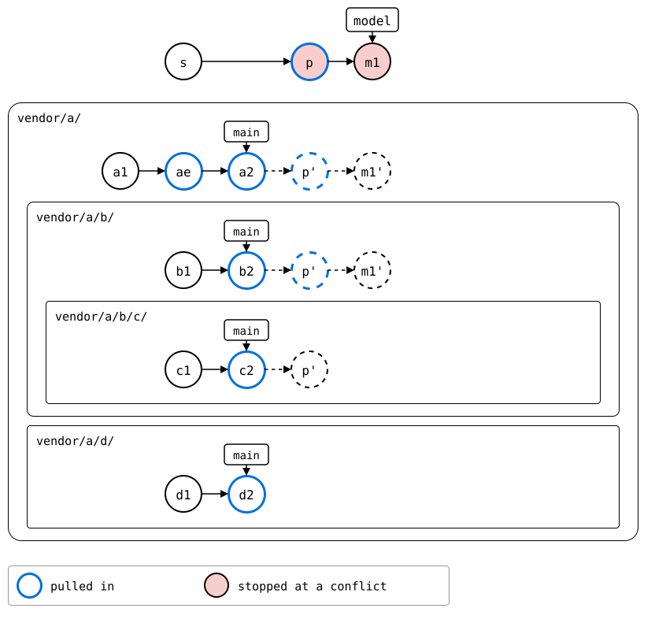

# Scenario: a recursive pull, rebased

The [recursive pull](README.md), with `--rebase`: the same tree, the
same upstreams, and the same two conflicts. Both orders below end in the
same files. They differ in where the pulled commits land, and in which
commit each conflict comes up.

- **Today**, `pull --rebase --recursive` rebases the monorepo's commits
  since each splice's last pull onto the new one, splice by splice.
  Those can be pulls of the splices above it: `b`'s pull changed `c/`,
  so `c`'s pull goes below it, and `b`'s pull is replayed on top.
- **One level at a time**, as in
  [rebased level by level](../01-nested-splices/02-three-levels/rebased-level-by-level.md):
  each splice takes its children's pulls in, and only its own commits
  come on top, rebased. As without `--rebase`, the monorepo gets one
  commit for the whole pull, *p*, and its own commit, *m1*, is replayed
  once, on top of it.

## Output

<!--
```scrut {fail_fast: true, output_stream: combined}
$ source "$TESTDIR/../../readme-setup.sh" && export GIT_CONFIG_COUNT=8 GIT_CONFIG_KEY_0="url.$UPSTREAM-a.git.insteadOf" GIT_CONFIG_VALUE_0=https://git.example.com/a.git GIT_CONFIG_KEY_1="url.$UPSTREAM-b.git.insteadOf" GIT_CONFIG_VALUE_1=https://git.example.com/b.git GIT_CONFIG_KEY_2="url.$UPSTREAM-c.git.insteadOf" GIT_CONFIG_VALUE_2=https://git.example.com/c.git GIT_CONFIG_KEY_3="url.$UPSTREAM-d.git.insteadOf" GIT_CONFIG_VALUE_3=https://git.example.com/d.git GIT_CONFIG_KEY_4="url.$UPSTREAM-e.git.insteadOf" GIT_CONFIG_VALUE_4=https://git.example.com/e.git GIT_CONFIG_KEY_5=user.name GIT_CONFIG_VALUE_5=Test GIT_CONFIG_KEY_6=user.email GIT_CONFIG_VALUE_6=test@example.com GIT_CONFIG_KEY_7=core.editor GIT_CONFIG_VALUE_7=true
```
-->

[`setup.bash`](setup.bash) builds this state:

```scrut
$ build_scenario scenario_recursive_pull
```

Each upstream moves on. `b`'s changes the `file.txt` in its `c/` too:

```scrut
$ git clone -q https://git.example.com/c.git ../c-work &&
>   echo "c upstream" >>../c-work/file.txt &&
>   git -C ../c-work commit -q -am "c2: c upstream" &&
>   git -C ../c-work push -q origin main
```

```scrut
$ git clone -q https://git.example.com/b.git ../b-work &&
>   echo "b upstream" >>../b-work/file.txt &&
>   echo "c in b's upstream" >>../b-work/c/file.txt &&
>   git -C ../b-work commit -q -am "b2: b upstream" &&
>   git -C ../b-work push -q origin main
```

```scrut
$ git clone -q https://git.example.com/d.git ../d-work &&
>   echo "d upstream" >>../d-work/file.txt &&
>   git -C ../d-work commit -q -am "d2: d upstream" &&
>   git -C ../d-work push -q origin main
```

`a`'s splices `e` in:

```scrut
$ git clone -q https://git.example.com/a.git ../a-work &&
>   cd ../a-work &&
>   git splice clone https://git.example.com/e.git e &&
>   echo "a upstream" >>file.txt &&
>   git commit -q -am "a2: a upstream" &&
>   git push -q origin main &&
>   cd ../monorepo
===  e: fetching https://git.example.com/e.git
ok   e: cloned ad47a17 from main
```

The monorepo changes `vendor/a/` and, in it, `b/`:

```scrut
$ echo "a in the monorepo" >>vendor/a/file.txt &&
>   echo "b in the monorepo" >>vendor/a/b/notes.txt &&
>   git add vendor/a &&
>   git commit -q -m "m1: a and b in the monorepo"
```

## Today

The monorepo's commit before the pull, kept for later:

```scrut
$ git branch before
```

```scrut
$ git splice pull --rebase --recursive vendor/a
ok   vendor/a fetched (main moved 764d9c4..48a4171)
ok   vendor/a/b fetched (main moved f815a3c..be68b59)
ok   vendor/a/b/c fetched (main moved 8c169b6..94cad5e)
ok   vendor/a/d fetched (main moved 2c64d15..36c850e)
Auto-merging vendor/a/file.txt
CONFLICT (content): Merge conflict in vendor/a/file.txt
error: could not apply 74d923b... m1: a and b in the monorepo
Could not apply 74d923b... # m1: a and b in the monorepo
!!   vendor/a: conflict while rebasing onto the pull -- resolve it, then 'git rebase --continue' (or 'git rebase --abort' to give up)
!!   Not pulled yet: vendor/a/b vendor/a/b/c vendor/a/d -- resolve the conflict, run 'git rebase --continue', then re-run pull
!!   Failed: vendor/a
[1]
```

```scrut
$ printf 'a seed\na in the monorepo\na upstream\n' >vendor/a/file.txt &&
>   git add vendor/a/file.txt &&
>   git rebase --continue >/dev/null
```

```scrut
$ git splice pull --rebase --recursive vendor/a
ok   vendor/a fetched
ok   vendor/a/b fetched
ok   vendor/a/b/c fetched
ok   vendor/a/d fetched
ok   vendor/a/e fetched
ok   vendor/a: nothing to pull
ok   vendor/a/b: pulled be68b59, and rebased 1 commit onto it
Auto-merging vendor/a/b/c/file.txt
CONFLICT (content): Merge conflict in vendor/a/b/c/file.txt
error: could not apply 1d4506e... splice: pull vendor/a/b from main at be68b59
Could not apply 1d4506e... # splice: pull vendor/a/b from main at be68b59
!!   vendor/a/b/c: conflict while rebasing onto the pull -- resolve it, then 'git rebase --continue' (or 'git rebase --abort' to give up)
!!   Not pulled yet: vendor/a/d vendor/a/e -- resolve the conflict, run 'git rebase --continue', then re-run pull
!!   Failed: vendor/a/b/c
[1]
```

```scrut
$ printf "c1: c seed\nc in b's upstream\nc upstream\n" >vendor/a/b/c/file.txt &&
>   git add vendor/a/b/c/file.txt &&
>   git rebase --continue >/dev/null
```

```scrut
$ git splice pull --rebase --recursive vendor/a
ok   vendor/a fetched
ok   vendor/a/b fetched
ok   vendor/a/b/c fetched
ok   vendor/a/d fetched
ok   vendor/a/e fetched
ok   vendor/a: nothing to pull
ok   vendor/a/b: nothing to pull
ok   vendor/a/b/c: nothing to pull
ok   vendor/a/d: pulled 36c850e
ok   vendor/a/e: nothing to pull
```

```scrut
$ git log --format=%s
splice: pull vendor/a/d from main at 36c850e
m1: a and b in the monorepo
splice: pull vendor/a/b from main at be68b59
splice: pull vendor/a/b/c from main at 94cad5e
splice: pull vendor/a from main at 48a4171
add vendor/a
initial commit
```

The pull of `c/`, *pc*, landed below the one of `b/`, *pb*: the pull of
`c/` rebased what the monorepo did since its last one, and *pb* is part
of that. Replaying *pb*, which brought `b`'s upstream's change to `c/`,
stopped at `c`'s conflict. *m1* stopped at `a`'s, and *pd* came on top,
since nothing since the last pull of `d/` changed it:



<!--
```scrut
$ check_drawing "$TESTDIR/rebased-today.drawio.svg" pa=main~4 pc=main~3 pb=main~2 pd=main
ok   rebased-today.drawio.svg: 9 commits, 5 arrows, 1 boxes, 4 lanes
```
-->

## One level at a time

The same, done by hand from the commit before *m1*: each splice pulled,
top-down, and *m1* replayed once, at the end:

```scrut
$ git switch -q -c model before~1 &&
>   git splice pull --branch main vendor/a &&
>   git splice pull --branch main vendor/a/b
ok   vendor/a fetched
ok   vendor/a/b fetched
ok   vendor/a/b/c fetched
ok   vendor/a/d fetched
ok   vendor/a: pulled 48a4171
ok   vendor/a/b fetched
ok   vendor/a/b/c fetched
ok   vendor/a/b: pulled be68b59
```

`c`'s conflict comes up in its own pull, as a merge with what `b`'s
upstream has in `c/`:

```scrut
$ git splice pull --branch main vendor/a/b/c
ok   vendor/a/b/c fetched
Auto-merging vendor/a/b/c/file.txt
CONFLICT (content): Merge conflict in vendor/a/b/c/file.txt
!!   vendor/a/b/c: conflict -- resolve it, then 'git commit' (or 'git cherry-pick --abort' to give up)
!!   vendor/a/b/c: pull failed
!!   Failed: vendor/a/b/c
[1]
```

```scrut
$ printf "c1: c seed\nc in b's upstream\nc upstream\n" >vendor/a/b/c/file.txt &&
>   git add vendor/a/b/c/file.txt &&
>   git commit -q --no-edit
```

```scrut
$ git splice pull --branch main vendor/a/d
ok   vendor/a/d fetched
ok   vendor/a/d: pulled 36c850e
```

The four pulls become one commit, as `pull --recursive` makes them
without `--rebase`:

```scrut
$ git reset -q --soft before~1 &&
>   git commit -q -m "p: pull vendor/a and the splices in it"
```

`a`'s conflict comes up when *m1* is replayed:

```scrut
$ git cherry-pick before >/dev/null 2>&1
[1]
```

```scrut
$ printf 'a seed\na in the monorepo\na upstream\n' >vendor/a/file.txt &&
>   git add vendor/a/file.txt &&
>   git cherry-pick --continue >/dev/null &&
>   git switch -q main
```



<!--
```scrut
$ check_drawing "$TESTDIR/rebased-by-level.drawio.svg" p=model~1 m1=model
ok   rebased-by-level.drawio.svg: 6 commits, 2 arrows, 1 boxes, 4 lanes
```
-->

Both end in the same files:

```scrut
$ git diff --stat main model
```

## The difference

| | Today | One level at a time |
|---|---|---|
| the monorepo's history | four pulls, `c/` below `b/`, `d/` above *m1* | one pull, *p*, below *m1* |
| replayed | `b`'s pull and *m1* | *m1* only |
| `c`'s conflict | replaying `b`'s pull | in `c`'s pull itself |
