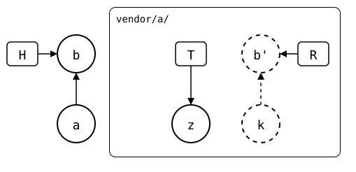

# Fresh clone

In the [same state](README.md), upstream rebuilt from scratch, a
colleague clones the monorepo. The clone has no fetched refs, and the
upstream no longer has the synced commit, so no fetch brings it. A pull
says that first, then prints the same ways out as the monorepo that
fetched the synced commit before.

## Output

<!--
```scrut {fail_fast: true, output_stream: combined}
$ source "$TESTDIR/../../readme-setup.sh"
```
-->

[`setup.bash`](setup.bash) builds this state:

```scrut
$ build_scenario scenario_diverged_unrelated_history
```

<!--
```scrut
$ k="$(git config --file vendor/a/.splice splice.commit)" &&
>   check_drawing "$TESTDIR/unrelated-history.drawio.svg" \
>     k="$k" a=HEAD~1 b=HEAD z=splices/upstream/heads/main
ok   unrelated-history.drawio.svg: 5 commits, 5 arrows, 3 boxes, 1 lanes
```
-->

<div align="center">



</div>

*a* (`add vendor/a`) cloned *k* (`seed`), the synced commit, and *b*
(`local change`) changed the folder since. The upstream now has only *z*
(`brand new unrelated history`). No upstream branch has *k* any more,
so it is dashed. The monorepo still has *k* from an earlier fetch; a
fresh clone doesn't:

```scrut
$ git clone -q --no-local . ../fresh
```

```scrut
$ cd ../fresh &&
>   git config user.name Test &&
>   git config user.email test@example.com
```

```scrut
$ git splice pull vendor/a
ok   vendor/a fetched
!!   vendor/a: its synced commit bde4164 isn't on its upstream any more
??   vendor/a: upstream and the splice share no history -- pick a side:

  # keep the upstream version, discarding local changes under vendor/a:
  git rm -r -q -- vendor/a && git commit -m 'remove vendor/a'
  git splice clone -- $UPSTREAM vendor/a

  # OR: keep both, resolving every file that differs as a conflict:
  git rm -q -- vendor/a/.splice && git commit -m 'unsplice vendor/a'
  git splice clone --merge -- $UPSTREAM vendor/a

  # OR: keep the monorepo version, overwriting upstream's branch:
  git splice push --force -- vendor/a

!!   Failed: vendor/a
[1]
```
