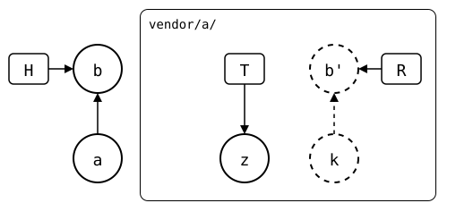
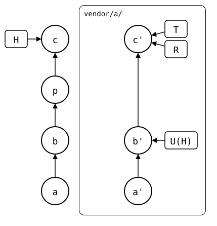

# `push --force` from a fresh clone

In the [same state](README.md), upstream rebuilt from scratch, a
colleague's [fresh clone](fresh-clone.md) keeps the monorepo's version
with `git splice push --force`. The clone doesn't have the synced
commit, so the rebuild starts from nothing: the upstream gets the
folder's whole history, without the synced commit. A push writes
nothing to the monorepo, so `.splice` still names the synced commit,
which no repository has any more. The push says how to record the
pushed commit instead.

## Output

<!--
```scrut {fail_fast: true, output_stream: combined}
$ source "$TESTDIR/../../readme-setup.sh"
```
-->

[`setup.bash`](setup.bash) builds this state:

```scrut
$ build_scenario scenario_diverged_unrelated_history
```

<!--
```scrut
$ k="$(git config --file vendor/a/.splice splice.commit)" &&
>   check_drawing "$TESTDIR/unrelated-history.drawio.svg" \
>     k="$k" a=HEAD~1 b=HEAD z=splices/upstream/heads/main
ok   unrelated-history.drawio.svg: 5 commits, 5 arrows, 3 boxes, 1 lanes
```
-->

<div align="center">



</div>

*a* (`add vendor/a`) cloned *k* (`seed`), the synced commit, and *b*
(`local change`) changed the folder since. The upstream now has only *z*
(`brand new unrelated history`), and a fresh clone has no *k*:

```scrut
$ git clone -q --no-local . ../fresh
```

```scrut
$ cd ../fresh &&
>   git config user.name Test &&
>   git config user.email test@example.com
```

```scrut
$ git splice fetch vendor/a
ok   vendor/a fetched
```

```scrut
$ git splice push --force vendor/a
ok   vendor/a: pushed 8b786b7 to main
??   vendor/a: run 'git splice pull --bump vendor/a' before the next change to it -- that records 8b786b7 as the synced commit
```

`pull --bump` records the pushed commit as the synced commit, since the
folder already has its files:

```scrut
$ git splice pull --bump -m "p: record the force push" vendor/a
ok   vendor/a fetched
ok   vendor/a: recorded 8b786b7 as the synced commit -- the folder already has its files
```

The next change pushes without `--force`:

```scrut
$ echo "next change" >>vendor/a/file.txt &&
>   git commit -q -a -m "c: next change" &&
>   git splice push vendor/a
ok   vendor/a: pushed 144ba8f to main
```

<!--
```scrut
$ check_drawing "$TESTDIR/push-force-from-a-fresh-clone.drawio.svg" \
>   a=HEAD~3 b=HEAD~2
ok   push-force-from-a-fresh-clone.drawio.svg: 7 commits, 9 arrows, 4 boxes, 1 lanes
```
-->

<div align="center">



</div>

The upstream has *a'*, *b'* and *c'*, the folder's history, and *p*
records *b'*, which it has.
