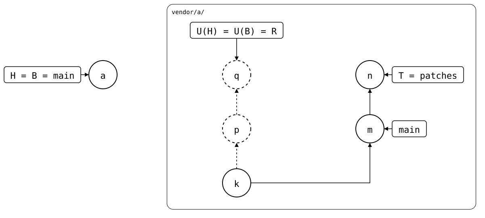

# Scenario: patch-branch-rebased: a clone that fetched after the rebase

The [same state](README.md): `patches` was rebased upstream, and the
monorepo fetched it before and after the rebase. Its pull works, since
the fetched branch's reflog remembers *q*, where `patches` was before.

A colleague's fresh clone of the monorepo has the same commits, but
fetches `patches` only after the rebase. Its reflog has no *q*, so its
pull merges from Git's merge base, *k*, and conflicts.

## Output

<!--
```scrut {fail_fast: true, output_stream: combined}
$ source "$TESTDIR/../../readme-setup.sh" && export GIT_CONFIG_COUNT=1 GIT_CONFIG_KEY_0="url.$UPSTREAM.insteadOf" GIT_CONFIG_VALUE_0=https://git.example.com/a.git
```
-->

[`setup.bash`](setup.bash) builds this state:

```scrut
$ build_scenario scenario_patch_branch_rebased https://git.example.com/a.git
```

<!--
```scrut
$ q="$(git config --file vendor/a/.splice splice.commit)"
```

```scrut
$ check_drawing "$TESTDIR/patch-branch-rebased.drawio.svg" q="$q" n=refs/splices/a/heads/patches
ok   patch-branch-rebased.drawio.svg: 6 commits, 8 arrows, 4 boxes, 1 lanes
```
-->

<div align="center">



</div>

The monorepo's reflog of the fetched branch has both, *q* and then *n*:

```scrut
$ git log -g --format='%h %s' refs/splices/a/heads/patches
28d3fa4 other patch
f463f92 other patch
```

A fresh clone of the monorepo:

```scrut
$ git clone -q "file://$PWD" ../colleague && cd ../colleague &&
>   git config user.name "Colleague" && git config user.email "colleague@example.com"
```

```scrut
$ git splice fetch vendor/a
ok   vendor/a fetched
```

Its reflog has only *n*:

```scrut
$ git log -g --format='%h %s' refs/splices/a/heads/patches
28d3fa4 other patch
```

So its pull conflicts:

```scrut
$ git splice pull vendor/a
ok   vendor/a fetched
Auto-merging vendor/a/file.txt
CONFLICT (content): Merge conflict in vendor/a/file.txt
!!   vendor/a: conflict -- resolve it, then 'git commit' (or 'git cherry-pick --abort' to give up)
!!   vendor/a: pull failed
!!   Failed: vendor/a
[1]
```

The monorepo's own clone, with *q* in its reflog, pulls the same commit
cleanly ([patch-branch-rebased](README.md#output)).
