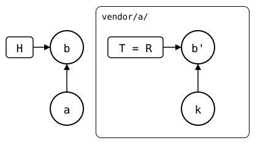
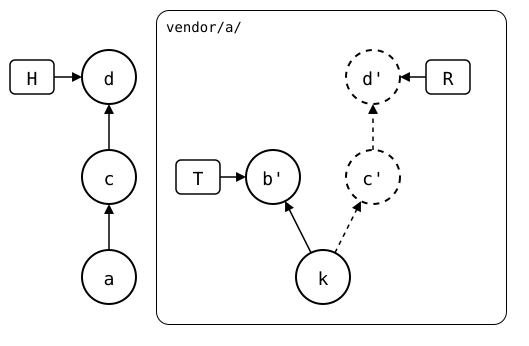
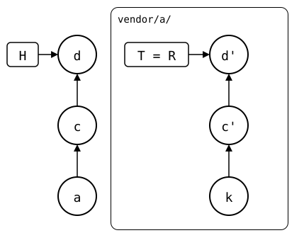

# Scenario: pushed-then-rebased

A monorepo commit was pushed, and then rewritten, e.g. by a rebase onto
a branch whose base was squash-merged. The upstream still has the copy
of the old commit, so a plain `push` refuses. `push
--force-if-includes` replaces it: the upstream has nothing the monorepo
didn't send.

## Output

<!--
```scrut {fail_fast: true, output_stream: combined}
$ source "$TESTDIR/../../readme-setup.sh"
```
-->

[`setup.bash`](setup.bash) builds this state, *b* pushed as *b'*:

```scrut
$ build_scenario scenario_pushed_then_rebased
```

<!--
```scrut
$ k="$(git config --file vendor/a/.splice splice.commit)" &&
>   check_drawing "$TESTDIR/pushed.drawio.svg" a=HEAD~1 k="$k"
ok   pushed.drawio.svg: 4 commits, 4 arrows, 2 boxes, 1 lanes
```
-->

<div align="center">



</div>

Rewrite *b*, as a rebase would: here, reword it to *c*, then add *d*:

```scrut
$ git commit -q --amend -m "c: a local change, reworded"
```

```scrut
$ echo "d: another change" >>vendor/a/file.txt &&
>   git commit -q -am "d: another change"
```

The upstream's *b'* is no longer in the rebuild's history:

<!--
```scrut
$ check_drawing "$TESTDIR/rebased.drawio.svg" \
>   a=HEAD~2 k="$k" b\'=splices/upstream/heads/main
ok   rebased.drawio.svg: 7 commits, 8 arrows, 3 boxes, 1 lanes
```
-->

<div align="center">



</div>

```scrut
$ git splice status
On branch main

  ahead 2, behind 1  vendor/a
```

`push` refuses, as `git push` refuses after a rebase:

```scrut
$ git splice push vendor/a
!!   vendor/a: upstream has commits this branch lacks
!!   Failed: vendor/a
[1]
```

`--force-if-includes` replaces *b'*: this clone pushed it, and the
upstream's branch is still where the last fetch or push saw it. It
refuses a commit the monorepo neither pulled nor pushed, e.g. one
someone else pushed; plain `--force` discards that too:

```scrut
$ git splice push --force-if-includes vendor/a
ok   vendor/a: pushed 4339bd1 to main
```

```scrut
$ git -C "$UPSTREAM" log --format=%s main
d: another change
c: a local change, reworded
seed
```

<!--
```scrut
$ check_drawing "$TESTDIR/pushed-again.drawio.svg" a=HEAD~2 k="$k"
ok   pushed-again.drawio.svg: 6 commits, 6 arrows, 2 boxes, 1 lanes
```
-->

<div align="center">



</div>
