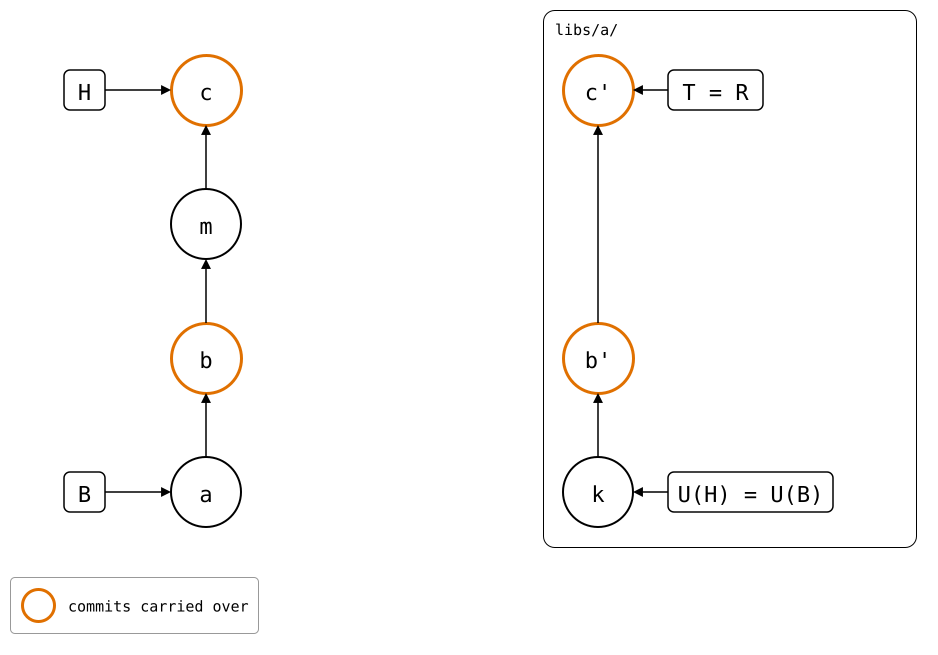

# Pushed before the move

In the [same state](README.md), the unpushed commit is pushed first, and
the splice moved after. A move changes no file inside the folder, so
there's nothing to push after it. A commit after the move then lands on
top of the pushed one.

## Output

<!--
```scrut {fail_fast: true, output_stream: combined}
$ source "$TESTDIR/../../readme-setup.sh"
```
-->

[`setup.bash`](setup.bash) builds this state:

```scrut
$ build_scenario scenario_moved_with_unpushed_commits
```

```scrut
$ git splice push vendor/a
ok   vendor/a: pushed e859a6b to main
```

```scrut
$ git mv vendor/a libs/a &&
>   git -c user.name=Mover -c user.email=mover@example.com commit -q -m "m: reorganize folders"
```

There is nothing left to push:

```scrut
$ git splice status
On branch main

  up to date  libs/a
```

A commit after the move:

```scrut
$ echo "after the move" >>libs/a/file.txt &&
>   git commit -q -a -m "c: after the move"
```

`push` wrote nothing to `.splice`, so its synced commit is still *k*,
and the upstream already has *b'*. The rebuild follows the folder back
to *a* and makes the same *b'*, with the new commit on top, so the
upstream's `main` moves forward:

```scrut
$ git splice push libs/a
ok   libs/a: pushed ff42743 to main
```

<div align="center">



</div>

<!--
```scrut
$ check_drawing "$TESTDIR/pushed-after-the-move.drawio.svg" \
>   a=HEAD~3 b=HEAD~2 k=refs/splices/upstream/heads/main~2
ok   pushed-after-the-move.drawio.svg: 7 commits, 9 arrows, 4 boxes, 1 lanes
```
-->

```scrut
$ git -C "$UPSTREAM" log --format='%s  (%an)' main
c: after the move  (Test)
local change  (Test)
seed  (Test)
```
