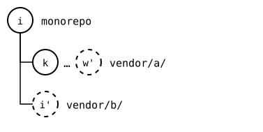
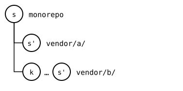

# swapped-splices: only the `.splice` files trade places

As in the [README](README.md), but only the two `.splice` files trade
places, and the folders' other files stay where they are. A splice
keeps its id for good, so the two splices traded places:

- **Each splice's history continues at its new folder**, as across the
  move of a whole folder.
- **A push sends the files now in that folder**: each upstream gets the
  files of the other's old folder, and loses its own.

[Nested splices](../../05-nested-splices/01-nested-splices/swapped-ids.md)
that trade their `.splice` files do the same.

## Output

<!--
```scrut {fail_fast: true, output_stream: combined}
$ source "$TESTDIR/../../readme-setup.sh"
```
-->

[`setup.bash`](setup.bash) builds the state of the [README](README.md):

```scrut
$ build_scenario scenario_swapped_splices
```

`vendor/b/` becomes a splice of the empty upstream, and isn't pushed yet:

```scrut
$ git splice init vendor/b "$UPSTREAM-b"
ok   vendor/b: initialized -- 'git splice push vendor/b' publishes it
```

```scrut
$ git ls-files vendor
vendor/a/.splice
vendor/a/a.txt
vendor/a/file.txt
vendor/b/.splice
vendor/b/b.txt
```

As a tree: the monorepo at *i*; `vendor/a/` at *k* (`seed`), then
*w'*, the copy of `a's unpushed work`, not pushed yet; `vendor/b/` with
*i'* alone, not pushed yet either:



<!--
```scrut
$ check_drawing "$TESTDIR/swapped-splice-files-before.drawio.svg" i=HEAD w="HEAD^{/a's unpushed work}" k="$(git config --file vendor/a/.splice splice.commit)"
ok   swapped-splice-files-before.drawio.svg: a tree of 3 rows
```
-->

## The swap

```scrut
$ git mv vendor/a/.splice tmp.splice &&
>   git mv vendor/b/.splice vendor/a/.splice &&
>   git mv tmp.splice vendor/b/.splice &&
>   git commit -q -m "s: swap the .splice files"
```

`vendor/a/` names the upstream of `vendor/b/` now, and keeps the files
of `$UPSTREAM`:

```scrut
$ git config --file vendor/a/.splice upstream.origin.url
$UPSTREAM-b
```

Both read as an ordinary push:

```scrut
$ git splice status
On branch main

  ahead 2       vendor/b
  new, ahead 2  vendor/a  push creates the branch
```

## A push sends each upstream the other's files

```scrut
$ git splice push vendor/a
??   vendor/a: upstream has no 'main' branch yet -- this push creates it
ok   vendor/a: pushed 707c682 to main
```

`$UPSTREAM-b` gets the files of `$UPSTREAM`, and not its own `b.txt`:

```scrut
$ git -C "$UPSTREAM-b" ls-tree -r --name-only main
a.txt
file.txt
```

```scrut
$ git -C "$UPSTREAM-b" log --format=%s main
s: swap the .splice files
splice: init vendor/b
```

```scrut
$ git splice push vendor/b
ok   vendor/b: pushed 4d90688 to main
```

`$UPSTREAM` gets `b.txt`, and the push deletes its own `file.txt` and
`a.txt`:

```scrut
$ git -C "$UPSTREAM" ls-tree -r --name-only main
b.txt
```

```scrut
$ git -C "$UPSTREAM" log --format=%s main
s: swap the .splice files
a's unpushed work
seed
```

Afterwards, both read as up to date:

```scrut
$ git splice status
On branch main

  up to date  vendor/a
  up to date  vendor/b
```

As a tree: `vendor/a/` with *s'* alone, which `$UPSTREAM-b` has now;
`vendor/b/` at *k*, then *s'*, which `$UPSTREAM` has now:



<!--
```scrut
$ check_drawing "$TESTDIR/swapped-splice-files-pushed.drawio.svg" s=HEAD k="$(git config --file vendor/b/.splice splice.commit)"
ok   swapped-splice-files-pushed.drawio.svg: a tree of 3 rows
```
-->
