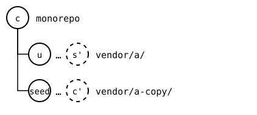
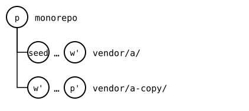

# mirrors: mirrors that swap paths after one pulled

> **Known bug, [#193](https://github.com/roschaefer/git-splice/issues/193).** This page shows what `git-splice` does today, bug included. See [known bugs and limitations](../../99-known-bugs.md#known-bugs).

As in [mirrors that swap paths](swapped-paths.md), each path keeps its
own history after the swap. Here only `vendor/a/` pulled an upstream
commit before, so the `.splice` files differ, and the swap changes both.
The rebuild still follows each path:

- **A push undoes an upstream commit**: `vendor/a/` now has the files of
  the mirror that never pulled *u*, so the swap's copy takes *u*'s change
  out again, and the push is a fast-forward.
- **The change stays lost**: once the other mirror pulled and pushed
  too, the upstream's files still lack it, and nothing says so.

## Output

<!--
```scrut {fail_fast: true, output_stream: combined}
$ source "$TESTDIR/../../readme-setup.sh"
```
-->

[`setup.bash`](setup.bash) builds this state:

```scrut
$ build_scenario scenario_mirrors
```

`vendor/a/` and its mirror `vendor/a-copy/`:

```scrut
$ git splice clone https://git.example.com/a.git vendor/a
===  vendor/a: fetching https://git.example.com/a.git
ok   vendor/a: cloned bde4164 from main
```

```scrut
$ cp -r vendor/a vendor/a-copy &&
>   git add vendor/a-copy &&
>   git commit -q -m "copy vendor/a"
```

The upstream gets *u*, and only `vendor/a/` pulls it:

```scrut
$ seed_bare_repo "$UPSTREAM" "u: upstream change"
```

```scrut
$ git splice pull vendor/a
ok   vendor/a fetched (main moved bde4164..20ab5e2)
ok   vendor/a: pulled 20ab5e2
```

```scrut
$ git grep 'commit = ' -- '*/.splice' | tr '\t' ' '
vendor/a-copy/.splice: commit = bde416459fbcc09c9b585f3b65a94cab3f68bfcd
vendor/a/.splice: commit = 20ab5e2c4571a3b368cc223ca123017be0cac120
```

A commit in each mirror, not pushed yet:

```scrut
$ echo "not for upstream" >vendor/a/secret.txt &&
>   git add vendor/a &&
>   git commit -q --author "Alice <alice@example.com>" -m "s: a secret"
```

```scrut
$ echo "copy change" >vendor/a-copy/copy.txt &&
>   git add vendor/a-copy &&
>   git commit -q --author "Bob <bob@example.com>" -m "c: copy change"
```

`vendor/a-copy/` hasn't pulled *u*:

```scrut
$ git splice status
On branch main

  ahead 1, behind 1  vendor/a-copy
  ahead 1            vendor/a
```



<!--
```scrut
$ check_drawing "$TESTDIR/swapped-after-a-pull-before.drawio.svg" s=HEAD~1 c=HEAD
ok   swapped-after-a-pull-before.drawio.svg: a tree of 3 rows
[0]
```
-->

### The swap

```scrut
$ git mv vendor/a tmp &&
>   git mv vendor/a-copy vendor/a &&
>   git mv tmp vendor/a-copy &&
>   git commit -q -m "w: swap the mirrors"
```

This time the swap changes both `.splice` files too:

```scrut
$ git diff --name-status HEAD^ HEAD | tr '\t' ' '
M vendor/a-copy/.splice
M vendor/a-copy/file.txt
R100 vendor/a/secret.txt vendor/a-copy/secret.txt
M vendor/a/.splice
R100 vendor/a-copy/copy.txt vendor/a/copy.txt
M vendor/a/file.txt
```

`vendor/a/` has the files that never had *u*, and still continues the
path's history, which has it:

```scrut
$ git splice status
On branch main

  ahead 2  vendor/a-copy
  ahead 2  vendor/a
```

```scrut
$ git splice log vendor/a
===  vendor/a (main)
< bb65449 w: swap the mirrors  (Test <test@example.com>)
< 3fc1971 s: a secret  (Alice <alice@example.com>)
```

### The push of `vendor/a/`

```scrut
$ git splice push vendor/a
ok   vendor/a: pushed bb65449 to main
```

The swap's copy takes out *u*'s line:

```scrut
$ git -C "$UPSTREAM" diff main^ main -- file.txt
diff --git a/file.txt b/file.txt
index 61110d6..e31de1f 100644
--- a/file.txt
+++ b/file.txt
@@ -1,2 +1 @@
 seed
-u: upstream change
```

```scrut
$ git -C "$UPSTREAM" show main:file.txt
seed
```

### The other mirror

`vendor/a-copy/` has *u*'s line, and is refused, then pulled and pushed
as in [mirrors that swap paths](swapped-paths.md):

```scrut
$ git splice push vendor/a-copy
!!   vendor/a-copy: upstream has commits this branch lacks
!!   Failed: vendor/a-copy
[1]
```

```scrut
$ git splice pull -m "p: pull the swapped mirror" vendor/a-copy
ok   vendor/a-copy fetched
ok   vendor/a-copy: pulled bb65449
```

```scrut
$ git splice push vendor/a-copy
ok   vendor/a-copy: pushed b8e03f6 to main
```

The pull took the line out of `vendor/a-copy/` too, so neither mirror
nor the upstream has it now, though *u* is in the upstream's history:

```scrut
$ cat vendor/a/file.txt vendor/a-copy/file.txt
seed
seed
```

```scrut
$ git -C "$UPSTREAM" show main:file.txt
seed
```

```scrut
$ git -C "$UPSTREAM" log --format=%s main
p: pull the swapped mirror
w: swap the mirrors
w: swap the mirrors
c: copy change
u: upstream change
s: a secret
seed
```



<!--
```scrut
$ check_drawing "$TESTDIR/swapped-after-a-pull-end.drawio.svg" p=HEAD
ok   swapped-after-a-pull-end.drawio.svg: a tree of 3 rows
[0]
```
-->
