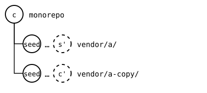
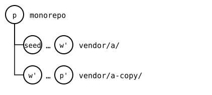

# mirrors: mirrors that swap paths

> **Known bug, [#193](https://github.com/roschaefer/git-splice/issues/193).** This page shows what `git-splice` does today, bug included. See [known bugs and limitations](../../99-known-bugs.md#known-bugs).

Mirrors are one splice, so the rebuild can't tell them apart. Unlike
[independent splices](../02-swapped-splices/README.md),
each path keeps its own history, whichever mirror's files it has now.
After a swap:

- **A push publishes what the path's files never had**: the push of
  `vendor/a/` sends `s: a secret`, then the swap that removes it.
- **The moved commit loses its message and author**: Bob's change
  reaches the upstream as part of `w: swap the mirrors`, by whoever
  committed the swap.
- **The other mirror is then behind and ahead**: its push is refused,
  and a pull merges the two histories.

`status` and `push` say that the mirrors' files differ, and the push
still goes through. With different `.splice` files, the push also undoes
an upstream commit ([swapped after a pull](swapped-after-a-pull.md)).

## Output

<!--
```scrut {fail_fast: true, output_stream: combined}
$ source "$TESTDIR/../../readme-setup.sh"
```
-->

[`setup.bash`](setup.bash) builds this state:

```scrut
$ build_scenario scenario_mirrors
```

`vendor/a/` and its mirror `vendor/a-copy/`, a plain copy with the same
`.splice`:

```scrut
$ git splice clone https://git.example.com/a.git vendor/a
===  vendor/a: fetching https://git.example.com/a.git
ok   vendor/a: cloned bde4164 from main
```

```scrut
$ cp -r vendor/a vendor/a-copy &&
>   git add vendor/a-copy &&
>   git commit -q -m "copy vendor/a"
```

A commit in each mirror, by two authors, not pushed yet:

```scrut
$ echo "not for upstream" >vendor/a/secret.txt &&
>   git add vendor/a &&
>   git commit -q --author "Alice <alice@example.com>" -m "s: a secret"
```

```scrut
$ echo "copy change" >>vendor/a-copy/file.txt &&
>   git commit -q --author "Bob <bob@example.com>" -am "c: copy change"
```

As a tree: `vendor/a/` at `seed`, with *s'* to push, and
`vendor/a-copy/` at `seed`, with *c'*:



<!--
```scrut
$ check_drawing "$TESTDIR/swapped-paths-before.drawio.svg" s=HEAD~1 c=HEAD
ok   swapped-paths-before.drawio.svg: a tree of 3 rows
```
-->

### The swap

```scrut
$ git mv vendor/a tmp &&
>   git mv vendor/a-copy vendor/a &&
>   git mv tmp vendor/a-copy &&
>   git commit -q -m "w: swap the mirrors"
```

The `.splice` files are alike, so the swap changes none of them, only
the files around them:

```scrut
$ git diff --name-status HEAD^ HEAD | tr '\t' ' '
M vendor/a-copy/file.txt
R100 vendor/a/secret.txt vendor/a-copy/secret.txt
M vendor/a/file.txt
```

`vendor/a/` no longer has the secret, and `vendor/a-copy/` has it. Each
path still has its own history. Both read as an ordinary push, and
`status` says that the mirrors' files differ:

```scrut
$ git splice status
On branch main

  ahead 2  vendor/a-copy  files differ from mirror vendor/a
  ahead 2  vendor/a       files differ from mirror vendor/a-copy
```

```scrut
$ git splice log
===  vendor/a-copy (main)
< c161a1b w: swap the mirrors  (Test <test@example.com>)
< 66604fa c: copy change  (Bob <bob@example.com>)
===  vendor/a (main)
< 80aeed5 w: swap the mirrors  (Test <test@example.com>)
< 8249790 s: a secret  (Alice <alice@example.com>)
```

### The push of `vendor/a/`

The push says so too, and pushes:

```scrut
$ git splice push vendor/a
??   vendor/a: files differ from mirror vendor/a-copy
ok   vendor/a: pushed 80aeed5 to main
```

The upstream gets `s: a secret`, by Alice, and its `secret.txt`. Bob's
change comes as part of the swap, without his message, by the swap's
author:

```scrut
$ git -C "$UPSTREAM" log --format='%s  (%an)' --name-status main |
>   tr '\t' ' '
w: swap the mirrors  (Test)

M file.txt
D secret.txt
s: a secret  (Alice)

A secret.txt
seed  (Test)

A file.txt
```

### The other mirror

`vendor/a-copy/` now has commits the upstream lacks, and the other way
around:

```scrut
$ git splice status
On branch main

  ahead 2, behind 2  vendor/a-copy  files differ from mirror vendor/a
  up to date         vendor/a       files differ from mirror vendor/a-copy
```

```scrut
$ git splice push vendor/a-copy
??   vendor/a-copy: files differ from mirror vendor/a
!!   vendor/a-copy: upstream has commits this branch lacks
!!   Failed: vendor/a-copy
[1]
```

A pull merges them, without a conflict, and keeps `secret.txt`:

```scrut
$ git splice pull -m "p: pull the swapped mirror" vendor/a-copy
ok   vendor/a-copy fetched
ok   vendor/a-copy: pulled 80aeed5
```

```scrut
$ ls vendor/a-copy
file.txt
secret.txt
```

```scrut
$ git splice push vendor/a-copy
??   vendor/a-copy: files and .splice differ from mirror vendor/a
ok   vendor/a-copy: pushed 173fba7 to main
```

The upstream has `secret.txt` again, and `c: copy change` with Bob as
its author, once it came with the folder that has it:

```scrut
$ git -C "$UPSTREAM" log --format='%s  (%an)' main
p: pull the swapped mirror  (Test)
w: swap the mirrors  (Test)
w: swap the mirrors  (Test)
c: copy change  (Bob)
s: a secret  (Alice)
seed  (Test)
```

```scrut
$ git -C "$UPSTREAM" ls-tree --name-only main
file.txt
secret.txt
```

`vendor/a/`, without the secret, is behind by the commits that brought
it back:

```scrut
$ git splice status
On branch main

  behind 3    vendor/a       files and .splice differ from mirror vendor/a-copy
  up to date  vendor/a-copy  files and .splice differ from mirror vendor/a
```



<!--
```scrut
$ check_drawing "$TESTDIR/swapped-paths-end.drawio.svg" p=HEAD
ok   swapped-paths-end.drawio.svg: a tree of 3 rows
```
-->

Nothing in the monorepo tells this swap apart from edits that make one
splice look like the other. To avoid it, keep mirrors alike: push one,
and pull the others right away
([mirrors](../../../07-design/07-going-forward/01-mirrors.md#meanwhile-discipline)).
