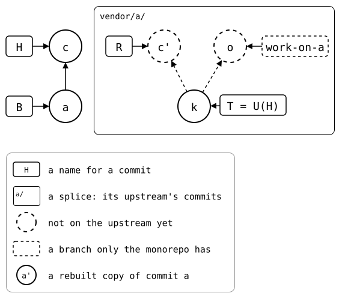

# Writing the docs

Run `just docs-check` to test every page. After an intended change, run
`just docs-check --write` to update their output.

## What belongs where

The chapters before Design explain what the tool does and how to use it.
Include a reason there when it helps a reader use a feature correctly;
keep the full justification in Design and link to it. Concepts defines
behaviour, the command reference gives syntax and output, and scenarios
can explain detailed workflows and edge cases.

Design records why: principles, tradeoffs, rejected alternatives and
mechanisms needed to explain a decision. Its overview states the
principles; subchapters develop their rationale rather than repeat usage.
Behaviour details belong there only when they are needed to understand
the choice, with links to their user-facing definitions.

A decision's bullet should make its purpose clear when skimmed. Its
explanation should say which problem or alternative led to the choice and
what would go wrong if that constraint were ignored. Restating a behaviour
under an imperative heading does not explain its rationale.

For a feature or behaviour change, contributors and AI agents should read
the relevant [Design](../07-design/README.md) principles first. Explain how
the proposal fits them. If it requires a different tradeoff, explicitly
revisit the principle and rationale in the same change; update behaviour
documentation and tests to match. Design guides future work, but is not a
claim that every current implementation detail must remain permanent.

## Markup

Markup in running text tells a reader what kind of thing a word names:
the commit *a*, not the English word "a". Each kind gets one markup,
everywhere.

| What | Markup | Examples |
| --- | --- | --- |
| Anything you can type or `git-splice` prints: commands, options, paths, files, branches, refs (`HEAD` too), config keys, variables, hashes, commit subjects, status output, the name of a tool you run | `monospace` | `git splice push`, `--force`, `.splice`, `main`, `HEAD`, `refs/splices/<key>/`, `$UPSTREAM`, `e849115`, `add vendor/a`, `ahead 1`, `git-splice`, `git subtree`, `git-subrepo` |
| A project's name, where it isn't the command you run | plain | Josh, Sapling, Jujutsu, Copybara |
| A commit, named as a drawing names it, or a variable for one | *italic* | *a*, *d'*, *X* |
| A role: our name for whichever commit plays a part, as `HEAD` names the checked-out one | plain capitals | H, B, T, R |
| Git's name for a part in a three-way merge, which the README uses for a role | *italic*, lowercase | *boundary*, *base*, *ours*, *theirs* |
| A formula | plain, nothing inside marked up | U(H), U(X^), U(e), tracked(feature) |
| A splice | its folder, with a trailing slash | `vendor/a/` |
| A repository | words, never a letter | the monorepo, the upstream of `vendor/a/` |
| A term, where it's defined | *italic*, only there | a splice's history starts at its *mount* |
| Emphasis, and the label that starts a list item or table row | **bold** | **Not prevented yet.** |

A few details:

- A command keeps its spelling, `git splice push`; the tool is
  `git-splice`. A path given as an argument stays as typed:
  `git splice push vendor/a`.
- A commit's subject goes next to its name: *a* (`add vendor/a`).
- A page shows each commit it names: a drawing on the page has it, or
  a code block shows its subject starting with the label, `m: reorganize
  folders`. A reader who lands on the page from a search or a link can't
  look it up on another one. A copy, *b'*, keeps the subject of the
  commit it copies, so only a drawing shows it.
  [`check-drawing labels`](../../check-drawing/)
  checks this for lowercase italics: *X* in capitals is a variable.
- Roles need no markup: no English word is written in capitals, so they
  already stand out. A role you type, like `BOUNDARY` for
  `check_drawing --alias`, is literal there.
- An upstream can also go by its variable or URL in a scenario:
  `$UPSTREAM-b`, `https://git.example.com/b.git`. With one splice inside
  another, they're the outer and the inner upstream; an app and the
  library it splices in are the app's upstream and the library's.
- Page titles, image alt text, labels in a drawing and code blocks get
  no markup.

## Words Git uses too

Git uses "upstream" and "tracking" for several things. Here each word
means one:

- **Upstream** is the repository a splice comes from, and an *upstream
  branch* is one of its branches. Git's upstream branch, the one
  `@{upstream}` names, is a *tracked branch* here.
- **Tracked branch** is the upstream branch that `--track` set for a
  monorepo branch, in `branch.<branch>.splice`; tracked(X) in a formula.
  Never "tracking branch": Git says that for the local branch, and it's
  easily mistaken for a remote-tracking branch. A tracked branch is no
  ref, only a name.
- **Remote-tracking branch** keeps Git's meaning only, a ref like
  `refs/remotes/origin/main`. The refs `git splice fetch` writes,
  `refs/splices/<key>/heads/*`, work like them, but are *splice refs*.

## Commands in scrut blocks

Each step a reader would type gets its own line. A scrut command goes on
from its `$ ` line to the `> ` lines below it:

```text
$ git clone -q https://git.example.com/lib.git ../lib-dev &&
>   echo "fix" >>../lib-dev/src/parse.txt &&
>   git -C ../lib-dev commit -q -a -m "fix parse()"
```

- A chain ends each step with `&&` and indents the next one by two
  spaces. Commands that don't depend on each other go on `> ` lines
  without the indent, instead of after a `;`. Within a step, what a
  `|` pipes into is indented by two more than the step.
- A block shows the output of one step: its last. A reader can't tell
  where one step's output ends and the next one's begins, so a step
  that prints something ends its block, and the next step starts a new
  one.
- A command with many arguments breaks with `\`, and keeps an option
  next to its value.
- A `$(…)` inside another command gets a name first, one from the page
  where there is one: `k="$(…)" && git diff --quiet "$k" …`.
- A script, for `sh -c` or a file, is a heredoc, one command per line.
- A loop over a few fixed steps is written out step by step.
- A config file, `.splice` or `.gitmodules`, is shown whole with `cat`,
  as a reader would see it, not picked apart with `git config --list`.
  Its upstream is reached as an `https://git.example.com/…` URL that
  `url.<path>.insteadOf` maps to `$UPSTREAM`, so the URL and the splice
  id stay the same on every run. `scrut update` writes the file's tabs
  as `\t… (escaped)`: turn them back into tabs.
- A command-reference page gets its structure from `--help`: each help
  section ends in the page section's `See also` link, and that section
  starts by extracting it with [`check-help`](../../check-help/). The hidden
  final check keeps the linked sections and the page's level-two headings
  equal and in order.
- A drawing's [`check_drawing`](../../check-drawing/) goes in a hidden
  block (`<!--` … `-->`): it keeps the drawing true, but a reader
  learns nothing from it. Only a page that explains the check itself,
  like its `--alias`, shows it. A hidden block holds code only, never an
  image: a picture no reader sees is one to show or delete.
- Each checked drawing appears at least once where it shows the current
  state: next to a block that checks it, with only prose between. The
  check runs on the state at that point, so a picture there can't show
  an earlier or later one. Any page may show it elsewhere too, at the
  top or on a concept page.
  [`check-drawing placement`](../../check-drawing/) checks this.
- A drawing's legend, a shape styled `legend=1` below it, explains
  only what the [central legend](#reading-the-drawings) doesn't: the
  colors, each with a sample commit and what it means. An orange outline
  (`#E07000`) marks a change the next rebuild carries across, on both
  ends, a commit R copies and its copy; a grey fill (`#E0E0E0`), where
  the number of commits the rebuild walks matters, the monorepo commits
  on the first-parent history since B; and, the other way, where what
  came in matters, a blue outline (`#0070E0`) each pull the drawing
  shows, at any level: the commit that records it and the upstream
  commits it brought in, so a pulled commit can be followed out through
  the splices around it. A drawing uses a color only with
  its sample in the legend; without, every commit is black and white.
  A legend may add any other mark the drawing needs, e.g. a shaded lane,
  as long as it says what it means; `check_drawing` only checks the
  colors it knows.
  The README's drawing, the first a reader sees, keeps a full legend,
  styled `legend=full`, that explains dashes and primes too. The first
  docs page with a drawing links to the central legend; the others
  don't repeat it. `check_drawing` checks the marks against the legend,
  as it checks the dashes. A drawing of another tool uses them the same way, for the
  commits that tool walks and the ones it carries over, e.g.
  `git subtree split`, with a legend in its words; there
  `check_drawing` can't check them.
- On a page whose commands `cd` into the repository of a splice, e.g. a
  worktree of its rebuild, a drawing shown while they run there shades
  that splice's lane (`#FFF2CC`), keeps the lanes inside it white, and
  says so in its legend: "where the commands run". Each such `cd` gets
  a code block of its own, with a sentence saying where the commands
  run from there on: inside a longer block, it's easy to miss.
- A drawn commit the page makes starts its subject with its label,
  `b: an option in pkg-a`, and a pull or bump gets one with `-m`. The
  output then shows the labels, so the prose doesn't need to name each
  commit's subject. `<label>=<rev>` is for the rest: a rebased or copied
  commit, which keeps another one's message, a commit the shared setup
  makes, and a commit on a branch other than `HEAD`.

## Reading the drawings

The drawings share one language, explained here once. A drawing's own
legend only adds what's unusual on it, like the commits the next rebuild
carries over.

<!--
```scrut {fail_fast: true, output_stream: combined}
$ source "$TESTDIR/../09-scenarios/readme-setup.sh" &&
>   source "$TESTDIR/../09-scenarios/01-everyday-sync/02-up-to-date/setup.bash" &&
>   build_scenario scenario_up_to_date &&
>   git worktree add -q -b work-on-a ../a-work "$(git splice rebuild vendor/a)" &&
>   echo "from the worktree" >../a-work/other.txt &&
>   git -C ../a-work add other.txt &&
>   git -C ../a-work commit -q -m "add other.txt" &&
>   echo "monorepo change" >>vendor/a/file.txt &&
>   git commit -q -am "monorepo change"
```
-->

<div align="center">



</div>

<!--
```scrut
$ check_drawing "$TESTDIR/../09-scenarios/01-everyday-sync/02-up-to-date/central-legend.drawio.svg" \
>   a=HEAD~1 c=HEAD k="$(git config --file vendor/a/.splice splice.commit)" o=work-on-a
ok   central-legend.drawio.svg: 5 commits, 8 arrows, 5 boxes, 1 lanes
```
-->

- A circle is a commit, with its arrows going to the commits made on top
  of it, so history grows away from the oldest commit, *a* or *k* here.
- A box names the commit its arrow points at: H, B, T, R and U(x) of
  the [sync model](../03-concepts/02-sync-model.md), or a branch.
- A lane, a rounded frame named after a folder, is a splice: the
  commits inside are its upstream's, like *k*, and those outside every
  lane the monorepo's, like *a* and *c*. Lanes nest like the folders do.
- Dashed is what no upstream has yet: a commit or the arrow into it,
  like *c'* and *o*. A dashed box names a branch only the monorepo has,
  like `work-on-a`, checked out in a worktree.
- A `'` marks a rebuilt copy: *c'* is the rebuild's copy of the
  monorepo's *c*, with the same changes and message, in the upstream's
  layout.

## The sidebar

The folders in `docs/` are the sidebar. The numbers in their names set
its order, and the site leaves them out of the URLs.

Keep Known bugs last under Scenarios. Its `99-` prefix is reserved;
give new scenario chapters lower numbers.

A page that would be alone in its folder is a file instead, named like
the folder. A folder with several pages has a `README.md`, the page
GitHub shows first. The site lists it first too, as "Overview", and names the folder
after its heading. A README that is a page of its own, like the
installation in `01-getting-started/`, keeps its heading in the sidebar.
Its folder then takes its name from `_category_.json`.
