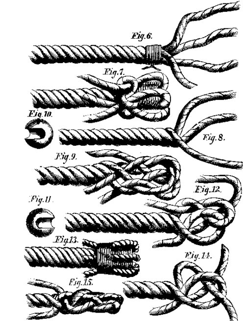

# Why "splice"



*Rope splices, from Scientific American Vol. XXIV No. 12 (1871).
Public domain, via
[Wikimedia Commons](https://commons.wikimedia.org/wiki/File:1871_illustration_rope_splices.png).*

A [splice](https://en.wikipedia.org/wiki/Splice) joins two things into
one: ropes, film, tape, wires, optical fibres, wooden beams, genes. The
name git-splice borrows from all of them.

## Rope splicing

A [rope splice](https://en.wikipedia.org/wiki/Rope_splicing) unlays the
strands of two ropes and weaves each into the other. Unlike a knot, it adds
no lump: the joint has nearly the rope's own diameter and runs through a
block like the rest of the rope.

git-splice works the same way. The upstream's files are woven into the
monorepo as an ordinary folder, with no pointer to another repository and
nothing extra to check out. You see the joint only as one small file,
`<path>/.splice`.

## Noun and verb

As a noun, a splice is the joint: here, the folder together with its
connection to the upstream repository. "The `vendor/a` splice" is the
folder `vendor/a` and the upstream it syncs with.

As a verb, you splice something in or out:

- **splice in**: bring upstream content into the monorepo, with `clone`,
  `merge` and `pull`.
- **splice out**: publish the monorepo's changes upstream, with `push`.

The [vocabulary](design/README.md#vocabulary) defines these and the
other terms.

## RNA splicing

In [RNA splicing](https://en.wikipedia.org/wiki/RNA_splicing), a cell cuts
the introns out of a gene's transcript and joins the remaining exons into
one continuous strand.

`push` does something similar to the monorepo's history. A monorepo commit
may touch the splice and `app/` at once. The rebuild keeps only the part
inside the folder, drops commits that don't touch it, and joins the rest
into a history the upstream can take as its own.

## `Array.prototype.splice`

JavaScript's
[`splice`](https://developer.mozilla.org/en-US/docs/Web/JavaScript/Reference/Global_Objects/Array/splice)
removes and inserts elements in place: unlike `slice`, it changes the
array it is called on.

```js
const files = ["app", "lib", "docs"];
files.splice(1, 1, "lib v2");  // files is now ["app", "lib v2", "docs"]
```

git-splice changes the repository it runs in, too. `pull` merges the
upstream's changes into the folder in place, as an ordinary commit on
your branch, rather than checking them out somewhere else.
