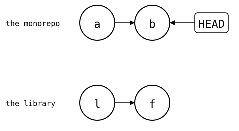
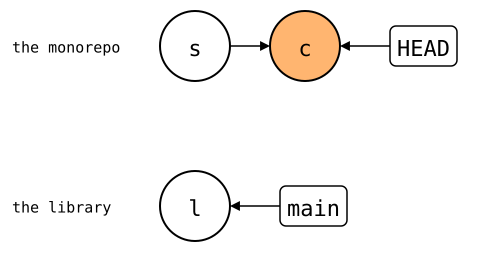

# `git submodule` compared

A submodule keeps the library in its own repository, nested in the
monorepo's worktree. The monorepo commits only the library's URL, in
`.gitmodules`, and one of its commits, as a "gitlink". This page shows
four problems that boundary makes when you fix the library together
with your app: the monorepo doesn't see the library's files, the fix
takes two pushes in the right order, worktrees barely support
submodules, and moving the library's folder leaves colleagues with its
old checkout. Each ends with the same in `git-splice`, and the
page with where submodules are better. First, though, where a submodule
keeps its state, because most of the problems start there.

The setup: `https://git.example.com/lib.git`, a library with 30 commits,
and a monorepo with an app. [How these pages run](README.md).

<!--
```scrut {fail_fast: true, output_stream: combined}
$ source "$TESTDIR/scrut-setup.sh"
```
-->

```scrut
$ git submodule add -q https://git.example.com/lib.git vendor/lib &&
>   git commit -q -m "add lib as a submodule"
```

## Where a submodule keeps its state

`git submodule add` and the commit after it wrote to six places:

<div align="center">


</div>

<!-- Each path the drawing shows exists:
```scrut
$ ls -d .gitmodules vendor/lib/.git .git/objects .git/index .git/config .git/modules/vendor/lib
.git/config
.git/index
.git/modules/vendor/lib
.git/objects
.gitmodules
vendor/lib/.git
```
-->

The commit records the library's commit as a gitlink, an entry of mode
`160000` in the tree:

```scrut
$ git ls-tree HEAD vendor/lib
160000 commit bafd496b1f4512a95b69464604f3da428aa9e33b	vendor/lib
```

`.gitmodules`, committed too, maps the submodule's name to its path and
URL:

```scrut
$ cat .gitmodules
[submodule "vendor/lib"]
	path = vendor/lib
	url = https://git.example.com/lib.git
```

The index has the same entry as the commit. Git ignores its file stats: to see whether
the submodule changed, it compares the submodule's `HEAD` with this
commit:

```scrut
$ git ls-files --stage vendor/lib
160000 bafd496b1f4512a95b69464604f3da428aa9e33b 0	vendor/lib
```

`git submodule add` (in a clone, `git submodule init`) copied the URL
into the monorepo's `.git/config`, and marked the submodule active. A
clone of the submodule uses this copy, not `.gitmodules`:

```scrut
$ git config --get-regexp '^submodule\.'
submodule.vendor/lib.url https://git.example.com/lib.git
submodule.vendor/lib.active true
```

The library's folder has no repository, only a file that points to one:

```scrut
$ cat vendor/lib/.git
gitdir: ../../.git/modules/vendor/lib
```

The repository lives under the monorepo's `.git/modules/`. Its config
points back at the folder, and has a third copy of the URL, which its
fetches use. `git submodule sync` copies `.gitmodules` over the other two:

```scrut
$ git -C vendor/lib config --get-regexp 'core.worktree|remote.origin.url'
core.worktree ../../../../vendor/lib
remote.origin.url https://git.example.com/lib.git
```

So the submodule's state is in the commit, a committed file, the index,
the monorepo's config, a file in the worktree and a repository of its own.
Each worktree adds its own index, pointer file and repository, see
[problem 3](#problem-3-worktrees-barely-support-submodules).

## Problem 1: the monorepo doesn't see the library's files

You fix the library and use the fix in the app, in one go:

```scrut
$ echo "fix" >>vendor/lib/src/parse.txt && echo "call parse()" >>app/main.txt
```

`status` names the changed app file, but only the submodule, not the file
in it:

```scrut
$ git status --short
 M app/main.txt
 m vendor/lib
```

Committing takes two commits, in two repositories. The monorepo's commit
records only that the gitlink moved:

```scrut
$ git -C vendor/lib commit -q -a -m "fix parse()" &&
>   git commit -q -a -m "app: call parse()"
```

```scrut
$ git show --stat --format=%s
app: call parse()

 app/main.txt | 1 +
 vendor/lib   | 2 +-
 2 files changed, 2 insertions(+), 1 deletion(-)
```

The monorepo's *a* (`add lib as a submodule`) records the library's *l*
(`lib commit 30`), and its *b* (`app: call parse()`) records *f* (`fix
parse()`), a commit in the library's own repository:

<div align="center">



</div>

So the monorepo's history of a library file is empty:

```scrut
$ git log --oneline -- vendor/lib/src/parse.txt
```

Git can look inside with `--submodule=diff` for `diff` and `log`, and
with `--recurse-submodules` for `grep`, but `status` has no such option.

### With `git-splice`: one commit, and every command sees the file

The same fix in a splice is one ordinary commit. Here in a copy of the
monorepo from before the submodule:

```scrut
$ cd ../splice-monorepo && git splice clone https://git.example.com/lib.git vendor/lib
===  vendor/lib: fetching https://git.example.com/lib.git
ok   vendor/lib: cloned bafd496 from main
```

```scrut
$ echo "fix" >>vendor/lib/src/parse.txt &&
>   echo "call parse()" >>app/main.txt &&
>   git status --short
 M app/main.txt
 M vendor/lib/src/parse.txt
```

```scrut
$ git commit -q -a -m "fix parse() and call it" && git show --stat --format=%s
fix parse() and call it

 app/main.txt             | 1 +
 vendor/lib/src/parse.txt | 1 +
 2 files changed, 2 insertions(+)
```

One commit *c* (`fix parse() and call it`) after the `clone` commit *s*.
The library has no new commit: its `main` stays at *l* until a push.
That's the difference to the submodule's drawing above, where the fix
needed *f*:

<div align="center">



</div>

<!--
```scrut
$ check_drawing "$TESTDIR/git-submodule-splice-fix.drawio.svg" --alias HEAD=H \
>   s=HEAD~1 c=HEAD l=refs/splices/lib/heads/main
ok   git-submodule-splice-fix.drawio.svg: 3 commits, 3 arrows, 2 boxes
```
-->

```scrut
$ git log --oneline -- vendor/lib/src/parse.txt
22698ef fix parse() and call it
3ab92de splice: clone vendor/lib from main at bafd496
```

```scrut
$ cd ../monorepo
```

## Problem 2: two pushes, in the right order

The monorepo's commit points at a library commit that only exists in this
clone. Push the monorepo first, and colleagues get a commit they can't
check out. (The `grep` drops what the server side prints itself, here
on the same terminal and in a random order with the rest, as the
"server" is a local folder.)

```scrut
$ git clone -q --bare --no-local . ../origin.git &&
>   git clone -q --recurse-submodules ../origin.git ../colleague 2>&1 |
>     grep -v '^fatal: git upload-pack'
fatal: remote error: upload-pack: not our ref a6152f5cee8b2bfd6b5dfc7bbb2bf5d8a7562325
fatal: Fetched in submodule path 'vendor/lib', but it did not contain a6152f5cee8b2bfd6b5dfc7bbb2bf5d8a7562325. Direct fetching of that commit failed.
```

The library's commit has to be pushed first:

```scrut
$ git -C vendor/lib push -q &&
>   rm -rf ../colleague &&
>   git clone -q --recurse-submodules ../origin.git ../colleague &&
>   echo cloned
cloned
```

Here the submodule was on `main`, because `git submodule add` cloned it.
In the colleague's clone, `git submodule update` checked out the
monorepo's recorded commit, on no branch. A fix committed there needs a
branch first (`git switch -c`), or a push as `HEAD:<branch>`:

```scrut
$ git -C ../colleague/vendor/lib status --short --branch
## HEAD (no branch)
```

### With `git-splice`: one push, when the fix is ready

A splice's files are part of the monorepo commit, so a colleague's clone
is complete whether or not the fix reached the library yet. Pushing it
there is a separate step, `git splice push`, for when the fix is ready.

## Problem 3: worktrees barely support submodules

`git worktree add` checks out another branch next to this one. The
submodule stays empty there:

```scrut
$ git worktree add -q ../feature -b feature && ls -A ../feature/vendor/lib
```

```scrut
$ git -C ../feature submodule status
-a6152f5cee8b2bfd6b5dfc7bbb2bf5d8a7562325 vendor/lib
```

Each worktree initializes its submodules on its own, with its own clone of
the library, under `.git/worktrees/<name>/modules/`:

```scrut
$ git -C ../feature submodule update -q --init && cat ../feature/vendor/lib/.git
gitdir: ../../../monorepo/.git/worktrees/feature/modules/vendor/lib
```

The submodule's own repository, with its own `.git/config`, is separate
in each worktree. But the monorepo's settings for the submodule,
`submodule.<name>.*` like its URL, live in the monorepo's `.git/config`,
which all worktrees share. A change in one worktree changes the others:

```scrut
$ git -C ../feature config submodule.vendor/lib.url https://git.example.com/lib-fork.git &&
>   git config submodule.vendor/lib.url
https://git.example.com/lib-fork.git
```

```scrut
$ git config submodule.vendor/lib.url https://git.example.com/lib.git
```

And Git refuses to move a worktree that has submodules, and removes it
only with `--force`:

```scrut
$ git worktree move ../feature ../feature-2
fatal: working trees containing submodules cannot be moved or removed
[128]
```

```scrut
$ git worktree remove ../feature
fatal: working trees containing submodules cannot be moved or removed
[128]
```

```scrut
$ git worktree remove --force ../feature && echo removed
removed
```

Git's documentation says so too: "Multiple checkout in general is still
experimental, and the support for submodules is incomplete. It is NOT
recommended to make multiple checkouts of a superproject."
([`git worktree`, BUGS](https://git-scm.com/docs/git-worktree#_bugs))

### With `git-splice`: the files are in every worktree

A splice lives in the worktree. A new worktree has it, with nothing to
initialize. The fix from `main` isn't upstream yet, so a push from
`feature` would bring it along:

```scrut
$ cd ../splice-monorepo &&
>   git worktree add -q ../splice-feature -b feature &&
>   cd ../splice-feature &&
>   git splice status
On branch feature

  new, ahead 1  vendor/lib  push creates the branch
```

What `git-splice` keeps outside the worktree, the fetched upstream
branches under `refs/splices/`, is shared by all worktrees, like
`refs/remotes/`: it describes the upstream, which is the same from every
worktree. A push from one worktree is seen by the others:

```scrut
$ echo "fix 2" >>vendor/lib/src/parse.txt &&
>   git commit -q -a -m "fix 2" &&
>   git splice push vendor/lib
??   vendor/lib: upstream has no 'feature' branch yet -- this push creates it
ok   vendor/lib: pushed 6b3df25 to feature
```

```scrut
$ cd ../splice-monorepo && git for-each-ref --format='%(refname)' refs/splices
refs/splices/lib/heads/feature
refs/splices/lib/heads/main
```

```scrut
$ git worktree remove ../splice-feature && echo removed
removed
```

One limit: two fetches at the same time, in two worktrees, may both try to
move the same ref. Then one fails with `cannot lock ref`, and running it
again fixes it, as with two `git fetch` at once.

## Problem 4: moving the library's folder

`git mv` moves a submodule, once the folder it moves into exists. It
updates `path` in `.gitmodules`, but the submodule keeps its name,
`vendor/lib`, and its repository stays under `.git/modules/vendor/lib/`:

```scrut
$ cd ../monorepo &&
>   mkdir libs &&
>   git mv vendor/lib libs/lib &&
>   cat .gitmodules
[submodule "vendor/lib"]
	path = libs/lib
	url = https://git.example.com/lib.git
```

```scrut
$ cat libs/lib/.git
gitdir: ../../.git/modules/vendor/lib
```

The colleague from [problem 2](#problem-2-two-pushes-in-the-right-order)
pulls the move. The new folder is empty, and the old one stays, a full
checkout that Git now lists as untracked:

```scrut
$ git commit -q -m "move lib to libs/" &&
>   git push -q ../origin.git main &&
>   cd ../colleague &&
>   git pull -q &&
>   git status --short
warning: unable to rmdir 'vendor/lib': Directory not empty
?? vendor/
```

```scrut
$ git submodule status
-a6152f5cee8b2bfd6b5dfc7bbb2bf5d8a7562325 libs/lib
```

`git submodule update --init` fills the new folder. The old one has to be
deleted by hand:

```scrut
$ git submodule update -q --init && ls libs/lib
src
```

```scrut
$ git status --short
?? vendor/
```

### With `git-splice`: a move like any other

A splice is ordinary files and its `.splice`, which records no path.
`git mv` moves it, and a colleague's pull moves its files like any other
rename. `status` finds it in its new folder, still ahead by the fix *c*
from problem 1:

```scrut
$ cd ../splice-monorepo &&
>   mkdir libs &&
>   git mv vendor/lib libs/lib &&
>   git commit -q -m "move lib to libs/" &&
>   git splice status
On branch main

  ahead 1  libs/lib
```

## Where submodules are better

- **The library's files stay out of the monorepo's history.** A clone
  that doesn't need them, `git clone` without `--recurse-submodules`,
  doesn't download them. A splice's files are monorepo content, in every
  clone. `update = none` in `.gitmodules` keeps a submodule out even of
  `git submodule update --init --recursive`; `git splice clone
  --from-submodule` refuses such a submodule rather than adding files no
  checkout had.
- **The commit pins an exact upstream revision.** A splice's commit is
  where it last matched upstream; the folder may have changed since.
- **Access stays separate.** The library can be private while the
  monorepo isn't, or the other way round.
- **Settings can be overridden per clone.** Pointing a submodule at a
  mirror or fork takes a `git config` change, not a commit. A splice's URL
  is committed in `.splice`, but `url.<base>.insteadOf` overrides it the
  same way, without a commit, as these pages do to reach
  `https://git.example.com/` on this machine:

```scrut
$ git config --get-regexp 'url\..*insteadof'
url.$COMPARISON/upstream/.insteadof https://git.example.com/
```
