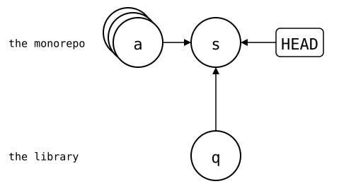
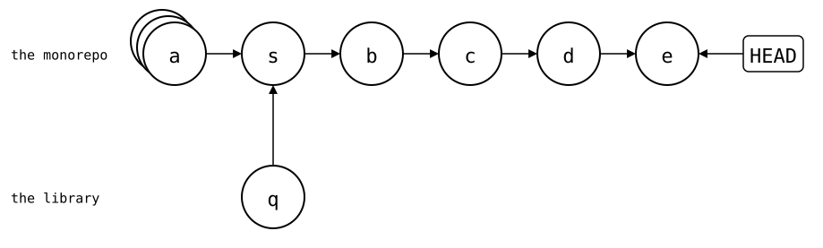
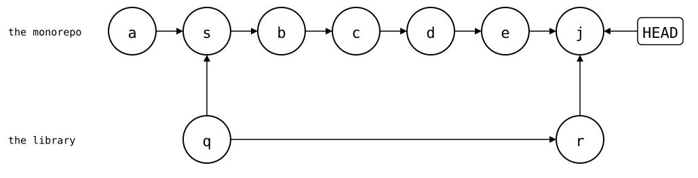
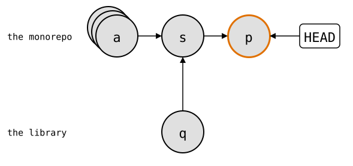
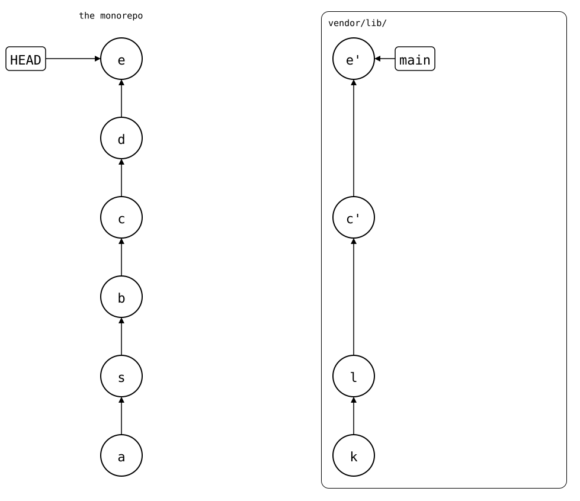

# `git subtree` compared

[`git subtree`](https://github.com/git/git/blob/master/contrib/subtree/git-subtree.adoc)
puts the library's files into a folder of the monorepo, like a splice.
`add` and `pull` merge the library's history into the monorepo's, either
whole or squashed into one commit. `split` and `push` turn the monorepo's
commits that touched the folder back into library commits.

`git-splice` started as a wrapper around `git subtree`, and stopped
because of two problems this page shows: without `--squash`, the
library's whole history comes into the monorepo; with it, `split` walks
the monorepo's whole history on every push. After them, the same with
`git-splice`, and where `git subtree` is the better tool.

The setup: `https://git.example.com/lib.git`, a library with 30 commits by
three developers, and a monorepo with an app and 40 commits.
[How these pages run](README.md).

<!--
```scrut {fail_fast: true, output_stream: combined}
$ source "$TESTDIR/scrut-setup.sh"
```
-->

```scrut
$ git branch before-lib && git rev-list --count HEAD
40
```

## Problem 1: the library's whole history comes in

Without `--squash`, `add` merges all of the library's commits into the
monorepo:

```scrut
$ git subtree add -q --prefix=vendor/lib https://git.example.com/lib.git main
git fetch https://git.example.com/lib.git main
From $COMPARISON/upstream/lib
 * branch            main       -> FETCH_HEAD
```

```scrut
$ git rev-list --count HEAD
71
```

```scrut
$ git log --graph --format=%s -4
*   Add 'vendor/lib/' from commit 'bafd496b1f4512a95b69464604f3da428aa9e33b'
|\  
| * lib commit 30
| * lib commit 29
| * lib commit 28
```

The monorepo doesn't need those 30 commits: it uses the library, it
doesn't develop it. What it does need, the changes that fit the library
into the app, are its own commits anyway.

That's the price for `split` to scale: it can start at the newest
library commit the monorepo has, and walks only the commits since.

## Problem 2: with `--squash`, `split` walks everything

`--squash` keeps the library's history out: `add` merges a single commit
with the library's files:

```scrut
$ git switch -q -c squashed before-lib &&
>   git subtree add -q --squash --prefix=vendor/lib https://git.example.com/lib.git main
git fetch https://git.example.com/lib.git main
From $COMPARISON/upstream/lib
 * branch            main       -> FETCH_HEAD
```

```scrut
$ git rev-list --count HEAD
42
```

It's still a merge, so the history isn't linear. `add` makes two
commits: *q* (`Squashed 'vendor/lib/' content from commit bafd496`),
the library's files without parents, and the merge *s*, with *a* (`app
commit 40`) and *q* as its parents:

<div align="center">



</div>

<!--
```scrut
$ check_drawing "$TESTDIR/git-subtree-squash-add.drawio.svg" --alias HEAD=H \
>   a=before-lib s=HEAD q=HEAD^2
ok   git-subtree-squash-add.drawio.svg: 3 commits, 3 arrows, 1 boxes
```
-->

*q* has the library's files at its root, as the library has them. The
merge *s* is what puts them into `vendor/lib/`:

```scrut
$ git ls-tree --name-only HEAD^2
src
```

Two fixes to the library, between app commits:

```scrut
$ echo "app commit 41" >>app/main.txt && git commit -q -a -m "app commit 41" &&
>   echo "lib fix 1" >>vendor/lib/src/parse.txt && git commit -q -a -m "lib fix 1" &&
>   echo "app commit 42" >>app/main.txt && git commit -q -a -m "app commit 42" &&
>   echo "lib fix 2" >>vendor/lib/src/parse.txt && git commit -q -a -m "lib fix 2"
```

The monorepo's history now, with the four new commits after *s*: *b*
(`app commit 41`), *c* (`lib fix 1`), *d* (`app commit 42`) and *e*
(`lib fix 2`):

<div align="center">



</div>

<!--
```scrut
$ check_drawing "$TESTDIR/git-subtree-squashed.drawio.svg" --alias HEAD=H \
>   a=before-lib s=HEAD~4 b=HEAD~3 c=HEAD~2 d=HEAD~1 e=HEAD q=HEAD~4^2
ok   git-subtree-squashed.drawio.svg: 7 commits, 7 arrows, 1 boxes
```
-->

Now `split` knows no library commit in the monorepo's history to start
from, so it walks all of it, every time, though only *c* and *e* touched
the library:

```scrut
$ subtree_split_walks vendor/lib
46
```

```scrut
$ git rev-list --count HEAD
46
```

### With `--rejoin`, a merge for every push, which a squash merge drops

`split --rejoin` merges the split result back into the monorepo, as a
starting point for the next `split`. With `--squash`, the result comes
in as a single commit too:

```scrut
$ git subtree split --rejoin --squash --prefix=vendor/lib
Merge made by the 'ort' strategy.
48108daa0f798109c3e672ed47a7de6204cf4e02
```

`48108da` is the library commit with the two fixes, the same one
`git splice push` makes [below](#how-git-splice-avoids-both). The merge
*j* (`Split 'vendor/lib/' into commit
'48108daa0f798109c3e672ed47a7de6204cf4e02'`) has *r* (`Squashed
'vendor/lib/' changes from bafd496..48108da`) as its second parent, on
top of *q*:

<div align="center">



</div>

<!--
```scrut
$ check_drawing "$TESTDIR/git-subtree-rejoin.drawio.svg" --alias HEAD=H \
>   a=before-lib s=HEAD^~4 b=HEAD^~3 c=HEAD^~2 d=HEAD^~1 e=HEAD^ j=HEAD \
>   q=HEAD^~4^2 r=HEAD^2
ok   git-subtree-rejoin.drawio.svg: 9 commits, 10 arrows, 1 boxes
```
-->

The next `split` starts at *r*, and walks only the few commits since:

```scrut
$ subtree_split_walks vendor/lib
3
```

That's one more merge commit for every push. And where a pull request is
squash-merged, *j* never reaches the branch it's merged into.
Squash-merged on top of *s*, that branch gets one commit *p* (`lib fixes
(#1)`) with the fixes, and neither *j* nor *r*:

```scrut
$ git switch -q -c squash-merged "HEAD^~4" &&
>   git merge -q --squash squashed >/dev/null &&
>   git commit -q -m "lib fixes (#1)"
```

<div align="center">



</div>

<!--
```scrut
$ check_drawing "$TESTDIR/git-subtree-squash-merged.drawio.svg" --alias HEAD=H \
>   a=before-lib s=HEAD~1 p=HEAD q=HEAD~1^2
ok   git-subtree-squash-merged.drawio.svg: 4 commits, 4 arrows, 1 boxes
```
-->

So the next `split` from there walks all of the monorepo's history
again:

```scrut
$ subtree_split_walks vendor/lib
43
```

## How `git-splice` avoids both

In a copy of the monorepo from before the library, `clone` adds one
ordinary commit, and the history stays linear. It also adds
`vendor/lib/.splice`, which stays in the monorepo: `push` never sends it
to the library.

```scrut
$ cd ../splice-monorepo && git splice clone https://git.example.com/lib.git vendor/lib
===  vendor/lib: fetching https://git.example.com/lib.git
ok   vendor/lib: cloned bafd496 from main
```

```scrut
$ git rev-list --count HEAD
41
```

```scrut
$ git log --graph --format=%s -3
* splice: clone vendor/lib from main at bafd496
* app commit 40
* app commit 39
```

The same two fixes:

```scrut
$ echo "app commit 41" >>app/main.txt && git commit -q -a -m "app commit 41" &&
>   echo "lib fix 1" >>vendor/lib/src/parse.txt && git commit -q -a -m "lib fix 1" &&
>   echo "app commit 42" >>app/main.txt && git commit -q -a -m "app commit 42" &&
>   echo "lib fix 2" >>vendor/lib/src/parse.txt && git commit -q -a -m "lib fix 2"
```

`push` only looks at the commits since the boundary, usually the newest
commit that changed `.splice`: the last `clone` or `pull`. It doesn't need the
library's history in the monorepo, nor the monorepo's history before that
commit. These are the commits it walks, following first parents:

```scrut
$ boundary="$(git log -1 --format=%H -- vendor/lib/.splice)" &&
>   git log --first-parent --format=%s "$boundary"..HEAD
lib fix 2
app commit 42
lib fix 1
app commit 41
```

It rebuilds the two that changed the library on top of the library's
history:

```scrut
$ git splice push vendor/lib
ok   vendor/lib: pushed 48108da to main
```

The monorepo's history stays a line, with the `clone` commit *s* in
place of the merge. The library's `main` gets *c'* and *e'*, rebuilt
from *c* and *e*, on top of the library's last commits *k* and *l*
(`lib commit 29` and `lib commit 30`):

<div align="center">



</div>

<!--
```scrut
$ check_drawing "$TESTDIR/git-subtree-splice.drawio.svg" --alias HEAD=H \
>   a=HEAD~5 s=HEAD~4 b=HEAD~3 c=HEAD~2 d=HEAD~1 e=HEAD \
>   k=refs/splices/lib/main~3 l=refs/splices/lib/main~2
ok   git-subtree-splice.drawio.svg: 10 commits, 10 arrows, 2 boxes
```
-->

Like `--squash`, a splice keeps the library's history out of the
monorepo's. It's still at hand, fetched under `refs/splices/lib/`:

```scrut
$ git log --oneline -4 refs/splices/lib/main
48108da lib fix 2
0579a80 lib fix 1
bafd496 lib commit 30
eacfd66 lib commit 29
```

## Where `git subtree` is the better tool

Moving a repository into the monorepo for good, and retiring its old
home. Without `--squash`, its history comes along, as in
[problem 1](#problem-1-the-librarys-whole-history-comes-in), and `git
blame` follows each line into the commits that made it.
