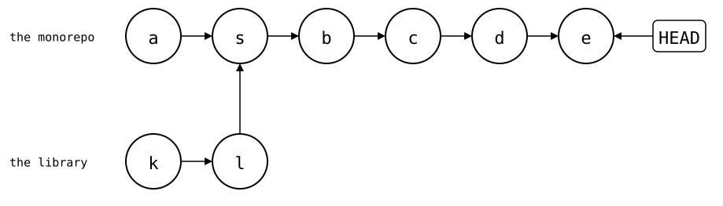

# `git subtree` compared

[`git subtree`](https://github.com/git/git/blob/master/contrib/subtree/git-subtree.adoc)
puts the library's files into a folder of the monorepo, like a splice.
`add` and `pull` merge the library's history into the monorepo's, either
whole or squashed into one commit. `split` and `push` turn the monorepo's
commits that touched the folder back into library commits. This page shows
what each costs, and where `git subtree` is the better tool.

The setup: `https://git.example.com/lib.git`, a library with 30 commits by
three developers, and a monorepo with an app and 40 commits.
[How these pages run](README.md).

<!--
```scrut {fail_fast: true, output_stream: combined}
$ source "$TESTDIR/scrut-setup.sh"
```
-->

```scrut
$ git branch before-lib && git rev-list --count HEAD
40
```

## The whole history

Without `--squash`, `add` merges all of the library's commits into the
monorepo:

```scrut
$ git subtree add -q --prefix=vendor/lib https://git.example.com/lib.git main
git fetch https://git.example.com/lib.git main
From $COMPARISON/upstream/lib
 * branch            main       -> FETCH_HEAD
```

```scrut
$ git rev-list --count HEAD
71
```

```scrut
$ git log --graph --format=%s -4
*   Add 'vendor/lib/' from commit 'bafd496b1f4512a95b69464604f3da428aa9e33b'
|\  
| * lib commit 30
| * lib commit 29
| * lib commit 28
```

The library's commits keep their authors, and `git blame` follows each
line into them, to the path the file had in the library:

```scrut
$ git blame -L 1,3 vendor/lib/src/parse.txt
^136dd00 src/parse.txt (Lib Dev 2 2026-01-01 00:00:00 +0000 1) line 1
b7c06ff8 src/parse.txt (Lib Dev 3 2026-01-01 00:00:00 +0000 2) line 2
0089dc84 src/parse.txt (Lib Dev 1 2026-01-01 00:00:00 +0000 3) line 3
```

`git log` limited to the folder doesn't cross into them, though. The
library's commits had no `vendor/lib/`, so the folder's log starts at the
merge:

```scrut
$ git log --oneline -- vendor/lib
83c95bf Add 'vendor/lib/' from commit 'bafd496b1f4512a95b69464604f3da428aa9e33b'
```

This is where `git subtree` is the right tool: moving a repository into
the monorepo for good, and retiring its old home. The history, and `git
blame` with it, comes along.

### What `split` walks

Two fixes to the library, between app commits:

```scrut
$ echo "app commit 41" >>app/main.txt && git commit -q -a -m "app commit 41" &&
>   echo "lib fix 1" >>vendor/lib/src/parse.txt && git commit -q -a -m "lib fix 1" &&
>   echo "app commit 42" >>app/main.txt && git commit -q -a -m "app commit 42" &&
>   echo "lib fix 2" >>vendor/lib/src/parse.txt && git commit -q -a -m "lib fix 2"
```

The monorepo's history now: *a* (`app commit 40`), the merge *s* that
`add` made, with the library's last commits *k* and *l* (`lib commit 29`
and `lib commit 30`) as its second parent, and the four new commits *b*,
*c*, *d* and *e*:

<div align="center">



</div>

```scrut
$ check_drawing "$TESTDIR/git-subtree-whole-history.drawio.svg" --alias HEAD=H \
>   a=before-lib s=HEAD~4 b=HEAD~3 c=HEAD~2 d=HEAD~1 e=HEAD k=HEAD~4^2~1 l=HEAD~4^2
ok   git-subtree-whole-history.drawio.svg: 8 commits, 8 arrows, 1 boxes
```

`split` rebuilds library commits from the monorepo's commits. It starts
from the newest commit it already knows, and here those are the library
commits that `add` imported. So it walks only the few commits since:

```scrut
$ subtree_split_walks vendor/lib
7
```

## Squashed

`--squash` keeps the library's history out: `add` merges a single commit
with the library's files:

```scrut
$ git switch -q -c squashed before-lib &&
>   git subtree add -q --squash --prefix=vendor/lib https://git.example.com/lib.git main
git fetch https://git.example.com/lib.git main
From $COMPARISON/upstream/lib
 * branch            main       -> FETCH_HEAD
```

```scrut
$ git rev-list --count HEAD
42
```

It's still a merge, so the history isn't linear, and `git blame` stops at
the squashed commit:

```scrut
$ git log --graph --format=%s -3
*   Merge commit '8e0bc3b1b1c045b4dc98c2fc7d471a64fae6a2b7' as 'vendor/lib'
|\  
| * Squashed 'vendor/lib/' content from commit bafd496
* app commit 40
```

```scrut
$ git blame -s -L 1,3 vendor/lib/src/parse.txt
^8e0bc3b src/parse.txt 1) line 1
^8e0bc3b src/parse.txt 2) line 2
^8e0bc3b src/parse.txt 3) line 3
```

The same two fixes:

```scrut
$ echo "app commit 41" >>app/main.txt && git commit -q -a -m "app commit 41" &&
>   echo "lib fix 1" >>vendor/lib/src/parse.txt && git commit -q -a -m "lib fix 1" &&
>   echo "app commit 42" >>app/main.txt && git commit -q -a -m "app commit 42" &&
>   echo "lib fix 2" >>vendor/lib/src/parse.txt && git commit -q -a -m "lib fix 2"
```

In place of the library's history, the merge *s* has *q* (`Squashed
'vendor/lib/' content from commit bafd496`) as its second parent, a
commit with the library's files and no parent of its own:

<div align="center">


</div>

```scrut
$ check_drawing "$TESTDIR/git-subtree-squashed.drawio.svg" --alias HEAD=H \
>   a=before-lib s=HEAD~4 b=HEAD~3 c=HEAD~2 d=HEAD~1 e=HEAD q=HEAD~4^2
ok   git-subtree-squashed.drawio.svg: 7 commits, 7 arrows, 1 boxes
```

Now `split` knows no library commit in the monorepo's history to start
from, so it walks all of it, every time, though only two commits touched
the library:

```scrut
$ subtree_split_walks vendor/lib
> git rev-list --count HEAD
46
46
```

`split --rejoin` avoids that: it merges the split result back into the
monorepo, as a sync point for the next `split`. That's one more merge
commit for every push, and a pull request that's squash-merged drops it,
with the sync point.

## The same with `git-splice`

In a copy of the monorepo from before the library, `clone` adds one
ordinary commit, and the history stays linear:

```scrut
$ cd ../splice-monorepo && git splice clone https://git.example.com/lib.git vendor/lib
===  vendor/lib: fetching https://git.example.com/lib.git
ok   vendor/lib: cloned bafd496 from main
```

```scrut
$ git rev-list --count HEAD
> git log --graph --format=%s -3
41
* splice: clone vendor/lib from main at bafd496
* app commit 40
* app commit 39
```

The same two fixes:

```scrut
$ echo "app commit 41" >>app/main.txt && git commit -q -a -m "app commit 41" &&
>   echo "lib fix 1" >>vendor/lib/src/parse.txt && git commit -q -a -m "lib fix 1" &&
>   echo "app commit 42" >>app/main.txt && git commit -q -a -m "app commit 42" &&
>   echo "lib fix 2" >>vendor/lib/src/parse.txt && git commit -q -a -m "lib fix 2"
```

`push` only looks at the commits since the boundary, usually the newest
commit that changed `.splice`: the last `clone` or `pull`. It doesn't need the
library's history in the monorepo, nor the monorepo's history before that
commit. These are the commits it walks, following first parents:

```scrut
$ git log --first-parent --format=%s "$(git log -1 --format=%H -- vendor/lib/.splice)"..HEAD
lib fix 2
app commit 42
lib fix 1
app commit 41
```

It rebuilds the two that changed the library on top of the library's
history:

```scrut
$ git splice push vendor/lib
ok   vendor/lib: pushed 48108da to main
```

```scrut
$ git -C "$COMPARISON/upstream/lib.git" log --format=%s -4 main
lib fix 2
lib fix 1
lib commit 30
lib commit 29
```

The monorepo's history stays a line, with the `clone` commit *s* in
place of the merge. The library's `main` gets *c'* and *e'*, rebuilt
from *c* and *e*, on top of *l*:

<div align="center">


</div>

```scrut
$ check_drawing "$TESTDIR/git-subtree-splice.drawio.svg" --alias HEAD=H \
>   a=HEAD~5 s=HEAD~4 b=HEAD~3 c=HEAD~2 d=HEAD~1 e=HEAD \
>   k=refs/splices/lib/main~3 l=refs/splices/lib/main~2
ok   git-subtree-splice.drawio.svg: 10 commits, 10 arrows, 2 boxes
```

Like `--squash`, a splice keeps the library's history out of the
monorepo, so `git blame` stops at the `clone`:

```scrut
$ git blame -s -L 1,3 vendor/lib/src/parse.txt
3ab92de9 1) line 1
3ab92de9 2) line 2
3ab92de9 3) line 3
```

The library's history is still at hand, fetched under
`refs/splices/lib/`, but not part of the monorepo's.
