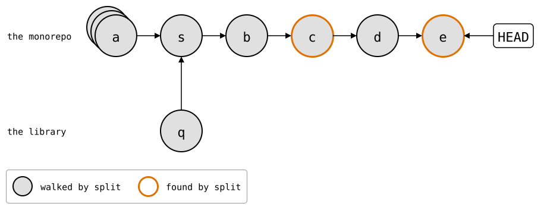
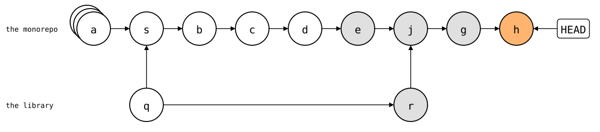

# `git subtree` compared

[`git subtree`](https://github.com/git/git/blob/master/contrib/subtree/git-subtree.adoc)
puts the library's files into a folder of the monorepo, like a splice.
`add` and `pull` merge the library's history into the monorepo's, either
whole or squashed into one commit. `split` and `push` turn the monorepo's
commits that touched the folder back into library commits.

`git-splice` started as a wrapper around `git subtree`, and stopped
because of two problems this page shows: without `--squash`, the
library's whole history comes into the monorepo; with it, `split` walks
the monorepo's whole history on every push. After them, the same with
`git-splice`, and where `git subtree` is the better tool.

The setup: `https://git.example.com/lib.git`, a library with 30 commits by
three developers, and a monorepo with an app and 40 commits.
[How these pages run](README.md).

<!--
```scrut {fail_fast: true, output_stream: combined}
$ source "$TESTDIR/scrut-setup.sh"
```
-->

```scrut
$ git branch before-lib
```

```scrut
$ git rev-list --count HEAD
40
```

## Problem 1: the library's whole history comes in

Without `--squash`, `add` merges all of the library's commits into the
monorepo:

```scrut
$ git subtree add -q --prefix=vendor/lib https://git.example.com/lib.git main
git fetch https://git.example.com/lib.git main
From $COMPARISON/upstream/lib
 * branch            main       -> FETCH_HEAD
```

```scrut
$ git rev-list --count HEAD
71
```

```scrut
$ git log --graph --format=%s -4
*   Add 'vendor/lib/' from commit 'bafd496b1f4512a95b69464604f3da428aa9e33b'
|\  
| * lib commit 30
| * lib commit 29
| * lib commit 28
```

The monorepo doesn't need those 30 commits: it uses the library, it
doesn't develop it. What it does need, the changes that fit the library
into the app, are its own commits anyway.

That's the price for `split` to scale: it can start at the newest
library commit the monorepo has, and walks only the commits since. It
finds where in the commit messages: every commit `add`, `pull` and
`split --rejoin` make names the folder in a `git-subtree-dir:` line,
and `split` looks for those. The merge's message also names a monorepo
commit, its first parent *a* (`app commit 40`), as
`git-subtree-mainline:`, and the library commit that commit's history
maps to, as `git-subtree-split:`:

```scrut
$ git log -1 --format=%B | grep '^git-subtree-'
git-subtree-dir: vendor/lib
git-subtree-mainline: 7de219808bfd601897cdad67aa5c90b5a2e9bce8
git-subtree-split: bafd496b1f4512a95b69464604f3da428aa9e33b
```

From there on, `split` knows the monorepo's history already, and walks
only what came after.

## Problem 2: with `--squash`, `split` walks everything

`--squash` keeps the library's history out: `add` merges a single commit
with the library's files:

```scrut
$ git switch -q -c squashed before-lib &&
>   git subtree add -q --squash --prefix=vendor/lib https://git.example.com/lib.git main
git fetch https://git.example.com/lib.git main
From $COMPARISON/upstream/lib
 * branch            main       -> FETCH_HEAD
```

```scrut
$ git rev-list --count HEAD
42
```

It's still a merge, so the history isn't linear. `add` makes two
commits: *q* (`Squashed 'vendor/lib/' content from commit bafd496`),
the library's files without parents, and the merge *s*, with *a* (`app
commit 40`) and *q* as its parents. *a* is drawn as a stack: it stands
for the 40 app commits in a line, which the drawings leave out:

<div align="center">


</div>

<!--
```scrut
$ check_drawing "$TESTDIR/git-subtree-squash-add.drawio.svg" --alias HEAD=H \
>   a=before-lib s=HEAD q=HEAD^2
ok   git-subtree-squash-add.drawio.svg: 3 commits, 3 arrows, 1 boxes
```
-->

*q* has the library's files at its root, as the library has them. The
merge *s* is what puts them into `vendor/lib/`:

```scrut
$ git ls-tree --name-only HEAD^2
src
```

Two fixes to the library, between app commits:

```scrut
$ echo "app commit 41" >>app/main.txt && git commit -q -a -m "app commit 41" &&
>   echo "lib fix 1" >>vendor/lib/src/parse.txt && git commit -q -a -m "lib fix 1" &&
>   echo "app commit 42" >>app/main.txt && git commit -q -a -m "app commit 42" &&
>   echo "lib fix 2" >>vendor/lib/src/parse.txt && git commit -q -a -m "lib fix 2"
```

The monorepo's history now, with the four new commits after *s*: *b*
(`app commit 41`), *c* (`lib fix 1`), *d* (`app commit 42`) and *e*
(`lib fix 2`):

<div align="center">


</div>

<!--
```scrut
$ check_drawing "$TESTDIR/git-subtree-squashed.drawio.svg" --alias HEAD=H \
>   a=before-lib s=HEAD~4 b=HEAD~3 c=HEAD~2 d=HEAD~1 e=HEAD q=HEAD~4^2
ok   git-subtree-squashed.drawio.svg: 7 commits, 7 arrows, 1 boxes
```
-->

Now `split` knows no library commit in the monorepo's history to start
from. *q*'s message names the library commit it squashes, but no
`git-subtree-mainline:`, no monorepo commit up to which the history is
known:

```scrut
$ git log -1 --format=%B HEAD~4^2 | grep '^git-subtree-'
git-subtree-dir: vendor/lib
git-subtree-split: bafd496b1f4512a95b69464604f3da428aa9e33b
```

So `split` walks all of it, every time, though only *c* and *e* touched
the library:

```scrut
$ subtree_split_walks vendor/lib
46
```

```scrut
$ git rev-list --count HEAD
46
```

The ones `split` finds are those that changed `vendor/lib/`. The stack
*a* is all 40 app commits:

<div align="center">



</div>

<!--
```scrut
$ check_drawing "$TESTDIR/git-subtree-split-walks.drawio.svg" --alias HEAD=H \
>   a=before-lib s=HEAD~4 b=HEAD~3 c=HEAD~2 d=HEAD~1 e=HEAD q=HEAD~4^2
ok   git-subtree-split-walks.drawio.svg: 7 commits, 7 arrows, 1 boxes
```
-->

### With `--rejoin`, a merge for every push, which a squash merge drops

`split --rejoin` merges the split result back into the monorepo, as a
starting point for the next `split`. With `--squash`, the result comes
in as a single commit too:

```scrut
$ git subtree split --rejoin --squash --prefix=vendor/lib
Merge made by the 'ort' strategy.
48108daa0f798109c3e672ed47a7de6204cf4e02
```

`48108da` is the library commit with the two fixes, the same one
`git splice push` makes [below](#how-git-splice-avoids-both). The merge
*j* (`Split 'vendor/lib/' into commit
'48108daa0f798109c3e672ed47a7de6204cf4e02'`) has *r* (`Squashed
'vendor/lib/' changes from bafd496..48108da`) as its second parent, on
top of *q*:

<div align="center">


</div>

<!--
```scrut
$ check_drawing "$TESTDIR/git-subtree-rejoin.drawio.svg" --alias HEAD=H \
>   a=before-lib s=HEAD^~4 b=HEAD^~3 c=HEAD^~2 d=HEAD^~1 e=HEAD^ j=HEAD \
>   q=HEAD^~4^2 r=HEAD^2
ok   git-subtree-rejoin.drawio.svg: 9 commits, 10 arrows, 1 boxes
```
-->

*j*'s message has what *q*'s lacks, a `git-subtree-mainline:`, here
*e*:

```scrut
$ git log -1 --format=%B | grep '^git-subtree-'
git-subtree-dir: vendor/lib
git-subtree-mainline: 9d3cc6061455cb38432ce9846218e1227e4771be
git-subtree-split: 48108daa0f798109c3e672ed47a7de6204cf4e02
```

The next `split` starts there, and walks only the few commits since:

```scrut
$ subtree_split_walks vendor/lib
3
```

After two more commits, *g* (`app commit 43`) and *h* (`lib fix 3`),
it walks only these, from *e*, the merge's first parent, on:

```scrut
$ git switch -q -c rejoined &&
>   echo "app commit 43" >>app/main.txt && git commit -q -a -m "app commit 43" &&
>   echo "lib fix 3" >>vendor/lib/src/parse.txt && git commit -q -a -m "lib fix 3" &&
>   subtree_split_walked vendor/lib
lib fix 2
Squashed 'vendor/lib/' changes from bafd496..48108da
Split 'vendor/lib/' into commit '48108daa0f798109c3e672ed47a7de6204cf4e02'
app commit 43
lib fix 3
```

<div align="center">



</div>

<!--
```scrut
$ check_drawing "$TESTDIR/git-subtree-rejoin-walks.drawio.svg" --alias HEAD=H \
>   a=before-lib s=HEAD~7 b=HEAD~6 c=HEAD~5 d=HEAD~4 e=HEAD~3 j=HEAD~2 \
>   g=HEAD~1 h=HEAD q=HEAD~7^2 r=HEAD~2^2
ok   git-subtree-rejoin-walks.drawio.svg: 11 commits, 13 arrows, 1 boxes
```
-->

<!-- Back to the branch the squash merge below is made from:
```scrut
$ git switch -q squashed
```
-->

That's one more merge commit for every push. And where a pull request is
squash-merged, *j* never reaches the branch it's merged into.
Squash-merged on top of *s*, that branch gets one commit *p* (`lib fixes
(#1)`) with the fixes, and neither *j* nor *r*:

```scrut
$ git switch -q -c squash-merged "HEAD^~4" &&
>   git merge -q --squash squashed >/dev/null &&
>   git commit -q -m "lib fixes (#1)"
```

<div align="center">


</div>

<!--
```scrut
$ check_drawing "$TESTDIR/git-subtree-squash-merged.drawio.svg" --alias HEAD=H \
>   a=before-lib s=HEAD~1 p=HEAD q=HEAD~1^2
ok   git-subtree-squash-merged.drawio.svg: 4 commits, 4 arrows, 1 boxes
```
-->

*p*'s message is the pull request's, so it has none of the lines
`split` looks for:

```scrut
$ git log -1 --format=%B | grep -c '^git-subtree-'
0
[1]
```

So the next `split` from there walks all of the monorepo's history
again, to find *p*:

```scrut
$ subtree_split_walks vendor/lib
43
```

### With several subtrees, the merges braid

Each subtree rejoins on its own. Here three more sub-repositories, `x`,
`y` and `z`, with a commit each:

<!--
```scrut
$ for r in x y z; do
>   command git init -q "../$r-work" &&
>     echo "$r" >"../$r-work/README" &&
>     command git -C "../$r-work" add README &&
>     command git -C "../$r-work" commit -q -m "$r commit 1" &&
>     command git clone -q --bare "../$r-work" "../upstream/$r.git" || break
> done
```
-->

```scrut
$ git switch -q -c three before-lib &&
>   for r in x y z; do
>     git subtree add -q --squash --prefix="vendor/$r" "https://git.example.com/$r.git" main >/dev/null || break
>   done
```

Two rounds of work, each a commit that fixes all three, then a `split
--rejoin` for each of them, always in the same order:

```scrut
$ for round in 1 2; do
>   for r in x y z; do echo "fix $round" >>"vendor/$r/README"; done &&
>     git commit -q -a -m "fix $round in x, y and z" &&
>     for r in x y z; do
>       git subtree split -q --rejoin --squash --prefix="vendor/$r" >/dev/null || break
>     done
> done
```

```scrut
$ git log --graph --format=%s before-lib..
*   Split 'vendor/z/' into commit 'a23fe6cee22c6fdbc440a11fc2ce954826b2deb1'
|\  
| * Squashed 'vendor/z/' changes from a524acb..a23fe6c
* |   Split 'vendor/y/' into commit '52d3a5cb51b6fa042700f2dba609afc8c255abe9'
|\ \  
| * | Squashed 'vendor/y/' changes from a9a463c..52d3a5c
* | |   Split 'vendor/x/' into commit '938ea9da1c9567fce25d56be0faae7e490e6c8ce'
|\ \ \  
| * | | Squashed 'vendor/x/' changes from 35e1621..938ea9d
* | | | fix 2 in x, y and z
* | | |   Split 'vendor/z/' into commit 'a524acb25444b320bfc62258031115aa4d659ca9'
|\ \ \ \  
| | |_|/  
| |/| |   
| * | | Squashed 'vendor/z/' changes from edb382f..a524acb
* | | |   Split 'vendor/y/' into commit 'a9a463c55f67c27b6b2e94303251381fe5d91686'
|\ \ \ \  
| | |_|/  
| |/| |   
| * | | Squashed 'vendor/y/' changes from 0e92a20..a9a463c
* | | |   Split 'vendor/x/' into commit '35e16213fcec3efdea8588461c9eb3e989c03050'
|\ \ \ \  
| | |_|/  
| |/| |   
| * | | Squashed 'vendor/x/' changes from f12e751..35e1621
* | | | fix 1 in x, y and z
* | | |   Merge commit '23b17e1f3d39bf541f3660542d0c615ab841d018' as 'vendor/z'
|\ \ \ \  
| | |_|/  
| |/| |   
| * | | Squashed 'vendor/z/' content from commit edb382f
|  / /  
* | |   Merge commit 'f854e45c340a9b97ba671c849e70eac63f2186b5' as 'vendor/y'
|\ \ \  
| | |/  
| |/|   
| * | Squashed 'vendor/y/' content from commit 0e92a20
|  /  
* / Merge commit '70c4706aabccfd407af9602c403f367906a9fbb6' as 'vendor/x'
|/  
* Squashed 'vendor/x/' content from commit f12e751
```

Each `Squashed` commit has the one before it, of the same
sub-repository, as its parent, below the other two sub-repositories'
rejoins. So its line crosses theirs, and the same braid, `| |_|/` over
`| |/| |`, repeats for every rejoin, for as long as the order stays the
same. Each sub-repository keeps a line of its own, open for the whole
history:

<div align="center">


</div>

<!--
```scrut
$ check_drawing "$TESTDIR/git-subtree-rejoin-three.drawio.svg" --alias HEAD=H \
>   a=before-lib sX=HEAD~10 sY=HEAD~9 sZ=HEAD~8 b=HEAD~7 \
>   jX1=HEAD~6 jY1=HEAD~5 jZ1=HEAD~4 c=HEAD~3 jX2=HEAD~2 jY2=HEAD~1 jZ2=HEAD \
>   qX=HEAD~10^2 qY=HEAD~9^2 qZ=HEAD~8^2 rX1=HEAD~6^2 rY1=HEAD~5^2 rZ1=HEAD~4^2 \
>   rX2=HEAD~2^2 rY2=HEAD~1^2 rZ2=HEAD^2
ok   git-subtree-rejoin-three.drawio.svg: 21 commits, 27 arrows, 1 boxes
```
-->

None of these merges says anything about the app. They're there so that
`split` stays fast.

## How `git-splice` avoids both

In a copy of the monorepo from before the library, `clone` adds one
ordinary commit, and the history stays linear. It also adds
`vendor/lib/.splice`, which stays in the monorepo: `push` never sends it
to the library.

```scrut
$ cd ../splice-monorepo && git splice clone https://git.example.com/lib.git vendor/lib
===  vendor/lib: fetching https://git.example.com/lib.git
ok   vendor/lib: cloned bafd496 from main
```

```scrut
$ git rev-list --count HEAD
41
```

```scrut
$ git log --graph --format=%s -3
* splice: clone vendor/lib from main at bafd496
* app commit 40
* app commit 39
```

The same two fixes:

```scrut
$ echo "app commit 41" >>app/main.txt && git commit -q -a -m "app commit 41" &&
>   echo "lib fix 1" >>vendor/lib/src/parse.txt && git commit -q -a -m "lib fix 1" &&
>   echo "app commit 42" >>app/main.txt && git commit -q -a -m "app commit 42" &&
>   echo "lib fix 2" >>vendor/lib/src/parse.txt && git commit -q -a -m "lib fix 2"
```

`push` only looks at the commits since the boundary, usually the newest
commit that changed `.splice`: the last `clone` or `pull`. It doesn't need the
library's history in the monorepo, nor the monorepo's history before that
commit. These are the commits it walks, following first parents:

```scrut
$ boundary="$(git log -1 --format=%H -- vendor/lib/.splice)" &&
>   git log --first-parent --format=%s "$boundary"..HEAD
lib fix 2
app commit 42
lib fix 1
app commit 41
```

It rebuilds the two that changed the library on top of the library's
history:

```scrut
$ git splice push vendor/lib
ok   vendor/lib: pushed 48108da to main
```

The monorepo's history stays a line, with the `clone` commit *s* in
place of the merge. The library's `main` gets *c'* and *e'*, rebuilt
from *c* and *e*, on top of the library's last commits *k* and *l*
(`lib commit 29` and `lib commit 30`):

<div align="center">


</div>

<!--
```scrut
$ check_drawing "$TESTDIR/git-subtree-splice.drawio.svg" --alias HEAD=H \
>   a=HEAD~5 s=HEAD~4 b=HEAD~3 c=HEAD~2 d=HEAD~1 e=HEAD \
>   k=refs/splices/lib/heads/main~3 l=refs/splices/lib/heads/main~2
ok   git-subtree-splice.drawio.svg: 10 commits, 10 arrows, 2 boxes
```
-->

Like `--squash`, a splice keeps the library's history out of the
monorepo's. It's still at hand, fetched under `refs/splices/lib/heads/`:

```scrut
$ git log --oneline -4 refs/splices/lib/heads/main
48108da lib fix 2
0579a80 lib fix 1
bafd496 lib commit 30
eacfd66 lib commit 29
```

### The same sync point, kept in a file

`git subtree` and `git-splice` remember the same thing: which monorepo
commit matches which library commit, so that neither has to walk the
history before it. In the [sync model](../concepts/sync-model/README.md)'s
terms:

| `git subtree` | `git-splice` |
| --- | --- |
| `split` | the rebuild, which `git splice rebuild` prints and `push` sends |
| the commit `split` makes | R |
| `git-subtree-mainline:`, the monorepo commit the walk goes back to | B, the boundary, where the rebuild starts |
| `git-subtree-split:`, the library commit it matches | U(B), the upstream commit B's `.splice` records |

`git subtree` writes the pair into the message of one commit, the merge
*j*, which names its first parent *e*: the commit that carries the pair
and the one it names are two. `git-splice` writes U into
`vendor/lib/.splice`, a file in the monorepo, so U(x) is what *x*'s
`.splice` records, for any commit *x*:

```scrut
$ git config -f vendor/lib/.splice splice.commit
bafd496b1f4512a95b69464604f3da428aa9e33b
```

B is the newest commit that changed it, here the `clone` commit *s*:
carrier and boundary in one. A squash merge drops *j*'s message, and
with it the pair. It keeps `.splice`'s content: the squash commit
changes the file, and so becomes B itself
([scenario](../scenarios/03-branches-and-teamwork/03-squash-merged-pull/README.md)).

## Where `git subtree` is the better tool

Moving a repository into the monorepo for good, and retiring its old
home. Without `--squash`, its history comes along, as in
[problem 1](#problem-1-the-librarys-whole-history-comes-in), and `git
blame` follows each line into the commits that made it.
