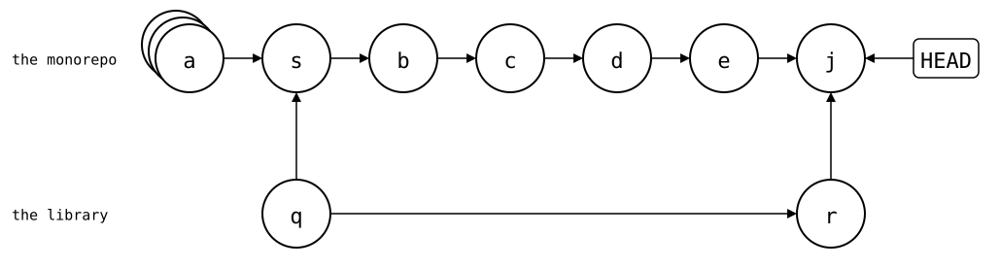
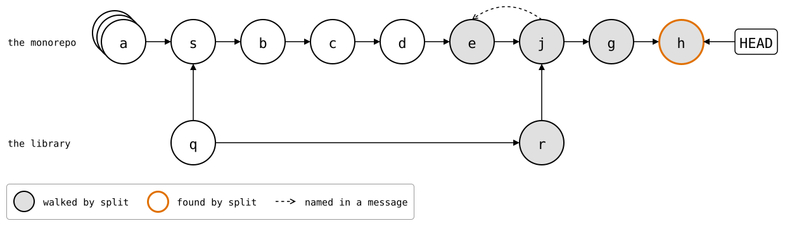
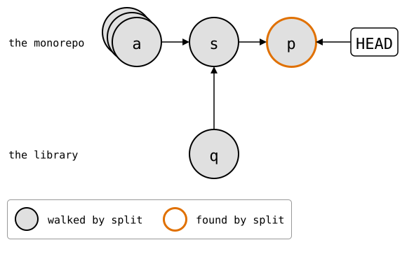

# `git subtree split --rejoin`

With `--squash`, `split` finds no library commit in the monorepo's history
to start from, and walks all of it on every push
([problem 2](../git-subtree.md#problem-2-with---squash-split-walks-everything)).
`--rejoin` gives it one, at the price of a merge for every push, which a
squash merge drops.

The setup: [the comparisons' library and monorepo](../README.md), with
the library added with `--squash` and the two fixes from problem 2:

<!--
```scrut {fail_fast: true, output_stream: combined}
$ source "$TESTDIR/../scrut-setup.sh"
```
-->

```scrut
$ git branch before-lib &&
>   git switch -q -c squashed &&
>   git subtree add -q --squash --prefix=vendor/lib https://git.example.com/lib.git main >/dev/null &&
>   echo "app commit 41" >>app/main.txt && git commit -q -a -m "app commit 41" &&
>   echo "lib fix 1" >>vendor/lib/src/parse.txt && git commit -q -a -m "lib fix 1" &&
>   echo "app commit 42" >>app/main.txt && git commit -q -a -m "app commit 42" &&
>   echo "lib fix 2" >>vendor/lib/src/parse.txt && git commit -q -a -m "lib fix 2"
```

## A merge for every push

`split --rejoin` merges the split result back into the monorepo, as a
starting point for the next `split`. With `--squash`, the result comes
in as a single commit too:

```scrut
$ git subtree split --rejoin --squash --prefix=vendor/lib
Merge made by the 'ort' strategy.
48108daa0f798109c3e672ed47a7de6204cf4e02
```

`48108da` is the library commit with the two fixes, the same one
`git splice push` makes
[on the comparison page](../git-subtree.md#how-git-splice-avoids-both).
The merge *j* (`Split 'vendor/lib/' into commit
'48108daa0f798109c3e672ed47a7de6204cf4e02'`) has *r* (`Squashed
'vendor/lib/' changes from bafd496..48108da`) as its second parent, on
top of *q*:

<div align="center">



</div>

<!--
```scrut
$ check_drawing "$TESTDIR/git-subtree-rejoin.drawio.svg" --alias HEAD=H \
>   a=before-lib s=HEAD^~4 b=HEAD^~3 c=HEAD^~2 d=HEAD^~1 e=HEAD^ j=HEAD \
>   q=HEAD^~4^2 r=HEAD^2
ok   git-subtree-rejoin.drawio.svg: 9 commits, 10 arrows, 1 boxes
```
-->

*j*'s message has what *q*'s lacks, a `git-subtree-mainline:`, here
*e*:

```scrut
$ git log -1 --format=%B | grep '^git-subtree-'
git-subtree-dir: vendor/lib
git-subtree-mainline: 9d3cc6061455cb38432ce9846218e1227e4771be
git-subtree-split: 48108daa0f798109c3e672ed47a7de6204cf4e02
```

The next `split` starts there, and walks only the few commits since:

```scrut
$ subtree_split_walks vendor/lib
3
```

After two more commits, *g* (`app commit 43`) and *h* (`lib fix 3`),
it walks only these, from *e*, the merge's first parent, on:

```scrut
$ git switch -q -c rejoined &&
>   echo "app commit 43" >>app/main.txt && git commit -q -a -m "app commit 43" &&
>   echo "lib fix 3" >>vendor/lib/src/parse.txt && git commit -q -a -m "lib fix 3" &&
>   subtree_split_walked vendor/lib
lib fix 2
Squashed 'vendor/lib/' changes from bafd496..48108da
Split 'vendor/lib/' into commit '48108daa0f798109c3e672ed47a7de6204cf4e02'
app commit 43
lib fix 3
```

<div align="center">



</div>

<!--
```scrut
$ check_drawing "$TESTDIR/git-subtree-rejoin-walks.drawio.svg" --alias HEAD=H \
>   a=before-lib s=HEAD~7 b=HEAD~6 c=HEAD~5 d=HEAD~4 e=HEAD~3 j=HEAD~2 \
>   g=HEAD~1 h=HEAD q=HEAD~7^2 r=HEAD~2^2
ok   git-subtree-rejoin-walks.drawio.svg: 11 commits, 13 arrows, 1 boxes
```
-->

## A squash merge drops it

That's one more merge commit for every push. And where a pull request is
squash-merged, *j* never reaches the branch it's merged into.
Squash-merged on top of *s*, that branch gets one commit *p* (`lib fixes
(#1)`) with the fixes, and neither *j* nor *r*:

```scrut
$ git switch -q -c squash-merged "squashed^~4" &&
>   git merge -q --squash squashed >/dev/null &&
>   git commit -q -m "lib fixes (#1)"
```

<div align="center">



</div>

<!--
```scrut
$ check_drawing "$TESTDIR/git-subtree-squash-merged.drawio.svg" --alias HEAD=H \
>   a=before-lib s=HEAD~1 p=HEAD q=HEAD~1^2
ok   git-subtree-squash-merged.drawio.svg: 4 commits, 4 arrows, 1 boxes
```
-->

*p*'s message is the pull request's, so it has none of the lines
`split` looks for:

```scrut
$ git log -1 --format=%B | grep -c '^git-subtree-'
0
[1]
```

So the next `split` from there walks all of the monorepo's history
again, to find *p*:

```scrut
$ subtree_split_walks vendor/lib
43
```

A splice's sync point is in a file, which the squash commit changes, so
it [survives a squash merge](../../scenarios/03-branches-and-teamwork/03-squash-merged-pull/README.md).
