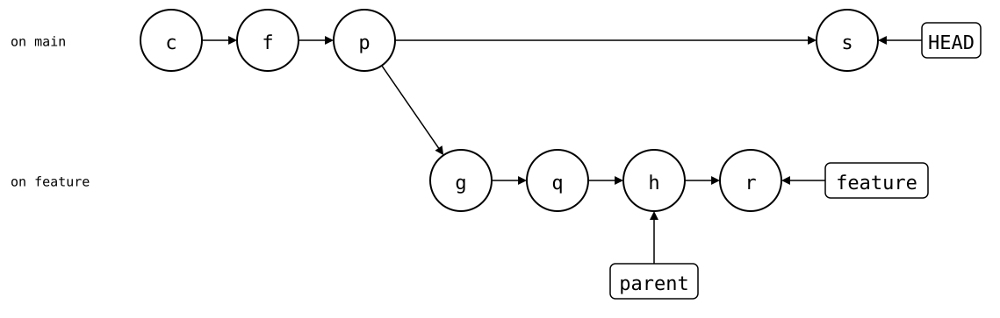
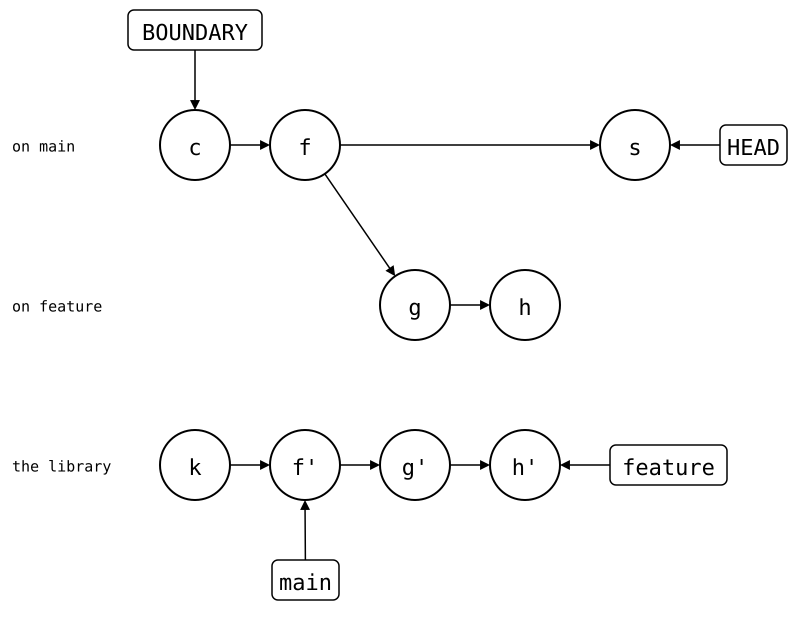

# git-subrepo compared

[git-subrepo](https://github.com/ingydotnet/git-subrepo) looks the most
like `git-splice`. The library's files are ordinary monorepo files, a
committed file in the folder, `.gitrepo`, names the library, and `push`
turns the monorepo's commits that touched the folder into library commits.
Every pull is one squashed commit, so the monorepo's history stays linear.

Both tools call the library's own repository the *upstream*, and the
branch of it that a folder syncs with the *upstream branch*. This page does
too.

The difference is what `.gitrepo` records besides the upstream: one
upstream branch, explicitly, and the monorepo commit of the last sync,
which every push writes too. This page shows what follows from that on a
feature branch that ends in a squash merge.

The setup: `https://git.example.com/lib.git`, a library with 30 commits,
and a monorepo with an app. [How these pages run](../README.md).

<!--
```scrut {fail_fast: true, output_stream: combined}
$ source "$TESTDIR/../scrut-setup.sh"
```
-->

```scrut
$ git subrepo --version
0.4.9
```

## Like `git-splice`: one commit per pull, linear history

`clone` adds the library as one commit:

```scrut
$ git subrepo clone https://git.example.com/lib.git vendor/lib
Subrepo 'https://git.example.com/lib.git' (main) cloned into 'vendor/lib'.
```

```scrut
$ cat vendor/lib/.gitrepo
; DO NOT EDIT (unless you know what you are doing)
;
; This subdirectory is a git "subrepo", and this file is maintained by the
; git-subrepo command. See https://github.com/ingydotnet/git-subrepo#readme
;
[subrepo]
	remote = https://git.example.com/lib.git
	branch = main
	commit = bafd496b1f4512a95b69464604f3da428aa9e33b
	parent = 7de219808bfd601897cdad67aa5c90b5a2e9bce8
	method = merge
	cmdver = 0.4.9
```

You fix the library and use the fix in the app, in one commit, and push:

```scrut
$ echo "fix" >>vendor/lib/src/parse.txt &&
>   echo "call parse()" >>app/main.txt &&
>   git commit -q -a -m "fix parse() and call it"
```

```scrut
$ git subrepo push vendor/lib
Subrepo 'vendor/lib' pushed to 'https://git.example.com/lib.git' (main).
```

The library gets the commit with only the folder's change:

```scrut
$ git -C "$COMPARISON/upstream/lib.git" show --stat --format=%s main
fix parse() and call it

 src/parse.txt | 1 +
 1 file changed, 1 insertion(+)
```

## Problem 1: every push is a commit in the monorepo

The monorepo's history is linear, but `push` added a commit of its own:

```scrut
$ git log --graph --format=%s -4
* git subrepo push vendor/lib
* fix parse() and call it
* git subrepo clone https://git.example.com/lib.git vendor/lib
* app commit 40
```

It records the push in `.gitrepo`: the library commit, and as `parent`
the monorepo commit it was pushed from:

```scrut
$ git diff HEAD~ -- vendor/lib/.gitrepo
diff --git a/vendor/lib/.gitrepo b/vendor/lib/.gitrepo
index 6a14f13..76360e9 100644
--- a/vendor/lib/.gitrepo
+++ b/vendor/lib/.gitrepo
@@ -6,7 +6,7 @@
 [subrepo]
 	remote = https://git.example.com/lib.git
 	branch = main
-	commit = bafd496b1f4512a95b69464604f3da428aa9e33b
-	parent = 7de219808bfd601897cdad67aa5c90b5a2e9bce8
+	commit = a2a29d443fae5b4efcda6f20543674547da4cbda
+	parent = 997fb8262ac0af221024f251d92cb2ed0f6d5aec
 	method = merge
 	cmdver = 0.4.9
```

```scrut
$ git log -1 --format=%s "$(git config --file vendor/lib/.gitrepo subrepo.parent)"
fix parse() and call it
```

## Problem 2: a feature branch pushes to `main`

`.gitrepo` names one upstream branch for every monorepo branch. On a
feature branch, a second fix:

```scrut
$ git switch -q -c feature &&
>   echo "fix 2" >>vendor/lib/src/parse.txt &&
>   git commit -q -a -m "fix 2"
```

`push` sends it to the upstream branch in `.gitrepo`, `main`, with no pull
request to review it:

```scrut
$ git subrepo push vendor/lib
Subrepo 'vendor/lib' pushed to 'https://git.example.com/lib.git' (main).
```

`--branch` pushes to another upstream branch, and `--update` writes it
into `.gitrepo`. After a push, it needs a `fetch` first, or it fails with
"Local repository does not contain" the commit it pushed:

```scrut
$ echo "fix 3" >>vendor/lib/src/parse.txt &&
>   git commit -q -a -m "fix 3" &&
>   git subrepo fetch vendor/lib
Fetched 'vendor/lib' from 'https://git.example.com/lib.git' (main).
```

```scrut
$ git subrepo push --branch feature --update vendor/lib
Subrepo 'vendor/lib' pushed to 'https://git.example.com/lib.git' (feature).
```

So the feature branch now syncs with the upstream branch `feature`.
(0.4.9 writes the branch even without `--update`,
[git-subrepo#313](https://github.com/ingydotnet/git-subrepo/issues/313).)

```scrut
$ git config --file vendor/lib/.gitrepo subrepo.branch
feature
```

## Problem 3: after a squash merge, the last sync is lost

The feature branch is done and squash-merged into `main`, as a pull
request would be:

```scrut
$ git switch -q main &&
>   git merge -q --squash feature &&
>   git commit -q -m "feature (squashed)"
Squash commit -- not updating HEAD
```

`main` now syncs with the upstream branch `feature`, and its `parent`
is a commit of the feature branch, which `main` doesn't contain:

```scrut
$ git config --file vendor/lib/.gitrepo subrepo.branch
feature
```

```scrut
$ parent="$(git config --file vendor/lib/.gitrepo subrepo.parent)" &&
>   git merge-base --is-ancestor "$parent" HEAD || echo "not in main"
not in main
```

On `main`, *c* is the `clone` and *f* the first fix; on the feature
branch, *g* and *h* are `fix 2` and `fix 3`, and *s* is the squash merge.
*p*, *q* and *r* are the commits `push` added. `parent` names *h*, the
commit the last push came from. *s* has *h*'s changes, but not *h*:

<div align="center">



</div>

<!--
```scrut
$ check_drawing "$TESTDIR/git-subrepo-squash-merged.drawio.svg" --alias HEAD=H \
>   c=HEAD~3 f=HEAD~2 p=HEAD~1 s=HEAD g=feature~3 q=feature~2 h=feature~1 r=feature \
>   parent="$parent" feature=feature
ok   git-subrepo-squash-merged.drawio.svg: 8 commits, 10 arrows, 3 boxes
```
-->

The next push from `main` stops, and asks for `parent` to be set to *p*
by hand:

```scrut
$ echo "fix 4" >>vendor/lib/src/parse.txt &&
>   git commit -q -a -m "fix 4" &&
>   git subrepo push vendor/lib
git-subrepo: The last sync point (where upstream and the subrepo were equal) is not an ancestor. 
             This is usually caused by a rebase affecting that commit. 
             To recover set the subrepo parent in 'vendor/lib/.gitrepo'
             to '5bd8dcf5c365cbc7ca13e4e13e51c68260584d43' 
             and validate the subrepo by comparing with 'git subrepo branch vendor/lib'
[1]
```

As the message says, a rebase does the same: the pushed commit gets a new
hash, and `parent` names the old one.

## How `git-splice` avoids them

The library goes back to its 30 commits, without the pushes above:

```scrut
$ git -C "$COMPARISON/upstream/lib.git" branch -q -f main bafd496 &&
>   git -C "$COMPARISON/upstream/lib.git" branch -q -D feature
```

In a copy of the monorepo from before the library, the same steps.
`clone` adds one commit, and `.splice` has the library and the synced
commit, no branch and no monorepo commit:

```scrut
$ cd ../splice-monorepo && git splice clone https://git.example.com/lib.git vendor/lib
===  vendor/lib: fetching https://git.example.com/lib.git
ok   vendor/lib: cloned bafd496 from main
```

```scrut
$ cat vendor/lib/.splice
[splice]
	id = f34fc447facba9d0
	commit = bafd496b1f4512a95b69464604f3da428aa9e33b
[upstream "origin"]
	url = https://git.example.com/lib.git
```

```scrut
$ echo "fix" >>vendor/lib/src/parse.txt &&
>   echo "call parse()" >>app/main.txt &&
>   git commit -q -a -m "fix parse() and call it"
```

```scrut
$ git splice push vendor/lib
ok   vendor/lib: pushed 5069701 to main
```

`push` records nothing in the monorepo:

```scrut
$ git log --graph --format=%s -3
* fix parse() and call it
* splice: clone vendor/lib from main at bafd496
* app commit 40
```

On a feature branch, `push` syncs with the upstream branch of the same
name, ready for a pull request:

```scrut
$ git switch -q -c feature &&
>   echo "fix 2" >>vendor/lib/src/parse.txt &&
>   git commit -q -a -m "fix 2" &&
>   git splice push vendor/lib
??   vendor/lib: upstream has no 'feature' branch yet -- this push creates it
ok   vendor/lib: pushed 6b3df25 to feature
```

```scrut
$ echo "fix 3" >>vendor/lib/src/parse.txt &&
>   git commit -q -a -m "fix 3" &&
>   git splice push vendor/lib
ok   vendor/lib: pushed 79da5cd to feature
```

The same squash merge:

```scrut
$ git switch -q main &&
>   git merge -q --squash feature &&
>   git commit -q -m "feature (squashed)"
Squash commit -- not updating HEAD
```

The same letters, without push commits. In the library, after *k*
(`lib commit 30`), *f'*, *g'* and *h'* are the pushed copies of *f*, *g*
and *h*, with only the folder's changes:

<div align="center">



</div>

<!--
```scrut
$ check_drawing "$TESTDIR/git-subrepo-splice.drawio.svg" --alias HEAD=H --alias BOUNDARY=B \
>   c=HEAD~2 f=HEAD~1 s=HEAD g=feature~1 h=feature k=refs/splices/lib/heads/main~1
ok   git-subrepo-splice.drawio.svg: 9 commits, 11 arrows, 4 boxes
```
-->

`main` syncs with the upstream branch `main` again. A push starts from
the boundary, the newest commit that changed `.splice`, here *c*. It's
derived from the history rather than stored, so a squash merge can't
drop it, and the sync point, the upstream commit in `.splice`, still
names a commit upstream has. So the next push sends the squashed commit
and the new one:

```scrut
$ echo "fix 4" >>vendor/lib/src/parse.txt &&
>   git commit -q -a -m "fix 4" &&
>   git splice push vendor/lib
ok   vendor/lib: pushed 940e7a2 to main
```

```scrut
$ git -C "$COMPARISON/upstream/lib.git" log --format=%s -4 main
fix 4
feature (squashed)
fix parse() and call it
lib commit 30
```

Rebasing a branch after its push makes the rebuilt commits differ from the
pushed ones, as with `git push`: `status` shows the splice as diverged, and
`git splice push --force` replaces the upstream branch, like
`git push --force`.

## Problem 4: fetched refs are keyed by folder

Both tools keep what they fetched under refs of their own. git-subrepo
keys them by the folder's path, `refs/subrepo/<path>/`; `git-splice` by the
upstream, `refs/splices/<key>/heads/<branch>`, with one key per URL. They differ
when another branch uses the same folder for another upstream, here a
second library:

```scrut
$ git init -q -b main ../other &&
>   echo "other" >../other/README &&
>   git -C ../other add README &&
>   git -C ../other commit -q -m "other library" &&
>   git init -q --bare "$COMPARISON/upstream/other.git" &&
>   git -C ../other push -q https://git.example.com/other.git main
```

Back in git-subrepo's monorepo, `vendor/lib/` on `main` was last fetched
from `lib.git`:

```scrut
$ cd ../monorepo && git log -1 --format=%s refs/subrepo/vendor/lib/fetch
fix 3
```

A branch from before the library clones the other one into the same
folder:

```scrut
$ git switch -q -c other ':/^app commit 40' &&
>   git subrepo clone https://git.example.com/other.git vendor/lib &&
>   git switch -q main
Subrepo 'https://git.example.com/other.git' (main) cloned into 'vendor/lib'.
```

Back on `main`, `vendor/lib/` still names `lib.git`, but its refs now hold
the other library, and `status` shows its commit as the upstream's:

```scrut
$ git subrepo status vendor/lib | grep -E 'Remote URL|Upstream Ref'
  Remote URL:      https://git.example.com/lib.git
  Upstream Ref:    3ea1a83
```

```scrut
$ git log -1 --format=%s refs/subrepo/vendor/lib/fetch
other library
```

`pull` and `push` fetch again before they use the refs, so they still
reach the right library. `status` doesn't.

The same with `git-splice`:

```scrut
$ cd ../splice-monorepo &&
>   git switch -q -c other ':/^app commit 40' &&
>   git splice clone https://git.example.com/other.git vendor/lib &&
>   git switch -q main
===  vendor/lib: fetching https://git.example.com/other.git
===  vendor/lib: upstream has no 'other' branch -- using 'main'; your first push creates 'other'
ok   vendor/lib: cloned 3ea1a83 from main
```

Each upstream has its own refs, so `main`'s are untouched:

```scrut
$ git for-each-ref --format='%(refname) %(subject)' refs/splices
refs/splices/lib/heads/feature fix 3
refs/splices/lib/heads/main fix 4
refs/splices/other/heads/main other library
```

```scrut
$ git splice status
On branch main

  up to date  vendor/lib
```

### After `git mv`

A move changes the key too. In git-subrepo's monorepo, `.gitrepo` moves
with the folder, and the next fetch starts new refs under the new path,
for the upstream branch `feature` that the squash merge left in
`.gitrepo`. The old refs stay behind:

```scrut
$ cd ../monorepo &&
>   mkdir libs &&
>   git mv vendor/lib libs/lib &&
>   git commit -q -m "move the library" &&
>   git subrepo fetch libs/lib
Fetched 'libs/lib' from 'https://git.example.com/lib.git' (feature).
```

```scrut
$ git for-each-ref --format='%(refname)' refs/subrepo
refs/subrepo/libs/lib/fetch
refs/subrepo/vendor/lib/branch
refs/subrepo/vendor/lib/commit
refs/subrepo/vendor/lib/fetch
refs/subrepo/vendor/lib/push
```

In `git-splice`'s, the move leaves the upstream's refs where they are:

```scrut
$ cd ../splice-monorepo &&
>   mkdir libs &&
>   git mv vendor/lib libs/lib &&
>   git commit -q -m "move the library" &&
>   git splice fetch libs/lib
ok   libs/lib fetched
```

```scrut
$ git for-each-ref --format='%(refname)' refs/splices
refs/splices/lib/heads/feature
refs/splices/lib/heads/main
refs/splices/other/heads/main
```

## Where git-subrepo is different

- **Explicit vs. implicit upstream branches.** `.gitrepo` names the
  upstream branch, so every monorepo branch syncs with that one, say
  `main` or a release branch, until `--branch` changes it, and a merge
  carries the change along
  ([git-subrepo#671](https://github.com/ingydotnet/git-subrepo/issues/671)).
  A splice names none: each monorepo branch syncs with the upstream branch
  of its own name, the default branch with the upstream's.
- **A push commits on the monorepo.** It records the pushed commit and the
  monorepo commit it came from in `.gitrepo`, so the monorepo's history
  shows every push, and a squash merge or rebase can strand that record
  ([git-subrepo#464](https://github.com/ingydotnet/git-subrepo/issues/464),
  [#600](https://github.com/ingydotnet/git-subrepo/issues/600)).
  A splice's push writes nothing to the monorepo; `.splice` changes on
  `clone` and `pull` only.
- **Fetched refs are keyed by folder, not by upstream.** Two branches
  that use the same folder for different upstreams share
  `refs/subrepo/<path>/`, and `status` shows whichever was fetched last.
  A `git mv` leaves the old path's refs behind. `git-splice` keys its refs
  by the upstream's URL.

## In short

| | git-subrepo | `git-splice` |
| --- | --- | --- |
| Monorepo history | linear | linear |
| Commits per sync | one per pull, one per push | one per pull |
| Upstream branch | the one in `.gitrepo`, for every monorepo branch | the monorepo branch's name |
| Sync point, the upstream commit last synced | `commit` in `.gitrepo`, written on clone, pull and push | `commit` in `.splice`, written on clone and pull |
| Where the last sync is in the monorepo | `parent` in `.gitrepo`, a stored commit | derived: the newest commit that changed `.splice` |
| After a squash merge | push stops until `.gitrepo` is fixed by hand | push works |
| After rebasing pushed commits | push stops until `.gitrepo` is fixed by hand | diverged, `push --force` as with Git |
| Fetched refs keyed by | folder path | upstream URL |
