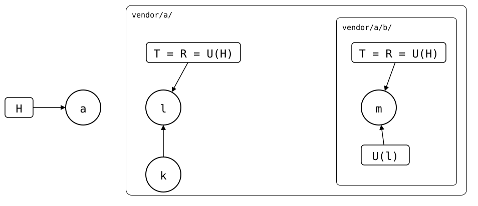

# Nesting

An upstream can use `git-splice` itself, e.g. an app with its library
spliced in. Clone the app into the monorepo, and the library comes along
as a splice of its own, *nested* in the app's. Nothing has to be cloned
recursively, as with `git clone --recurse-submodules`: the library's
`.splice` is an ordinary file of the app.

<!--
```scrut {fail_fast: true, output_stream: combined}
$ source "$TESTDIR/../../scenarios/readme-setup.sh" &&
>   source "$TESTDIR/../../scenarios/05-nested-splices/03-diamond/setup.bash" &&
>   scenario_diamond "$PWD/monorepo" "$UPSTREAM" >/dev/null 2>&1 &&
>   cd monorepo
```
-->

The app's upstream has its library at `c/`, with a `c/.splice`. One
`clone` gives the monorepo both:

```scrut
$ git splice clone https://git.example.com/a.git a
===  a: fetching https://git.example.com/a.git
ok   a: cloned 6962bd0 from main
```

```scrut
$ git splice status
On branch main

  ?? never fetched  a/c  run 'git splice fetch a/c'

  up to date        a
```

`a/c/` is a splice now. `clone` fetched only the app's upstream, so the
library's waits for a
[`fetch`](../../walkthrough/fetch.md).

## The nested `.splice` travels with the files

A clone or pull of the splice above brings the nested `.splice` in, and a
push of the splice above sends it back, where it's a splice again. A
splice's own push leaves its own `.splice` out.

<div align="center">



</div>

Each splice has a lane, and the lanes nest as the folders do. Commit *l*
of the upstream above has the `.splice` of the splice below, which
records *m*: U(l) = *m*
([scenario](../../scenarios/05-nested-splices/01-nested-splices/README.md)).

## Pull top-down, push bottom-up

`merge` and `pull` start at the top, because pulling the splice above can
move the synced commit of the one below. `push` starts at the bottom,
because the push above sends the `.splice` below, which must not name a
commit its upstream doesn't have
([why](../../../docs/design/README.md#splicing-in-merge-and-pull--fetch--merge)).

## The upstream above has the older history

The splice above came in as one squashed commit, so the monorepo doesn't
have the history of the splice below from before that. The upstream above
has it, so that's where it's taken from
([scenario](../../scenarios/05-nested-splices/01-nested-splices/spliced-elsewhere.md)).

## A nested splice follows the branch above

A nested `.splice` without `default-branch` follows the branch of the
splice above. So it means the same in the monorepo and in the upstream
above
([scenario](../../scenarios/05-nested-splices/02-nested-default-branch/README.md)).

## One library, two paths: a diamond

Two apps that both splice in one library give the monorepo two paths to
it, as in a package manager's dependency graph:

```text
   monorepo
    /  |  \
  a/   |   b/
    \  |  /
      c/
```

Each path has a real copy, so each app's repository still works on its
own. Each copy has its own [id](../splice-identity/README.md), since each
repository ran `clone` itself, so the copies are independent and can be
at different versions. They share one fetch of the library's upstream
([upstreams](../upstreams/README.md)), and Git stores their identical
files once. A change made in one copy reaches the others by a push and
their pulls
([scenario](../../scenarios/05-nested-splices/03-diamond/README.md)).

## A splice inside itself: a cycle

If an upstream splices in, directly or not, something that contains it,
the splice contains itself. A package manager can allow that, since it
installs each package once. A splice contains its files, though, so a
cycle is an endless tree of folders, and every pull nests one more copy.
The repeated [id](../splice-identity/README.md) shows it, but nothing
refuses it yet
([#86](https://github.com/roschaefer/git-splice/issues/86),
[scenario](../../scenarios/05-nested-splices/04-cycle/README.md)).

## Read more

- [Nested splices](../../scenarios/05-nested-splices/01-nested-splices/README.md)
  that are dropped, replaced or pushed from above, and [three
  levels](../../scenarios/05-nested-splices/01-nested-splices/02-three-levels/README.md).
- How the apps' standalone repositories stay in sync in a
  [diamond](../../scenarios/05-nested-splices/03-diamond/README.md).
- Why a cycle is caught [one level late](../../scenarios/05-nested-splices/04-cycle/README.md).
