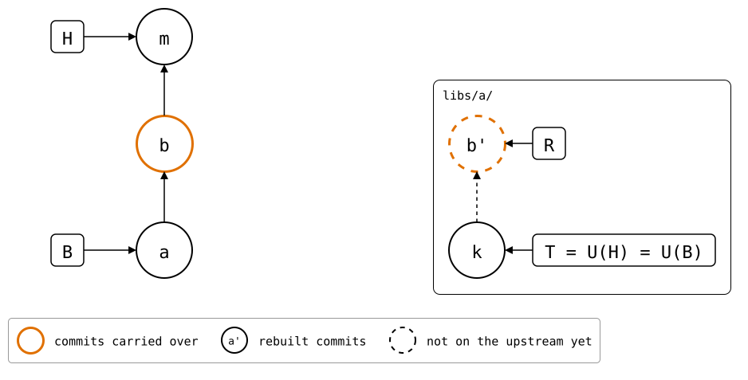
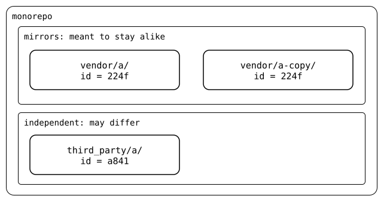

# Splice identity

Git has no such thing as a splice id. `git-splice` writes one into each
`.splice` it creates, because it needs to recognize a splice when the
folder's path can't identify it. That matters in three situations.

## A move carries the commits along

`git mv` changes a splice's path, and unpushed commits made under the old
path still belong to the splice. The id moves with the folder, so a push
follows it back to the old path:

<div align="center">



</div>

*b* changed the folder when it was still `vendor/a/`, and its copy *b'* is
what the push sends
([scenario](../../scenarios/07-moved-folders/01-moved-with-unpushed-commits/README.md)).
Where a `.splice` is new at a path, or has another id, and no move
explains it, the splice's history starts there, at its *mount*. Nothing
older is published.

## Same id, same directory

Two folders with the same id are one directory in two places, *mirrors*.
Folders with different ids can move independently, even when they come
from one upstream:

<div align="center">



</div>

When mirrors have different files, they have *drifted*, and that's
something to fix. [Mirrors](mirrors.md) shows how that happens.

## A repeated id exposes a cycle

With [nesting](../nesting/README.md), a `.splice` with the same id as one
above it means a splice contains itself. The id is what makes that
visible, though nothing refuses it yet
([cycle](../nesting/cycle.md)).

## What an id is

An id names a mount. It names neither a folder nor an upstream:

| What happens | The id |
|---|---|
| `clone` or `init` | is new, even for an upstream another folder already splices |
| `git mv` of the folder | moves along with `.splice` |
| a new URL, or another upstream | stays |
| `cp -r` of the folder, or a nested `.splice` reaching the monorepo twice | is copied: now two folders have it |

<!--
```scrut {fail_fast: true, output_stream: combined}
$ source "$TESTDIR/../../scenarios/readme-setup.sh"
```

```scrut
$ build_scenario scenario_splice_identity
```
-->

## Each `clone` is a new splice

```scrut
$ git splice clone https://git.example.com/a.git vendor/a
===  vendor/a: fetching https://git.example.com/a.git
ok   vendor/a: cloned bde4164 from main
```

```scrut
$ cat vendor/a/.splice
[splice]
	id = 224f2c2563d3b6f7
	commit = bde416459fbcc09c9b585f3b65a94cab3f68bfcd
[upstream "origin"]
	url = https://git.example.com/a.git
```

A second clone of the same upstream, at the same commit, gets another id:

```scrut
$ git splice clone https://git.example.com/a.git libs/a
===  libs/a: fetching https://git.example.com/a.git
ok   libs/a: cloned bde4164 from main
```

```scrut
$ git grep 'id = ' -- '*/.splice' | tr '\t' ' '
libs/a/.splice: id = a841bb3c200928e9
vendor/a/.splice: id = 224f2c2563d3b6f7
```

The two share the upstream's fetched refs
([upstreams](../upstreams/README.md)), and nothing else.

## A move keeps the id

```scrut
$ mkdir third_party && git mv libs/a third_party/a && git commit -q -m "move libs/a"
```

```scrut
$ git grep 'id = ' -- '*/.splice' | tr '\t' ' '
third_party/a/.splice: id = a841bb3c200928e9
vendor/a/.splice: id = 224f2c2563d3b6f7
```

## A fork is a splice of its own

To vendor a fork next to the original, clone it:

```scrut
$ git splice clone https://git.example.com/a-fork.git vendor/a-fork
===  vendor/a-fork: fetching https://git.example.com/a-fork.git
ok   vendor/a-fork: cloned c09993d from main
```

```scrut
$ git grep -e 'id = ' -e 'url = ' -- vendor/a/.splice vendor/a-fork/.splice | tr '\t' ' '
vendor/a-fork/.splice: id = d6f171146e73aee0
vendor/a-fork/.splice: url = https://git.example.com/a-fork.git
vendor/a/.splice: id = 224f2c2563d3b6f7
vendor/a/.splice: url = https://git.example.com/a.git
```

Copying `vendor/a/` and changing the URL to the fork's would keep the id,
and so declare a mirror of something that isn't one. The id can't tell
that from an upstream that moved, and nothing warns about it yet.

## Rarer cases

- Two [splices that swap paths](../../scenarios/07-moved-folders/02-swapped-splices/README.md) each keep their own history.
- [Mirrors](mirrors.md) can swap paths, or make a move ambiguous.
- [How the id is derived](../../../docs/design/README.md#the-splice-file).
