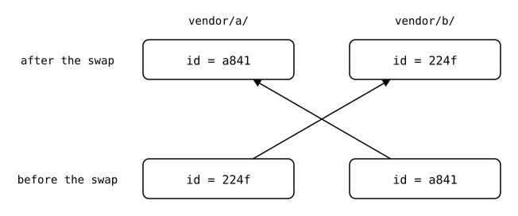

# Splice identity

Git has no such thing as a splice id. `git-splice` needs one because of
what a push does: it sends a folder's history upstream, and that history
may only contain commits of this splice. Sending anything older could
publish another splice's unpushed work, or a password someone removed
from the folder before it became a splice.

So `git-splice` has to know where a splice's history starts, and the
obvious candidates can't tell:

- **The path.** A `git mv` changes it, and the history before the move
  still belongs to the splice. A different splice can also take over the
  path, and then the history before that doesn't belong.
- **The upstream URL.** It changes when the upstream moves, and the
  history still belongs to the splice. Two folders can also share a URL
  and still be separate splices.

An `id` in `.splice` solves this. It moves with the folder and stays when
the URL changes. Here two splices swap paths, and each history follows
its id across:

<div align="center">



</div>

A `git log -- vendor/a` would mix the two splices here. A push of
`vendor/a/` doesn't: it follows id `a841` back to `vendor/b/`, and sends
nothing from when `vendor/a/` was the other splice
([scenario](../../scenarios/07-moved-folders/02-swapped-splices/README.md)).
Where a `.splice` is new at a path, or has another id, and no move
explains it, the splice's history starts there. That point is its
*mount*.

## What an id is

An id names a mount. It names neither a folder nor an upstream:

| What happens | The id |
|---|---|
| `clone` or `init` | is new, even for an upstream another folder already splices |
| `git mv` of the folder | moves along with `.splice` |
| a new URL, or another upstream | stays |
| `cp -r` of the folder, or a nested `.splice` reaching the monorepo twice | is copied: now two folders have it |

The last row gives the id a second meaning. Two folders with the same id
are one splice in two places, *mirrors*, meant to have the same files:

<div align="center">


</div>

Independent splices of one upstream can sit at different versions, for
example a library in use at two versions. When mirrors have different
files, they have *drifted*, and that's something to fix.
[Mirrors](mirrors.md) shows how that happens.

<!--
```scrut {fail_fast: true, output_stream: combined}
$ source "$TESTDIR/../../scenarios/readme-setup.sh"
```

```scrut
$ build_scenario scenario_splice_identity
```
-->

## Each `clone` is a new splice

```scrut
$ git splice clone https://git.example.com/a.git vendor/a
===  vendor/a: fetching https://git.example.com/a.git
ok   vendor/a: cloned bde4164 from main
```

```scrut
$ cat vendor/a/.splice
[splice]
	id = 224f2c2563d3b6f7
	commit = bde416459fbcc09c9b585f3b65a94cab3f68bfcd
[upstream "origin"]
	url = https://git.example.com/a.git
```

A second clone of the same upstream, at the same commit, gets another id:

```scrut
$ git splice clone https://git.example.com/a.git libs/a
===  libs/a: fetching https://git.example.com/a.git
ok   libs/a: cloned bde4164 from main
```

```scrut
$ git grep 'id = ' -- '*/.splice' | tr '\t' ' '
libs/a/.splice: id = a841bb3c200928e9
vendor/a/.splice: id = 224f2c2563d3b6f7
```

The two share the upstream's fetched refs
([upstreams](../upstreams/README.md)), and nothing else.

## A move keeps the id

```scrut
$ mkdir third_party && git mv libs/a third_party/a && git commit -q -m "move libs/a"
```

```scrut
$ git grep 'id = ' -- '*/.splice' | tr '\t' ' '
third_party/a/.splice: id = a841bb3c200928e9
vendor/a/.splice: id = 224f2c2563d3b6f7
```

The rebuild follows the id back to the old path, so unpushed commits from
before the move are kept
([scenario](../../scenarios/07-moved-folders/01-moved-with-unpushed-commits/README.md)).

## A fork is a splice of its own

To vendor a fork next to the original, clone it:

```scrut
$ git splice clone https://git.example.com/a-fork.git vendor/a-fork
===  vendor/a-fork: fetching https://git.example.com/a-fork.git
ok   vendor/a-fork: cloned c09993d from main
```

```scrut
$ git grep -e 'id = ' -e 'url = ' -- vendor/a/.splice vendor/a-fork/.splice | tr '\t' ' '
vendor/a-fork/.splice: id = d6f171146e73aee0
vendor/a-fork/.splice: url = https://git.example.com/a-fork.git
vendor/a/.splice: id = 224f2c2563d3b6f7
vendor/a/.splice: url = https://git.example.com/a.git
```

Copying `vendor/a/` and changing the URL to the fork's would keep the id,
and so declare a mirror of something that isn't one. The id can't tell
that from an upstream that moved, and nothing warns about it yet.

## Rarer cases

- A `.splice` with the id of one above it is a [cycle](../nesting/cycle.md).
- [Mirrors](mirrors.md) can swap paths, or make a move ambiguous.
- [How the id is derived](../../../docs/design/README.md#the-splice-file).
