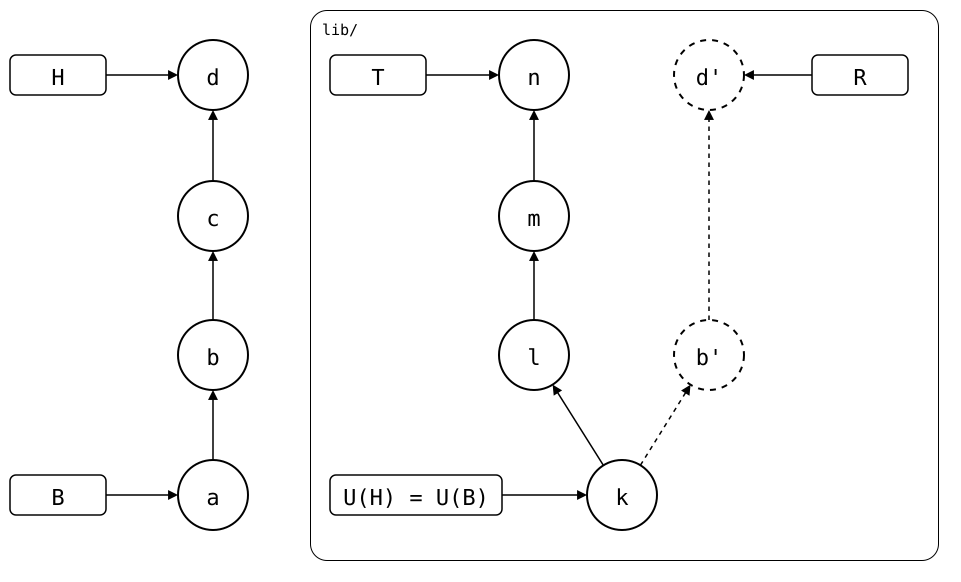
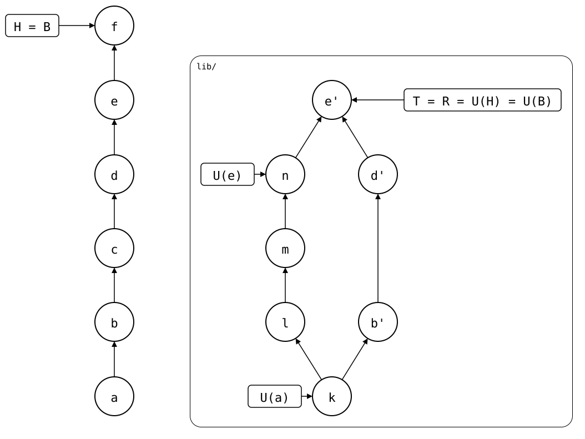
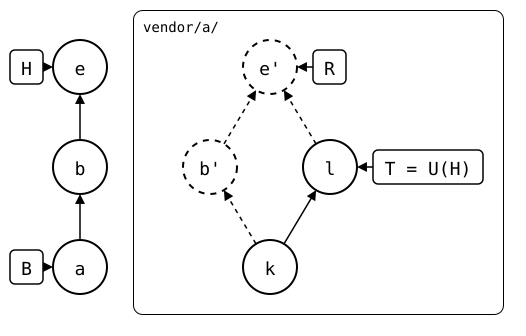
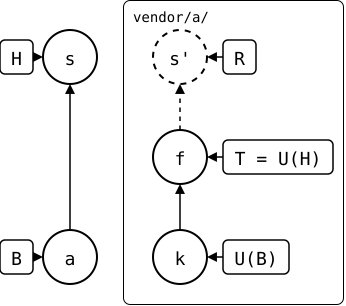
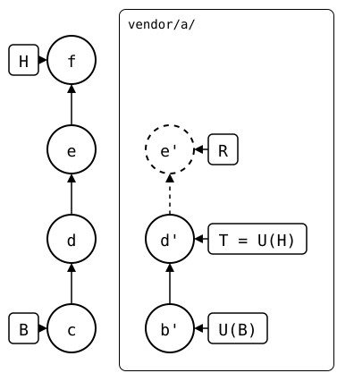

# Sync model

A splice's folder has two histories: the monorepo's, where it's a
folder, and its upstream's, where it's the whole repository. Commits
don't cross between them, changes do. This is the
[README](../../../README.md)'s drawing, with letters for its names:

## Before the pull

<div align="center">



</div>

Circles are commits, newest on top, and boxes point at them. The lane
`lib/` holds the splice's upstream commits
([scenario](../../scenarios/01-everyday-sync/01-sync-model/README.md)).
H is `HEAD`, the monorepo commit whose splice is being examined. From H,
the model finds five other commits:

| Name | Meaning | Also called | Lives in |
|---|---|---|---|
| B | The [boundary](../../walkthrough/boundary.md), where the rebuild starts: usually the last pull ([where exactly](#where-b-is)). | *boundary* | the monorepo |
| U(H) | The synced commit: the upstream commit `.splice` records at `HEAD`. | | the upstream |
| U(B) | The upstream commit recorded by B's `.splice`. R starts there. Usually U(H). | | the upstream |
| T | *Theirs*: the upstream branch as the monorepo last saw it, in `refs/splices/`: tracked(X) where the splice [tracks](../../scenarios/03-branches-and-teamwork/07-tracked-branch/README.md) one on the monorepo's branch X, else the one named like X. | *theirs* | the upstream |
| R | The [rebuild](../../walkthrough/rebuild.md), *ours*: the folder's history since B, rebuilt as upstream commits on top of U(B). | *rebuild*, *ours* | computed |

<!-- Builds a fresh sandbox; see `just docs-check`.
```scrut {fail_fast: true, output_stream: combined}
$ source "$TESTDIR/../../walkthrough/scrut-setup.sh"
```
-->

A monorepo commit *X* has a sync point U(X): the upstream commit recorded
in *X*'s `.splice`. For example, this prints U(H) in the walkthrough
sandbox:

```scrut
$ git config --blob HEAD:vendor/pkg-a/.splice splice.commit
9bb866a3ba726f2229597a45e8ea3368f7e669a8
```

The sync point changes only when `.splice` changes, for example in a pull.
The monorepo commits between two such changes share the same sync point. A
pull commit *X* normally brought in U(X^)..U(X), the range between the
previous and new sync points. A push between them is the exception
([scenario](../../scenarios/03-branches-and-teamwork/05-bisect-into-a-pull/01-after-a-push/README.md)).

## R, the rebuild

<!-- Build the scenario drawn above, while keeping the walkthrough sandbox
available for the example below.
```scrut
$ WALKTHROUGH_MONOREPO="$PWD" &&
>   SCENARIO_ROOT="$WALKTHROUGH/sync-model-scenario" &&
>   mkdir "$SCENARIO_ROOT" && cd "$SCENARIO_ROOT" &&
>   source "$TESTDIR/../../scenarios/readme-setup.sh" &&
>   source "$TESTDIR/../../scenarios/01-everyday-sync/01-sync-model/setup.bash" &&
>   scenario_sync_model "$PWD/monorepo" "$UPSTREAM" &&
>   cd monorepo && scenario_built=1
```
-->

[`git splice rebuild`](../../walkthrough/rebuild.md) computes R. It
recreates each monorepo commit since B that changed the folder as an
upstream commit on top of U(B). A rebuilt commit contains the folder's
tree without `.splice` and keeps the original author, dates and message.

### After the pull

Pulling the upstream creates commit *e* in the next diagram:

```scrut
$ git splice pull -m e lib
ok   lib fetched
ok   lib: pulled df79a48
```

<div align="center">


</div>

A box U(x) points at the commit recorded in *x*'s `.splice`. After the
pull in the drawing:

- The pull commit *e* records *n*, so U(H) = *n*.
- The earlier changes *b* and *d* were never pushed. They remain in *e*'s
  folder, so that folder is not the tree of *n*. Therefore *e* is not B.
- B stays at *a*, and U(B) stays at *k*.
- When the rebuild reaches *e*, it has two histories to preserve: the
  unpushed changes ending at *d'*, and the pulled history ending at *n*.
  Therefore *e'* has both as parents and is a merge commit.

The [scenario](../../scenarios/01-everyday-sync/01-sync-model/01-after-pull/README.md)
builds this state.

### After the push and bump

A push sends *b'*, *d'* and *e'*. B and U(B) stay where they are until
[`git splice pull --bump`](../../walkthrough/bump.md) records *e'* as U(H),
in a new commit *f*:

```scrut
$ git splice push lib
ok   lib: pushed 8430dba to main
```

```scrut
$ git splice pull --bump -m f lib
ok   lib fetched
ok   lib: bumped the synced commit to 8430dba
```

<div align="center">



</div>

*f*'s folder is *e'*, so *f* is the new B, and the rebuild has nothing to add:
R = T = U(H) = U(B) = *e'*
([scenario](../../scenarios/01-everyday-sync/01-sync-model/01-after-pull/01-pushed-and-bumped/README.md)).

### Parents of rebuilt commits

In the situation after the [pull](#after-the-pull), the rebuild walks through
the monorepo commits from B to H. It rebuilds *b* and *d*, then reaches H,
the pull commit *e*. At that point, the rebuilt tip—the newest commit
produced so far—is *d'*, and the synced commit U(H) is *n*. The parents
of *e'* depend on the relationship between these commits. Neither
contains the other, so *e'* gets *d'* as its first parent and *n* as its
second parent. The rebuild has reached H, so *e'* is R.

Git numbers these parents first and second:

```scrut
$ R="$(git splice rebuild lib)" &&
>   git show -s --format='R^1 (first parent): %s' "$R^1" &&
>   git show -s --format='R^2 (second parent): %s' "$R^2"
R^1 (first parent): d
R^2 (second parent): n
```

The same comparison happens whenever the rebuild reaches a monorepo
commit that changed `.splice`:

| Rebuilt tip and synced commit | The copy's parents | When |
|---|---|---|
| neither contains the other | rebuilt tip as first parent, synced commit as second: a merge | a pull merged unpushed commits ([scenario](../../scenarios/01-everyday-sync/02-up-to-date/03-diverged-then-pulled/README.md))<br/> |
| synced commit contains the rebuilt tip, or there is no rebuilt tip | synced commit | a squash merge put local edits into the pull commit itself ([scenario](../../scenarios/03-branches-and-teamwork/03-squash-merged-pull/01-local-edit-in-the-squash/README.md)), or the commit is where the splice starts, e.g. a `git mv` ([scenario](../../scenarios/07-moved-folders/01-moved-with-unpushed-commits/README.md))<br/> |
| rebuilt tip contains the synced commit | rebuilt tip, and no copy if the folder didn't change | a hand edit of `.splice`, or a bump while commits are unpushed ([scenario](../../scenarios/01-everyday-sync/02-up-to-date/02-push-ahead/01-pushed-then-pulled/bump-after-push.md#a-bump-while-ahead))<br/> |

The rebuilt copy becomes the new tip. Once the rebuild reaches H, its
final tip is R.

So each pull since B that merged unpushed commits adds one merge to R,
with the commit it pulled as the second parent. R takes that commit from
the pull's `.splice`, not from T: T may have moved on since, with a
fetch, and the merge would then claim changes the pull never brought in.

### Where B is

B is the newest commit on the monorepo's first-parent history that
changed `.splice` and whose folder is the upstream commit it recorded.
So a pull that merged unpushed commits, like *e* above, isn't B. Two
exceptions:

- **Where the splice starts**, its *mount* (its first `.splice`, or a
  `git mv`), B is that commit whatever its folder. The rebuild copies it
  too where its folder isn't U(B), e.g. after `init`, or a `git mv` with
  unpushed changes.
- **For a nested splice**, B can be the last pull of the splice above,
  and R's history up to there comes from the upstream above, at its
  synced commit ([nesting](../nesting/README.md)).

[`boundary`](../../walkthrough/boundary.md) prints B.

### R is computed, not stored

R is never stored. It's computed from `HEAD` each time, and the same
`HEAD` always gives the same R. So a commit pushed once is rebuilt
identically, and the next push is a fast-forward. And since R is
computed, `.splice` needs no monorepo commit ids, which a rebase or a
squash merge would invalidate
([design](../../../docs/design/README.md#splicing-out-push-and-the-rebuild)).
A pull could have been a merge, with U(H) as its second parent:
[weak parents](../../../docs/going-forward/weak-parents.md) compares the two.

## How R and T determine the status

R and T are two histories of the same folder, as upstream commits. How
they relate is the [sync state](../../walkthrough/status.md#sync-states):

| R and T | `status` shows |
|---|---|
| the same files, or the same commit | `up to date` |
| T is an ancestor of R | `ahead N` |
| R is an ancestor of T | `behind N` |
| neither, but with a common ancestor | `ahead N, behind M` |
| no common ancestor | `!! unrelated history` |

U(H) and T may be missing: right after `init`, there's no U(H) yet, and R
starts as a root commit; before the first fetch, there's no T, and the
splice is `never fetched`, or the upstream has no such branch.

A pull is a **three-way merge**, in the monorepo's layout:

- **base**: the newest commit R and T have in common, `git merge-base R T`
- **ours**: `HEAD`, with the folder as it is
- **theirs**: `HEAD` with T's files in the folder

Git merges them as usual. Only the folder differs between base and
theirs, so only the folder can conflict. The result is one ordinary
monorepo commit, which records T as the new U(H). It's the new B too,
unless it merged commits that were never pushed.

The base is usually U(H). After a push, it's the pushed commit: R contains
it, so the merge doesn't replay changes the upstream already has. That's
also why U(H) alone says little about where a splice stands. A push moves
T, and with it R's relation to T, but not U(H).

## Why a push isn't recorded

A push never writes to the monorepo, so U(H) stays what the last pull
brought in. Recording the push would take a monorepo commit that changes
`.splice`, on the branch that pushed. Merging that branch would then
carry the record to a branch that syncs with a different upstream
branch: a feature branch's `.splice` would name a commit of the
upstream's feature branch, and after the merge, `main`'s would too.

It isn't needed either. `status` compares the folder's files with T, and
after the push they're the same, so the splice is up to date. And a pull
merges from where R and T meet, not from U(H), unless the upstream
rewrote its branch: then from where the branch was before, its fork point
([example](../../scenarios/06-rewritten-history/04-patch-branch-rebased/README.md)).
The rebuild is
deterministic, so R contains the pushed commit, with the same hash, and
they meet there ([example](../../scenarios/01-everyday-sync/02-up-to-date/02-push-ahead/01-pushed-then-pulled/README.md)).
Except after `git splice push --rebuilt-commit`: R doesn't contain an
edited commit, so `git splice pull --bump` has to record it as U(H) before
the next change, as `push` reminds you
([edited-before-push](../../scenarios/06-rewritten-history/01-edited-before-push/README.md)).

The cost is that each rebuild walks every commit since B, pushed or not.
[Bumping](../../walkthrough/bump.md) records the pushed commit as U(H) where
that matters.

## Finding the commits in the walkthrough sandbox

<!-- Return to the walkthrough sandbox built at the start of this page.
```scrut
$ cd "$WALKTHROUGH_MONOREPO"
```
-->

The walkthrough's [sandbox](../../../docs/sandbox.md), where
`vendor/pkg-a/` is behind its upstream by one commit.

For `vendor/pkg-a/`:

```text
      monorepo, newest first                 pkg-a.git, newest first

      . lib-c: first version             T   > pkg-a: a second commit, after the clone
  B   = splice: clone vendor/pkg-a           |
          (folder = U(B))           U(H) = R * pkg-a: seed
```

On the left, as in the [README](../../../README.md#the-solution), `=` marks
the commits that change `.splice`, `*` those that change other files in
the folder, whether or not they change files elsewhere too, and `.` those
that don't touch the folder. On the right, as in `git splice log`, `<`
marks R's commits that T lacks, `>` T's commits that R lacks. Since B, no
commit changed the folder, so R has nothing to add to U(H): R = U(H). U(H) is an
ancestor of T, so `status` shows `behind 1`, the commit between them.

B is what [`boundary`](../../walkthrough/boundary.md) prints. Here, it is
the clone commit:

```scrut
$ git show -s --oneline "$(git splice boundary vendor/pkg-a)"
3aef6fd splice: clone vendor/pkg-a from main at 9bb866a
```

U(H) is the commit recorded there. `fetch` copied it into the monorepo, so
Git can show it:

```scrut
$ git log -1 --oneline "$(git config --file vendor/pkg-a/.splice splice.commit)"
9bb866a pkg-a: seed
```

Its folder is U(H), so it's B, and U(B) = U(H), where R starts:

```scrut
$ B="$(git log --first-parent -1 --format=%H -- vendor/pkg-a/.splice)" &&
>   U_B="$(git config --file vendor/pkg-a/.splice splice.commit)" &&
>   git diff --quiet "$U_B" "$B:vendor/pkg-a" -- ':!.splice' &&
>   echo "B's folder is U(B)"
B's folder is U(B)
```

T is the fetched branch. Its history leads to U(H):

```scrut
$ git log --oneline splices/pkg-a/heads/main
703b936 pkg-a: a second commit, after the clone
9bb866a pkg-a: seed
```

R is what [`rebuild`](../../walkthrough/rebuild.md) prints. Nothing
changed the folder since B, so R is U(H):

```scrut
$ git show -s --oneline "$(git splice rebuild vendor/pkg-a)"
9bb866a pkg-a: seed
```

`log --graph` draws R and T, labeled, down to the commit they have in
common, `o`:

```scrut
$ git splice log --graph vendor/pkg-a
===  vendor/pkg-a (main)
> 703b936 (T) pkg-a: a second commit, after the clone  (Walkthrough <walkthrough@example.com>)
o 9bb866a (R) pkg-a: seed  (Walkthrough <walkthrough@example.com>)
```

A change in the monorepo, to a file the upstream didn't change:

```scrut
$ echo "local" >vendor/pkg-a/local.txt &&
>   git add vendor/pkg-a/local.txt &&
>   git commit -q -m "pkg-a: a local file"
```

Now R has a commit T lacks, and the other way around:

```scrut
$ git splice status vendor/pkg-a
On branch main

  ahead 1, behind 1  vendor/pkg-a
```

```scrut
$ git splice log --graph vendor/pkg-a
===  vendor/pkg-a (main)
< f985b9f (R) pkg-a: a local file  (Walkthrough <walkthrough@example.com>)
| > 703b936 (T) pkg-a: a second commit, after the clone  (Walkthrough <walkthrough@example.com>)
|/  
o 9bb866a pkg-a: seed  (Walkthrough <walkthrough@example.com>)
```

The pull merges T in, with `o` as the base:

```scrut
$ git splice pull vendor/pkg-a
ok   vendor/pkg-a fetched
ok   vendor/pkg-a: pulled 703b936
```

The pull commit records T as the new U(H). Its folder also contains the
local file, so it is not the same tree as T and the pull is not the new B.
B stays at the clone commit:

```scrut
$ git log -1 --format=%s "$(git splice boundary vendor/pkg-a)"
splice: clone vendor/pkg-a from main at 9bb866a
```

U(B) stays at `pkg-a: seed`. R joins the local commit with T by a merge,
as `git pull` would have:

```scrut
$ git splice log --graph vendor/pkg-a
===  vendor/pkg-a (main)
<   6dc0e40 (R) splice: pull vendor/pkg-a from main at 703b936  (Walkthrough <walkthrough@example.com>)
|\  
< | f985b9f pkg-a: a local file  (Walkthrough <walkthrough@example.com>)
| o 703b936 (T) pkg-a: a second commit, after the clone  (Walkthrough <walkthrough@example.com>)
|/  
o 9bb866a pkg-a: seed  (Walkthrough <walkthrough@example.com>)
```

The push sends R, a fast-forward of T:

```scrut
$ git splice push vendor/pkg-a
ok   vendor/pkg-a: pushed 6dc0e40 to main
```

```scrut
$ git log --graph --format='%h %s' splices/pkg-a/heads/main
*   6dc0e40 splice: pull vendor/pkg-a from main at 703b936
|\  
| * 703b936 pkg-a: a second commit, after the clone
* | f985b9f pkg-a: a local file
|/  
* 9bb866a pkg-a: seed
```

Now R and T are equal, and the splice is up to date. U(H) is still the
commit the pull brought in. It lags behind T, since the push didn't
write to the monorepo:

```scrut
$ git splice status vendor/pkg-a
On branch main

  up to date  vendor/pkg-a
```

```scrut
$ git config --file vendor/pkg-a/.splice splice.commit
703b9360f7ac335a1134e9b5771a90a7c09ba39a
```

```scrut
$ git rev-parse splices/pkg-a/heads/main
6dc0e40cd5eda556b7b18759d2e2bb1ae2ae214a
```
