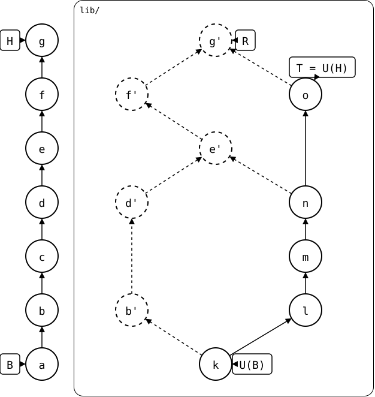

# Scenario: pulled again

The monorepo and upstream both change again after the [first pull](../README.md).
The second pull creates another merge in the rebuilt history:

<div align="center">



</div>

## Output

<!--
```scrut {fail_fast: true, output_stream: combined}
$ source "$TESTDIR/../../../../readme-setup.sh"
```
-->

[`setup.bash`](setup.bash) builds this state:

```scrut
$ build_scenario scenario_pulled_again
```

<!--
```scrut
$ R="$(git splice rebuild lib)" &&
> check_drawing "$TESTDIR/pulled-again.drawio.svg" \
>   a=HEAD~6 b=HEAD~5 c=HEAD~4 d=HEAD~3 e=HEAD~2 f=HEAD~1 g=HEAD \
>   k=refs/splices/upstream/heads/main~4 \
>   l=refs/splices/upstream/heads/main~3 \
>   m=refs/splices/upstream/heads/main~2 \
>   n=refs/splices/upstream/heads/main~1 \
>   o=refs/splices/upstream/heads/main \
>   "b'=$R~4" "d'=$R~3" "e'=$R~2" "f'=$R^1" "g'=$R"
ok   pulled-again.drawio.svg: 17 commits, 22 arrows, 5 boxes, 1 lanes
```
-->

The rebuild contains one merge for each pull:

```scrut
$ git splice log --graph lib
===  lib (main)
<   1b2d2ce (R) g  (Test <test@example.com>)
|\  
< | 597e7a6 f  (Test <test@example.com>)
< |   8430dba e  (Test <test@example.com>)
|\ \  
< | | d4da194 d  (Test <test@example.com>)
< | | 9ec734f b  (Test <test@example.com>)
o | | ae8b31f k  (Test <test@example.com>)
 / /  
| o e22b60a (T) o  (Test <test@example.com>)
|/  
o df79a48 n  (Test <test@example.com>)
```

The first parents of the two rebuilt pulls are the local histories that
each pull preserved. Their second parents are the upstream commits they
pulled, *n* and *o*:

```scrut
$ R="$(git splice rebuild lib)" &&
>   git show -s --format='g first parent:  %s' "$R^1" &&
>   git show -s --format='g second parent: %s' "$R^2" &&
>   git show -s --format='e first parent:  %s' "$R~2^1" &&
>   git show -s --format='e second parent: %s' "$R~2^2"
g first parent:  f
g second parent: o
e first parent:  d
e second parent: n
```
