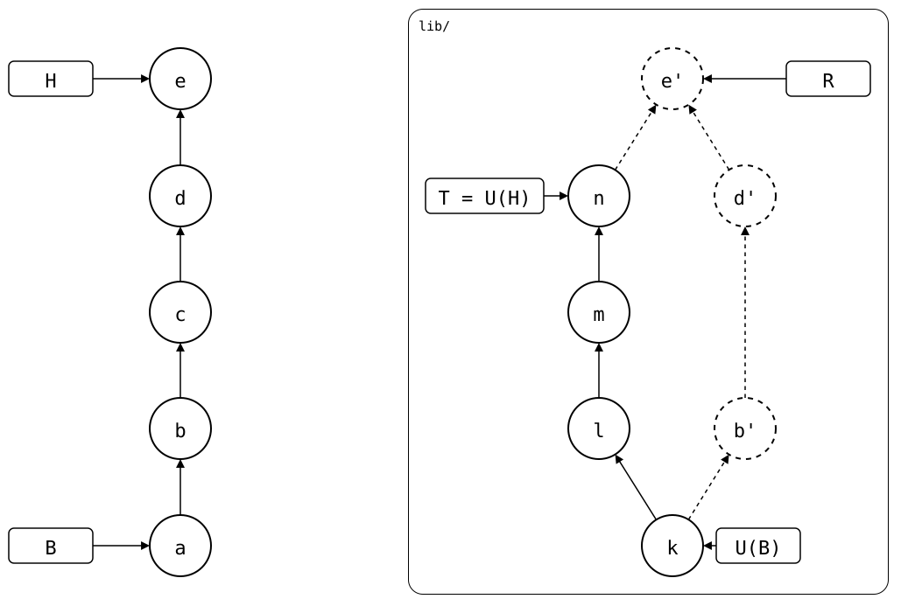

# Scenario: after-pull

A pull merged local commits that were never pushed. The pull's commit is
the newest that changed `.splice`, but the rebuild starts further back,
at B: the newest such commit whose folder is the upstream commit it
recorded, U(B)
([sync model](../../../../concepts/sync-model/README.md)). The commits are
named as in the drawing there:

<div align="center">



</div>

- **Monorepo (`lib/`)**: cloned at *k* in *a*, then *b* and *d* change the
  folder, *c* changes another one. `git splice pull` then merges *n* in, as *e*.
- **Upstream**: *k*, then *l*, *m* and *n*. It has never seen *b* or *d*.

## Output

<!--
```scrut {fail_fast: true, output_stream: combined}
$ source "$TESTDIR/../../../readme-setup.sh"
```
-->

[`setup.bash`](setup.bash) builds this state:

```scrut
$ build_scenario scenario_after_pull
```

The drawing shows what Git and `git-splice` say about it. *a* and *e* aren't
subjects the drawing can show, so they're named by their place in the
history ([`check_drawing`](../../../../../check-drawing/)):

```scrut
$ check_drawing "$TESTDIR/after-pull.drawio.svg" a=HEAD~4 e=HEAD
ok   after-pull.drawio.svg: 12 commits, 16 arrows, 5 boxes, 1 lanes
```

The monorepo, with *e* on top. *a* is the clone, `add lib`:

```scrut
$ git log --format=%s
splice: pull lib from main at df79a48
d
c
b
add lib
initial commit
```

```scrut
$ git -C "$UPSTREAM" log --format='%h %s' main
df79a48 n
d34c417 m
5ba0fc7 l
ae8b31f k
```

### U(H)

*e* is the newest commit that changed `.splice`. It records *n* as U(H):

```scrut
$ git log --first-parent -1 --format=%s -- lib/.splice
splice: pull lib from main at df79a48
```

```scrut
$ git log -1 --format='%h %s' "$(git config --file lib/.splice splice.commit)"
df79a48 n
```

### B

But *e*'s folder isn't *n*: it has *b*'s and *d*'s files too, which the upstream
lacks. A rebuild starting at *e* would send them as one commit, under *e*'s
message:

```scrut
$ git diff --stat "$(git config --file lib/.splice splice.commit)" HEAD:lib -- ':!.splice'
 b.txt | 1 +
 d.txt | 1 +
 2 files changed, 2 insertions(+)
```

So the rebuild goes back to the commit before *e* that changed `.splice`.
All of them, newest first:

```scrut
$ git log --first-parent --format=%s -- lib/.splice
splice: pull lib from main at df79a48
add lib
```

*a*'s folder is the commit it recorded, *k*. It's `HEAD~4`:

```scrut
$ k="$(git config --blob 'HEAD~4:lib/.splice' splice.commit)" &&
>   git diff --quiet "$k" HEAD~4:lib -- ':!.splice' &&
>   echo "a's folder is k"
a's folder is k
```

So *a* is B, what `git splice boundary` prints, and U(B) = *k*:

```scrut
$ git log -1 --format=%s "$(git splice boundary lib)"
add lib
```

The commits since B that change the folder are the ones the rebuild
copies, newest first:

```scrut
$ git log --first-parent --format=%s "$(git splice boundary lib)"..HEAD -- lib
splice: pull lib from main at df79a48
d
b
```

### R

From B, the rebuild copies *b* and *d* on top of U(B) = *k*, as *b'* and *d'*, and
skips *c*. Then it copies *e* as *e'*, a merge of *d'* and *n*, with *e*'s message.
`log --graph` draws R and T down to *n*, where they meet. *k* shows up as
the parent of *b'*:

```scrut
$ git splice log --graph lib
===  lib (main)
<   712cf4c (R) splice: pull lib from main at df79a48  (Test <test@example.com>)
|\  
< | d4da194 d  (Test <test@example.com>)
< | 9ec734f b  (Test <test@example.com>)
o | ae8b31f k  (Test <test@example.com>)
 /  
o df79a48 (T) n  (Test <test@example.com>)
```

### After the push

The push sends *b'*, *d'* and *e'*, and T moves to *e'*:

```scrut
$ git splice push lib
ok   lib: pushed 712cf4c to main
```

A pull right after it has nothing to bring in, and leaves `.splice` as it
was. So B is still *a*: every rebuild still walks from *a*, and rebuilds *b'*,
*d'* and *e'* with the same hashes.

```scrut
$ git splice pull lib
ok   lib fetched
ok   lib: nothing to pull
```

```scrut
$ git log -1 --format=%s "$(git splice boundary lib)"
add lib
```

### After a bump

`git splice pull --bump` records *e'* as U(H), in a new commit:

```scrut
$ git splice pull --bump lib
ok   lib fetched
ok   lib: bumped the synced commit to 712cf4c
```

Its folder is *e'*, so it's the new B, U(B) = *e'*, and rebuilds start there
([pushed-and-bumped](01-pushed-and-bumped/README.md) draws this state):

```scrut
$ git log -1 --format=%s "$(git splice boundary lib)"
splice: bump lib from main at 712cf4c
```
