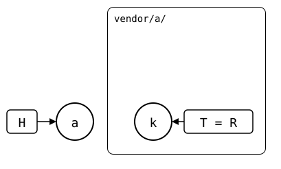

# Scenario: up-to-date

A splice freshly cloned and never touched again on either side.

- **Monorepo (`vendor/a/`)**: *a* clones *k* (`seed`), no local changes since.
- **Upstream**: *k*, unchanged.

<div align="center">



</div>

## Output

<!--
```scrut {fail_fast: true, output_stream: combined}
$ source "$TESTDIR/../../readme-setup.sh"
```
-->

[`setup.bash`](setup.bash) builds this state:

```scrut
$ build_scenario scenario_up_to_date
```

<!--
```scrut
$ k="$(git config --file vendor/a/.splice splice.commit)" &&
>   check_drawing "$TESTDIR/up-to-date.drawio.svg" k="$k" a=HEAD
ok   up-to-date.drawio.svg: 2 commits, 2 arrows, 2 boxes, 1 lanes
```
-->

Nothing to do on either side:

```scrut
$ git splice status
On branch main

  up to date  vendor/a
```

```scrut
$ git splice push vendor/a
ok   vendor/a: nothing to push
```

```scrut
$ git splice pull vendor/a
ok   vendor/a fetched
ok   vendor/a: nothing to pull
```
