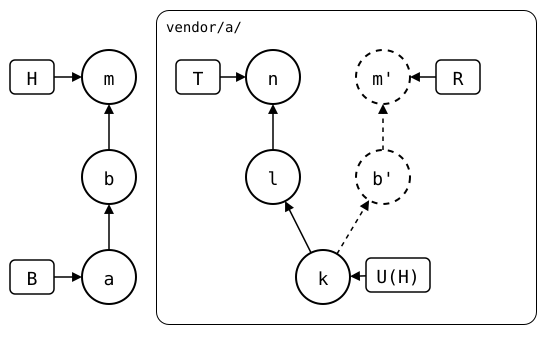
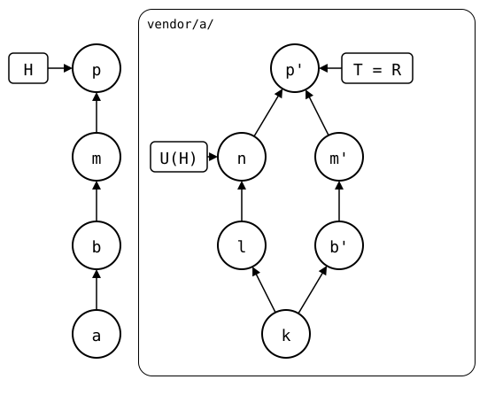

# Scenario: up-to-date, the upstream pulled in a worktree of the rebuild

[Worked on in a worktree](worked-on-in-a-worktree.md) checks out the
rebuild of `vendor/a/` in a worktree, and `git splice merge
--rebuilt-commit` brings a commit made there back. That merge keeps the
synced commit where it was: whatever the worktree adds counts as the
monorepo's own work, to push.

Here, the worktree pulls `vendor/a/`'s own upstream instead, as one would
in a clone, while the monorepo has a change of its own, *b*. The merge
brings that pull back as *m*, a local commit with the upstream's changes
in it. `.splice` still names *k*, so the rebuild has them in *m'*, beside
*l* and *n*, the upstream's commits with the same changes:

<div align="center">



</div>

The push refuses, as the upstream has *l* and *n*. A pull then records
*n*, and the next push publishes the upstream's changes a second time,
in *m'*:

<div align="center">



</div>

`git splice pull vendor/a` in the monorepo would have merged *n* as the
synced commit right away, and the push would have sent *b'* and a merge
with *n*, without *m'*.

## Output

<!--
```scrut {fail_fast: true, output_stream: combined}
$ source "$TESTDIR/../../readme-setup.sh" && export GIT_CONFIG_COUNT=2 GIT_CONFIG_KEY_0=user.name GIT_CONFIG_VALUE_0=Test GIT_CONFIG_KEY_1=user.email GIT_CONFIG_VALUE_1=test@example.com
```
-->

[`setup.bash`](setup.bash) builds this state:

```scrut
$ build_scenario scenario_up_to_date
```

The upstream gets two commits, *l* and *n*, and the monorepo fetches
them:

```scrut
$ git clone -q "$UPSTREAM" ../a-clone &&
>   echo "first" >>../a-clone/file.txt &&
>   git -C ../a-clone commit -q -am "l: upstream first" &&
>   echo "second" >>../a-clone/file.txt &&
>   git -C ../a-clone commit -q -am "n: upstream second" &&
>   git -C ../a-clone push -q origin main
```

```scrut
$ git splice fetch vendor/a
ok   vendor/a fetched (main moved bde4164..d2c4626)
```

The monorepo changes `vendor/a/`:

```scrut
$ echo "local" >vendor/a/local.txt &&
>   git add vendor/a/local.txt &&
>   git commit -q -m "b: local change"
```

## Pulled in the worktree

```scrut
$ git worktree add -q -b work-on-a ../a-work "$(git splice rebuild vendor/a)"
```

```scrut
$ git -C ../a-work pull -q --no-rebase --no-edit "$UPSTREAM" main
```

```scrut
$ git -C ../a-work log --graph --format=%s
*   Merge branch 'main' of $UPSTREAM into work-on-a
|\  
| * n: upstream second
| * l: upstream first
* | b: local change
|/  
* seed
```

## Brought back

```scrut
$ git splice merge --rebuilt-commit work-on-a -m "m: merge the worktree" vendor/a
ok   vendor/a: merged [0-9a-f]{7} (regex)
```

The worktree has done its job:

```scrut
$ git worktree remove ../a-work &&
>   git branch -q -D work-on-a
```

<!--
```scrut
$ k="$(git config --file vendor/a/.splice splice.commit)" &&
>   check_drawing "$TESTDIR/upstream-merged-back.drawio.svg" a=HEAD~2 k="$k"
ok   upstream-merged-back.drawio.svg: 8 commits, 11 arrows, 5 boxes, 1 lanes
```
-->

`.splice` still names *k*, so the upstream's changes count as local ones,
and its commits as missing:

```scrut
$ git log -1 --format=%s "$(git config --file vendor/a/.splice splice.commit)"
seed
```

```scrut
$ git splice status
On branch main

  ahead 2, behind 2  vendor/a
```

```scrut
$ git splice push vendor/a
!!   vendor/a: upstream has commits this branch lacks
!!   Failed: vendor/a
[1]
```

## Pulled, and pushed

```scrut
$ git splice pull vendor/a -m "p: pull vendor/a"
ok   vendor/a fetched
ok   vendor/a: pulled d2c4626
```

```scrut
$ git splice push vendor/a
ok   vendor/a: pushed bdb6adf to main
```

The upstream has *l* and *n*'s changes twice now: in *l* and *n*, and in
*m'*:

```scrut
$ git -C "$UPSTREAM" log --graph --format=%s main
*   p: pull vendor/a
|\  
| * n: upstream second
| * l: upstream first
* | m: merge the worktree
* | b: local change
|/  
* seed
```

```scrut
$ git -C "$UPSTREAM" show --stat --format=%s main^1
m: merge the worktree

 file.txt | 2 ++
 1 file changed, 2 insertions(+)
```

<!--
```scrut
$ check_drawing "$TESTDIR/upstream-pushed-twice.drawio.svg" \
>   a=HEAD~3 k="$k"
ok   upstream-pushed-twice.drawio.svg: 10 commits, 12 arrows, 3 boxes, 1 lanes
```
-->
