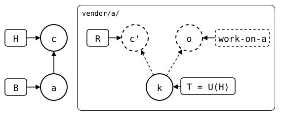
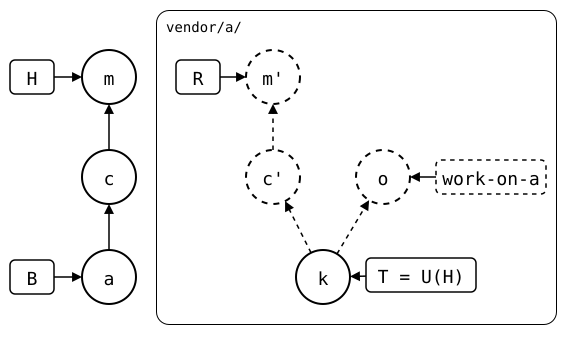
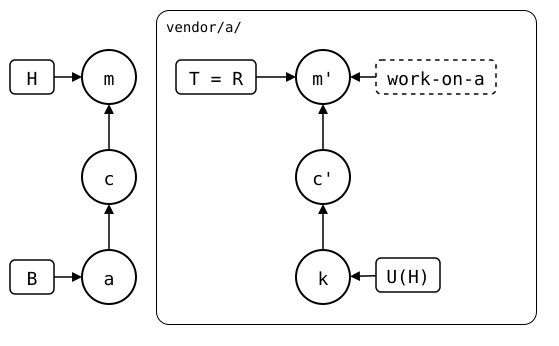
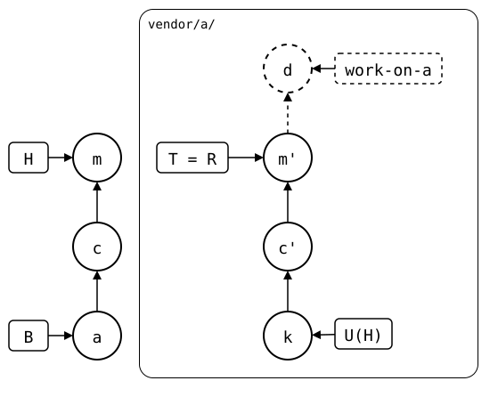
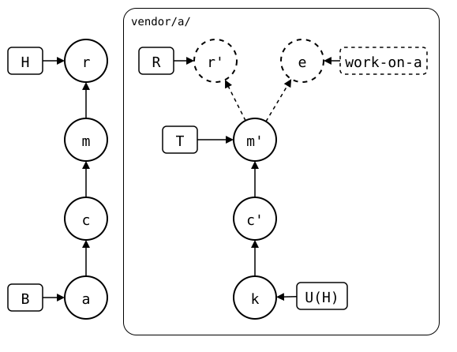

# Scenario: up-to-date, worked on in a worktree of the rebuild

`git splice rebuild vendor/a` prints the splice's history as its upstream
would have it: a commit of the upstream's repository, with the folder's
files at its root. Checked out in a worktree of the monorepo, it's that
repository, to work in as if it were a clone: build it on its own, or run
`git-splice` there for a splice inside it.

`git splice merge --rebuilt-commit` brings what was committed there back
into `vendor/a/`. It's a three-way merge from where the commit left the
rebuild, so the monorepo's own changes since then stay. The synced commit
doesn't move: the commit is local work, and the next push sends it. Like
`git merge --squash`, it takes the commit's changes, not the commit: a
branch that goes on is rebased onto the new rebuild first.

## Output

<!--
```scrut {fail_fast: true, output_stream: combined}
$ source "$TESTDIR/../../readme-setup.sh"
```
-->

[`setup.bash`](setup.bash) builds this state:

```scrut
$ build_scenario scenario_up_to_date
```

The rebuild, checked out on a branch of its own:

```scrut
$ git worktree add -q -b work-on-a ../a-work "$(git splice rebuild vendor/a)"
```

```scrut
$ ls ../a-work
file.txt
```

A commit there:

```scrut
$ echo "from the worktree" >../a-work/other.txt &&
>   git -C ../a-work add other.txt &&
>   git -C ../a-work commit -q -m "add other.txt"
```

Meanwhile, the monorepo changes `vendor/a/` too:

```scrut
$ echo "monorepo change" >>vendor/a/file.txt &&
>   git commit -q -am "monorepo change"
```

Two lines of work start at the rebuild, *k*: the monorepo's change *c*,
which the rebuild copies to *c'*, and *o*, the worktree's commit, on a
branch of the monorepo no upstream has, `work-on-a`:

<div align="center">



</div>

<!--
```scrut
$ k="$(git config --file vendor/a/.splice splice.commit)" &&
>   check_drawing "$TESTDIR/worked-on-before-merge.drawio.svg" \
>     a=HEAD~1 c=HEAD k="$k" o=work-on-a
ok   worked-on-before-merge.drawio.svg: 5 commits, 8 arrows, 5 boxes, 1 lanes
```
-->

## Back into the monorepo

```scrut
$ git splice merge --rebuilt-commit work-on-a vendor/a
ok   vendor/a: merged d55cb3f
```

One commit, with the worktree commit's message, and both changes:

```scrut
$ git log --format=%s -3
add other.txt
monorepo change
add vendor/a
```

```scrut
$ cat vendor/a/other.txt vendor/a/file.txt
from the worktree
seed
monorepo change
```

The merge's commit, *m*, has *o*'s changes, not *o*: the rebuild has *m'*
on top of *c'*, and *o* stays on its branch:

<div align="center">



</div>

<!--
```scrut
$ check_drawing "$TESTDIR/worked-on-merged-back.drawio.svg" \
>   a=HEAD~2 c=HEAD~1 m=HEAD k="$k" o=work-on-a
ok   worked-on-merged-back.drawio.svg: 7 commits, 10 arrows, 5 boxes, 1 lanes
```
-->

`.splice` still names `seed`, so both changes are ahead, and the push
sends them:

```scrut
$ git log -1 --format=%s "$(git config --file vendor/a/.splice splice.commit)"
seed
```

```scrut
$ git splice status
On branch main

  ahead 2  vendor/a
```

```scrut
$ git splice push vendor/a
ok   vendor/a: pushed 895449a to main
```

```scrut
$ git -C "$UPSTREAM" log --format=%s main
add other.txt
monorepo change
seed
```

## Continued, and merged again

The rebuild doesn't have *o*, only *m'*, so the worktree's branch is
rebased onto it before it goes on, as a branch after a squash merge is.
The rebase leaves *o* out, since *m'* has its changes:

```scrut
$ git -C ../a-work rebase -q "$(git splice rebuild vendor/a)" &&
>   git -C ../a-work log --format=%s
hint: use --reapply-cherry-picks to include skipped commits
hint: Disable this message with "git config set advice.skippedCherryPicks false"
add other.txt
monorepo change
seed
```

The push sent *c'* and *m'* upstream, and the worktree's branch is the
rebuild now:

<div align="center">



</div>

<!--
```scrut
$ check_drawing "$TESTDIR/worked-on-rebased.drawio.svg" \
>   a=HEAD~2 c=HEAD~1 m=HEAD k="$k"
ok   worked-on-rebased.drawio.svg: 6 commits, 9 arrows, 5 boxes, 1 lanes
```
-->

It goes on, and removes the file again, in *d*:

```scrut
$ git -C ../a-work rm -q other.txt &&
>   git -C ../a-work commit -q -m "remove other.txt"
```

<div align="center">



</div>

<!--
```scrut
$ check_drawing "$TESTDIR/worked-on-continued.drawio.svg" \
>   a=HEAD~2 c=HEAD~1 m=HEAD k="$k" d=work-on-a
ok   worked-on-continued.drawio.svg: 7 commits, 10 arrows, 5 boxes, 1 lanes
```
-->

The branch starts at *m'* now, so the merge starts there too. The only
change since is *d*, which removes `other.txt`, and so does the merge:

```scrut
$ git splice merge --rebuilt-commit work-on-a vendor/a
ok   vendor/a: merged 179d029
```

```scrut
$ git log --format=%s -1
remove other.txt
```

```scrut
$ ls vendor/a
file.txt
```

Without the rebase, the branch would still start at *k*, and so would
the merge. `other.txt` didn't exist there, so it would look like the
monorepo's own addition, and stay.

## Nothing to merge

`merge --rebuilt-commit` brings back files, not messages. A commit in the
worktree that changes no files has nothing to bring back, like *e*, *d*
reworded:

```scrut
$ git -C ../a-work commit -q --amend -m "remove other.txt, reworded"
```

*e* has the files of *d*, which the monorepo merged as *r*. The rebuild's
copy of *r*, *r'*, is *d* itself here: the same files, parent, message
and date make the same commit.

<div align="center">



</div>

<!--
```scrut
$ check_drawing "$TESTDIR/worked-on-reworded.drawio.svg" \
>   a=HEAD~3 c=HEAD~2 m=HEAD~1 r=HEAD k="$k" \
>   e=work-on-a
ok   worked-on-reworded.drawio.svg: 9 commits, 13 arrows, 6 boxes, 1 lanes
```
-->

So the merge leaves the monorepo as it is, *r* and its message too, and
no cherry-pick in progress:

```scrut
$ git splice merge --rebuilt-commit work-on-a vendor/a
ok   vendor/a: dbb456a's changes are in the folder already -- nothing to merge
```

```scrut
$ git log --format=%s -1
remove other.txt
```

```scrut
$ git status --short
```

A reworded message goes upstream with `git splice push
--rebuilt-commit` instead ([edited before
push](../../06-rewritten-history/01-edited-before-push/README.md)).
