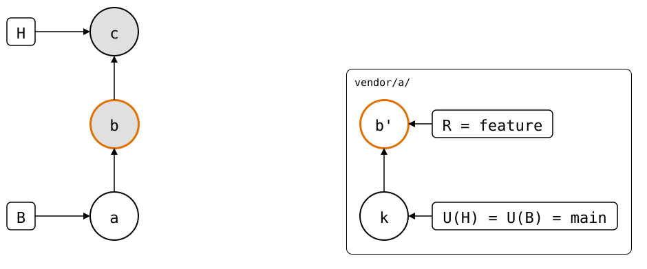

# Scenario: stacked-branch

A branch stacked on a feature branch that upstream already has, and the
splice didn't change on the stacked branch: *b* was pushed to `feature`,
and *c*, on `stacked`, changes nothing in `vendor/a/`.

<div align="center">



</div>

Upstream has no `stacked` branch, so `git-splice` compares with
upstream's default branch, as a PR from `stacked` would. `main` lacks
*b'*, so the splice counts as new, and `push` creates `stacked` upstream at *b'*, the
same commit as `feature`. A PR from it into
`main` would show the same change as the PR from `feature`; one into
`feature` would be empty. That's the cost of comparing with the default
branch (#150): pushing only the splices that changed on `stacked`, here
none, avoids it.

## Output

<!--
```scrut {fail_fast: true, output_stream: combined}
$ source "$TESTDIR/../../../../readme-setup.sh"
```
-->

[`setup.bash`](setup.bash) builds this state:

```scrut
$ build_scenario scenario_stacked_branch
```

<!--
```scrut
$ check_drawing "$TESTDIR/stacked-branch.drawio.svg" \
>   a=HEAD~2 b=HEAD~1 k=refs/splices/upstream/heads/main
ok   stacked-branch.drawio.svg: 5 commits, 7 arrows, 4 boxes, 1 lanes
```
-->

```scrut
$ git splice status
On branch stacked

  new, ahead 1  vendor/a  push creates the branch
```

```scrut
$ git splice log
===  vendor/a (upstream has no 'stacked' branch -- compared with 'main')
< e859a6b local change  (Test <test@example.com>)
```

```scrut
$ git splice push vendor/a
??   vendor/a: upstream has no 'stacked' branch yet -- this push creates it
ok   vendor/a: pushed e859a6b to stacked
```

```scrut
$ git ls-remote --heads "$UPSTREAM"
e859a6b3f55b1e873e69f2dc39247c735e67df6a\trefs/heads/feature (escaped)
bde416459fbcc09c9b585f3b65a94cab3f68bfcd\trefs/heads/main (escaped)
e859a6b3f55b1e873e69f2dc39247c735e67df6a\trefs/heads/stacked (escaped)
```
