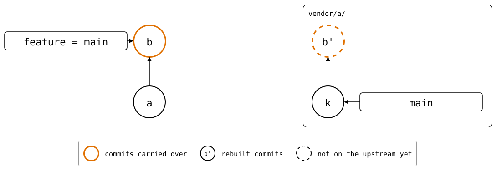

# Scenario: feature-branch-from-main

The monorepo's `feature` branch has a commit that its `main` lacks. Upstream
protects its `main`, say, so changes only go in through a PR from another
branch.

<div align="center">



</div>

The splice didn't change on `feature`, but `feature` has *b*, which
upstream's `main` lacks. That's what counts, as for a PR: `push` creates
`feature` upstream with it, ready for one (#150).

## Output

<!--
```scrut {fail_fast: true, output_stream: combined}
$ source "$TESTDIR/../../readme-setup.sh"
```
-->

[`setup.bash`](setup.bash) builds this state:

```scrut
$ build_scenario scenario_feature_branch_from_main
```

<!--
```scrut
$ changed="$(git rev-parse feature)" &&
>   git switch -q main &&
>   git branch -D feature >/dev/null
```

```scrut
$ check_drawing "$TESTDIR/feature-branch-before-switch.drawio.svg" \
>   a=HEAD k=refs/splices/upstream/heads/main
ok   feature-branch-before-switch.drawio.svg: 2 commits, 2 arrows, 2 boxes, 1 lanes
```

```scrut
$ git switch -q -c feature
```

```scrut
$ check_drawing "$TESTDIR/feature-branch-before-change.drawio.svg" \
>   a=HEAD k=refs/splices/upstream/heads/main
ok   feature-branch-before-change.drawio.svg: 2 commits, 2 arrows, 2 boxes, 1 lanes
```

```scrut
$ git reset -q --hard "$changed"
```

```scrut
$ check_drawing "$TESTDIR/feature-branch-from-main.drawio.svg" \
>   a=HEAD~1 b=HEAD k=refs/splices/upstream/heads/main
ok   feature-branch-from-main.drawio.svg: 4 commits, 5 arrows, 3 boxes, 1 lanes
```
-->

```scrut
$ git splice status
On branch feature

  new, ahead 1  vendor/a  push creates the branch
```

```scrut
$ git splice log
===  vendor/a (upstream has no 'feature' branch -- compared with 'main')
< e859a6b local change  (Test <test@example.com>)
```

```scrut
$ git splice diff --stat
===  vendor/a
 file.txt | 1 +
 1 file changed, 1 insertion(+)
```

```scrut
$ git splice push vendor/a
??   vendor/a: upstream has no 'feature' branch yet -- this push creates it
ok   vendor/a: pushed e859a6b to feature
```

<!--
```scrut
$ check_drawing "$TESTDIR/feature-branch-after-push.drawio.svg" \
>   a=HEAD~1 b=HEAD k=refs/splices/upstream/heads/main
ok   feature-branch-after-push.drawio.svg: 4 commits, 6 arrows, 4 boxes, 1 lanes
```
-->

```scrut
$ git splice status
On branch feature

  up to date  vendor/a
```
