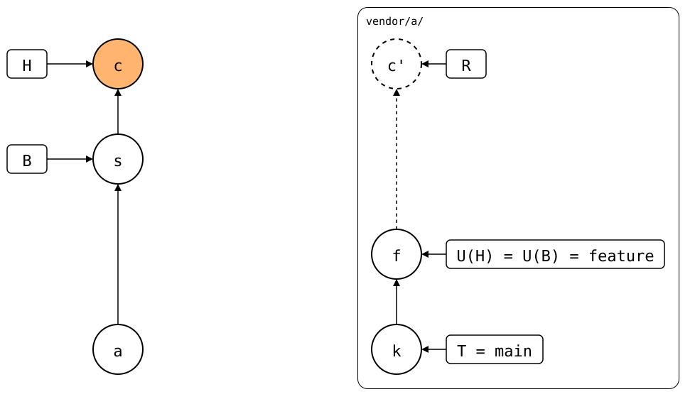

# Scenario: squash-merged-pull

A pull on a feature branch, squash-merged into `main` as *s*, then a
local commit, *c*:

<div align="center">



</div>

`.splice` records a commit, not a branch: *s* records *f*, though nobody
merged the upstream's `feature` into its `main`.

A squash merge keeps the content and drops the history. With `git subtree`,
that lost the sync point. Here *s* itself changed `.splice`, so it is B, and
the rebuild starts at *f*.

## Output

<!--
```scrut {fail_fast: true, output_stream: combined}
$ source "$TESTDIR/../../readme-setup.sh"
```
-->

[`setup.bash`](setup.bash) builds this state:

```scrut
$ build_scenario scenario_squash_merged_pull
```

<!--
```scrut
$ check_drawing "$TESTDIR/squash-merged-pull.drawio.svg" \
>   a=HEAD~2 k=refs/splices/upstream/heads/main
ok   squash-merged-pull.drawio.svg: 6 commits, 9 arrows, 5 boxes, 1 lanes
```
-->

```scrut
$ git log --format=%s
c: local change
s: feature (squash-merged)
add vendor/a
initial commit
```

```scrut
$ git splice status
On branch main

  ahead 2  vendor/a
```

```scrut
$ git splice log
===  vendor/a (main)
< 2b23025 c: local change  (Test <test@example.com>)
< 1ee7bf7 f: upstream feature work  (Test <test@example.com>)
```

```scrut
$ git splice push vendor/a
ok   vendor/a: pushed 2b23025 to main
```

```scrut
$ git -C "$UPSTREAM" log --format=%s main
c: local change
f: upstream feature work
seed
```
