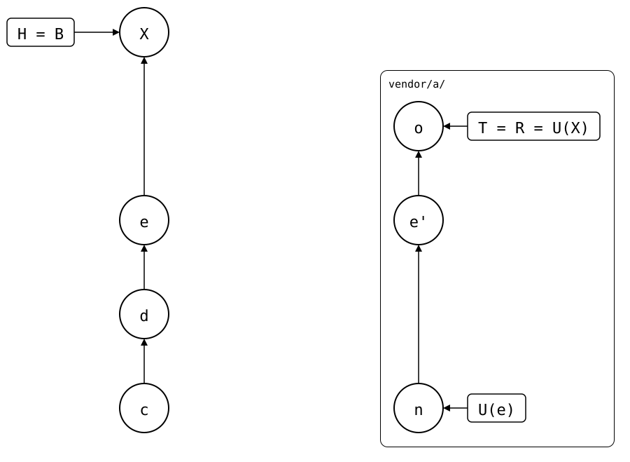

# Scenario: after-a-push

The [parent scenario's](../README.md) recipe takes the upstream commits
of a pull *X* from `.splice`: U(X^) in *X*'s first parent, U(X) in *X*. That's
only right if *X* merged from U(X^). After a push, it didn't.

- **Monorepo**: the parent scenario, with its pull now named *c*, and *d*
  (`add notes`). Then *e*, a local change in `vendor/a/`, pushed with
  `git splice push`. Then *X*, a pull of one more upstream commit.
- **Upstream**: the parent scenario's commits up to *n* (`fix a typo`),
  *e'*, the pushed copy of *e*, and *o* (`add upstream.txt`).

<div align="center">



</div>

U(e)..U(X) is *e'* and *o*, though *X* only brought in *o*.

## Output

<!--
```scrut {fail_fast: true, output_stream: combined}
$ source "$TESTDIR/../../../readme-setup.sh"
```
-->

[`setup.bash`](setup.bash) builds this state:

```scrut
$ build_scenario scenario_after_a_push
```

The drawing shows what Git and `git-splice` say about it, with each
commit named by its place in the history
([`check_drawing`](../../../../../check-drawing/)):

```scrut
$ check_drawing "$TESTDIR/after-a-push.drawio.svg" c=HEAD~3 d=HEAD~2 e=HEAD~1 X=HEAD n=refs/splices/upstream/main~2 o=refs/splices/upstream/main
ok   after-a-push.drawio.svg: 7 commits, 8 arrows, 3 boxes, 1 lanes
```

```scrut
$ git log --format=%s
splice: pull vendor/a from main at 9294a14
a local change in vendor/a
add notes
splice: pull vendor/a from main at 803779d
add check.sh
add vendor/a
initial commit
```

*X* is the newest pull. The recipe's range has the pushed commit too:

```scrut
$ X=HEAD && U1="$(git config --blob "$X^:vendor/a/.splice" splice.commit)" && U2="$(git config --blob "$X:vendor/a/.splice" splice.commit)" && git log --format=%s "$U1..$U2"
add upstream.txt
a local change in vendor/a
```

A push doesn't write to the monorepo, so `.splice` in *X*'s first parent
still names the commit of the first pull
([pushed-then-pulled](../../../01-everyday-sync/02-up-to-date/02-push-ahead/01-pushed-then-pulled/README.md)).
*X* merged from the pushed commit, and only brought in `add upstream.txt`.
The pushed commit's change was in the monorepo before *X*:

```scrut
$ git show "$X^:vendor/a/file.txt"
seed, fixed
a local line
```

So the second bisect tests a commit the monorepo already had. Bisect
assumes one change from good to bad in the range. If the pushed commit
broke the test and a later one fixed it, bisect can name the pushed
commit, though *X* didn't bring it in.

A splice made with `git splice init` and pushed has no synced commit at
all, so U(X^) is empty and the recipe stops at its first command.

In both cases, the lower bound is where *X*'s merge started: where the
monorepo's history, rebuilt as upstream commits, meets the upstream's.
Only `git-splice` computes that, so plain Git can't get it from `.splice`.
[#109](https://github.com/roschaefer/git-splice/issues/109) proposes
`git splice show <commit>`, which could print the range from there.
