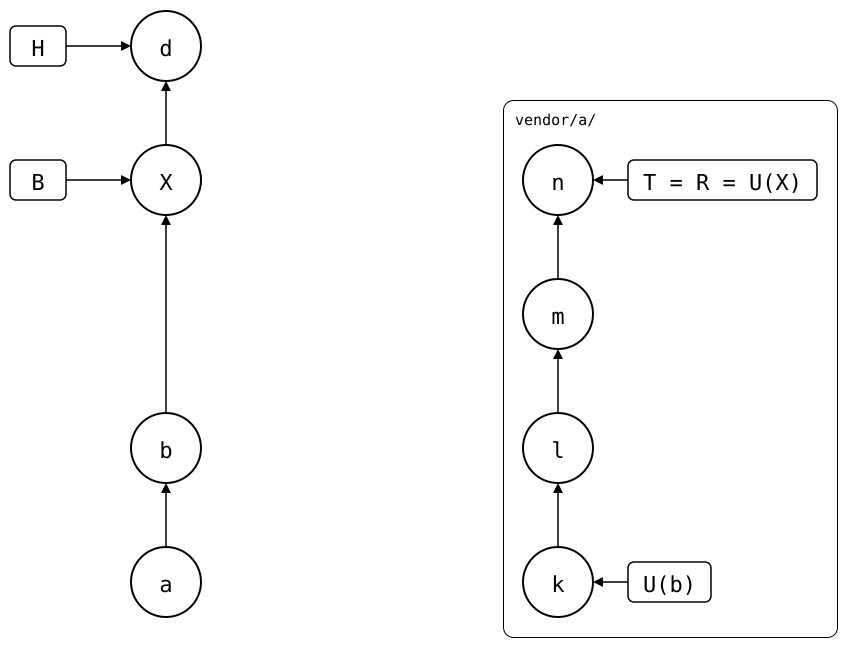

# Scenario: bisect-into-a-pull

`git bisect` in the monorepo ends at a pull *X*. A pull splices upstream
changes in as one commit, so the bug came in with one of the upstream
commits squashed into it. Which one?

- **Upstream**: *k*, then three commits: *l*, *m* and *n*.
- **Monorepo**: *a* spliced *k* in. Then *b* added
  `check.sh`, a test outside the splice that fails when the library logs
  at debug level. Then *X*, a pull of *l*, *m* and *n*, and one more commit, *d*.

The upstream's own history has no test for it: the bug only shows in
the monorepo. So the upstream commits are tested inside the monorepo, as
it was right before the pull.

<div align="center">



</div>

*X* merged from U(b) = *k* and records U(X) = *n*, so the pulled commits are
U(b)..U(X): *l*, *m* and *n*.

## Output

[`setup.bash`](setup.bash) builds this state:

<!--
```scrut {fail_fast: true, output_stream: combined}
$ source "$TESTDIR/../../readme-setup.sh"
```
-->

```scrut
$ build_scenario scenario_bisect_into_a_pull
```

<!--
```scrut
$ check_drawing "$TESTDIR/bisect-into-a-pull.drawio.svg" \
>   X=HEAD~1
ok   bisect-into-a-pull.drawio.svg: 8 commits, 10 arrows, 4 boxes, 1 lanes
```
-->

### Bisect the monorepo

```scrut
$ git log --format=%s
d: add notes
splice: pull vendor/a from main at b413207
b: add check.sh
a: add vendor/a
initial commit
```

The commit that added `check.sh` is the known good one. Before it,
`./check.sh` doesn't exist, and `git bisect run` would count that as bad:

```scrut
$ good="$(git log -1 --format=%H --diff-filter=A -- check.sh)" &&
>   git bisect start HEAD "$good" >/dev/null &&
>   git bisect run ./check.sh >/dev/null &&
>   git show --stat --format='first bad commit: %s' refs/bisect/bad
first bad commit: splice: pull vendor/a from main at b413207

 vendor/a/.splice    | 2 +-
 vendor/a/config.txt | 1 +
 vendor/a/file.txt   | 2 +-
 3 files changed, 3 insertions(+), 2 deletions(-)
```

The first bad commit is the pull *X*. It has the changes of three upstream
commits in one.

```scrut
$ X="$(git rev-parse refs/bisect/bad)" && git bisect reset >/dev/null
```

### The upstream commits in the pull

`.splice` records the synced commit: U(X^) before the pull, in *X*'s
first parent, and U(X) after it, in *X*, here saved as `U1` and `U2`. The
commits between them came in with *X*.
The fetched upstream refs have them:

```scrut
$ U1="$(git config --blob "$X^:vendor/a/.splice" splice.commit)" &&
>   U2="$(git config --blob "$X:vendor/a/.splice" splice.commit)" &&
>   git log --oneline "$U1..$U2"
b413207 n: fix a typo
be7ce06 m: log at debug level
bdc6c70 l: add config.txt
```

[#109](https://github.com/roschaefer/git-splice/issues/109) proposes
`git splice show <commit>` to print them.

That range is only right if nothing was pushed since the pull before *X*.
A push doesn't write to `.splice`, so U(X^) then is older than where *X*
merged from, and the range has commits the monorepo already had
([after-a-push](01-after-a-push/README.md)).

### Bisect the upstream commits inside the monorepo

Two worktrees: `../before`, the monorepo right before the pull, and
`../lib`, the upstream at U(X). Both have the upstream's layout, so
they need a worktree of their own.

```scrut
$ git worktree add -q --detach ../before "$X^" &&
>   git worktree add -q --detach ../lib "$U2" &&
>   cd ../lib
```

Bisect runs in `../lib`. For each candidate, it copies the candidate's
files into `../before/vendor/a` and runs the monorepo's test there:

```scrut
$ cat >../copy-and-check.sh <<'EOF'
> set -e
> git --work-tree=../before/vendor/a checkout -f HEAD -- .
> cd ../before
> ./check.sh
> EOF
```

```scrut
$ git bisect start "$U2" "$U1"
Bisecting: 0 revisions left to test after this (roughly 1 step)
[be7ce0647ac80b4fc46a18cd62f417924503bc66] m: log at debug level
```

```scrut
$ git bisect run sh ../copy-and-check.sh
running 'sh' '../copy-and-check.sh'
Bisecting: 0 revisions left to test after this (roughly 0 steps)
[bdc6c706680c6d0250da4aedfed5b65755d11ba0] l: add config.txt
running 'sh' '../copy-and-check.sh'
be7ce0647ac80b4fc46a18cd62f417924503bc66 is the first bad commit
commit be7ce0647ac80b4fc46a18cd62f417924503bc66
Author: Upstream <upstream@example.com>
Date:   Thu Jan 1 00:00:00 2026 +0000

    m: log at debug level

 config.txt | 2 +-
 1 file changed, 1 insertion(+), 1 deletion(-)
bisect found first bad commit
```

That's the exact upstream commit. If the bug shows in the upstream
alone, `git bisect run` in `../lib` without `../before` is enough.

The copy leaves files in the folder that a candidate doesn't have, e.g.
ones an upstream commit deleted. It also only writes files: the index
of `../before` doesn't change, so a test that asks Git, e.g. with
`git ls-files` or `git grep`, doesn't see files a candidate added. And if *X* merged local changes into the
folder, the candidates are tested without them.
[#110](https://github.com/roschaefer/git-splice/issues/110) proposes
`git splice expand`, which would turn *X* into one monorepo commit per
upstream commit, so that `git bisect` continues in the monorepo itself.
