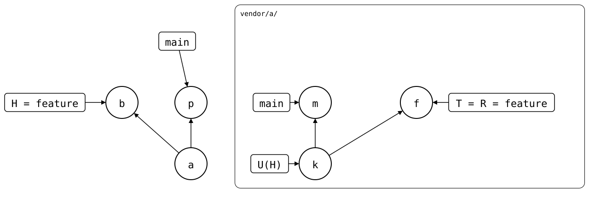

# Scenario: feature-branch-behind-default-branch

A feature branch was pushed, so upstream has it as a PR. Then upstream's
`main` moved on, the monorepo's `main` pulled that in, and the feature
branch was rebased onto `main` with plain `git rebase main`, to bring the
PR up to date.

- **Upstream**: *k* (`seed`) on `main`, then *m* (`bump dep`), which adds
  `lock.txt`. `feature`, the PR, is *f* (`feature change`) on top of
  *k*.
- **Monorepo (`vendor/a/`)**: *a* cloned *k*. On `main`, the pull *p*
  brought in *m*. On `feature`, *b* (`feature change`) was pushed as *f*,
  and then rebased onto *p* as *c*.

<div align="center">



</div>

Four branches take part, two in each repository: `main` and `feature`
in the monorepo, *p* and *c*, and `main` and `feature` upstream, *m*
and *f*. `git-splice` syncs the monorepo's folder with the upstream
branch of the same name. Rebasing `feature` onto `main` is plain Git,
and it's one operation that can be done in either repository. Do it in
one of them only, then carry the result across with `git-splice`, in
this order:

<div align="center">


</div>

- **The monorepo first**, as here: pull on `main`, `git rebase main` on
  `feature`, then [`push --force`](push-force.md).
- **The upstream first**: [rebase](rebased-upstream.md) or
  [merge](merged-upstream.md) `feature` onto `main` upstream, then
  `pull` on `feature`.

Mixing the two, a rebase in the monorepo and a pull of the PR that was
never rebased, joins two bases for the same branch: `feature` upstream
still lacks *m*, which the monorepo's `feature` has now. A
[`pull`](pull.md) keeps both copies of the feature change, and
[`pull --rebase`](pull-rebase.md) refuses, since it would drop *m*.

## Output

<!--
```scrut {fail_fast: true, output_stream: combined}
$ source "$TESTDIR/../../readme-setup.sh"
```
-->

[`setup.bash`](setup.bash) builds this state:

```scrut
$ build_scenario scenario_feature_branch_behind_default_branch
```

<!--
```scrut
$ check_drawing "$TESTDIR/feature-branch-behind-default-branch.drawio.svg" \
>   a=HEAD~2 p=main c=HEAD k=refs/splices/a/heads/main~1 \
>   m=refs/splices/a/heads/main f=refs/splices/a/heads/feature
ok   feature-branch-behind-default-branch.drawio.svg: 7 commits, 10 arrows, 5 boxes, 1 lanes
```
-->

```scrut
$ git log --graph --format=%s main feature
* feature change
* splice: pull vendor/a from main at 5cc5467
* splice: clone vendor/a from main at bde4164
* initial commit
```

```scrut
$ git -C "$UPSTREAM" log --graph --format=%s main feature
* bump dep
| * feature change
|/  
* seed
```

Ahead 2 are *m* and *c*, behind 1 is *f*, the copy of *b* that upstream
has:

```scrut
$ git splice status
On branch feature

  ahead 2, behind 1  vendor/a
```

Every commit only upstream has is a copy of one the monorepo's `feature`
has, so `push` suggests `--force`, not a `pull`:

```scrut
$ git splice push vendor/a
!!   vendor/a: upstream's 'feature' has only copies of commits this branch has, e.g. from before a 'git rebase' here -- run 'git splice push --force vendor/a' to replace them: a pull would keep both
!!   Failed: vendor/a
[1]
```
