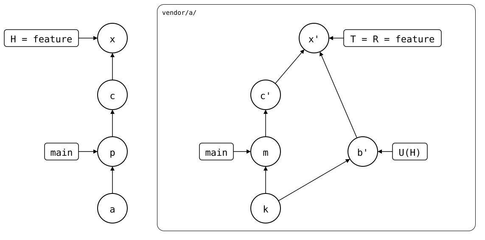
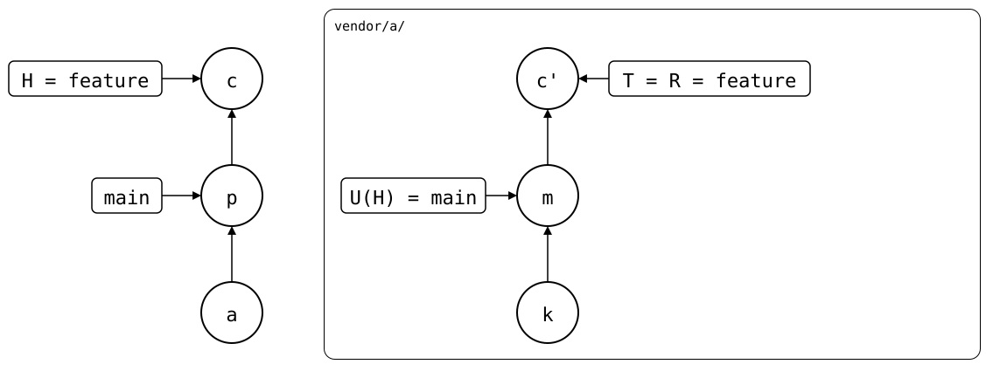

# What you don't want: the old commits back on the PR

In the [same state](README.md), `feature` is rebased in the monorepo,
and then the PR, which was never rebased, is pulled. That mixes the two
strategies: the next push sends the old commits back to the PR, next to
the rebased ones.

## Output

<!--
```scrut {fail_fast: true, output_stream: combined}
$ source "$TESTDIR/../../readme-setup.sh"
```
-->

[`setup.bash`](setup.bash) builds this state:

```scrut
$ build_scenario scenario_feature_branch_behind_default_branch
```

<!--
```scrut
$ pushed="$(git rev-parse splices/a/heads/feature)"
```
-->

The rebase copies *b* onto *p* as *c*:

```scrut
$ git rebase -q main
```

`push` refuses: upstream has a commit this branch lacks, *b'*:

```scrut
$ git splice push vendor/a
!!   vendor/a: upstream has commits this branch lacks
!!   Failed: vendor/a
[1]
```

Out of habit, you pull before pushing again. Neither pull is the way
here, but only one of them stops you:

- A plain `pull` keeps every change, as `git pull` does, so it goes
  through. What it does to the PR is what this page is about.
- `pull --rebase` would take *b'*'s files and drop *m*: *b'* lacks it,
  and never had it, since `main` brought it in, not `feature`. That
  would lose a change, which `git pull --rebase` keeps, so it refuses.

The refusal first, since a pull changes the state it needs. It prints
the two [rebase strategies](README.md#the-rebase-strategies):

```scrut
$ git splice pull --rebase vendor/a
ok   vendor/a fetched
!!   vendor/a: 'feature' never had the synced commit 48aa825, which this branch got elsewhere, e.g. with 'git rebase main' -- --rebase would drop it. To rebase 'feature', do it on one side only:

  # keep this branch's rebase, overwriting upstream's 'feature':
  git splice push --force -- vendor/a

  # OR: rebase or merge 'feature' upstream, e.g. with "Update branch" on GitHub, then:
  git splice pull --rebase -- vendor/a

!!   Failed: vendor/a
[1]
```

The plain `pull` merges *b'*, the copy of *b* from before the rebase,
into `feature` as the pull *x*. No change is lost,
and `lock.txt` stays:

```scrut
$ git splice pull -m "x: pull the PR" vendor/a
ok   vendor/a fetched
ok   vendor/a: pulled 1041672
```

```scrut
$ cat vendor/a/lock.txt
m: bump dep
```

But the push then sends both copies of the feature change to the PR:

```scrut
$ git splice push vendor/a
ok   vendor/a: pushed 7680df9 to feature
```

```scrut
$ git -C "$UPSTREAM" log --graph --format=%s feature
*   x: pull the PR
|\  
| * b: feature change
* | b: feature change
* | m: bump dep
|/  
* k: seed
```

<div align="center">



</div>

<!--
```scrut
$ check_drawing "$TESTDIR/pulled-and-pushed.drawio.svg" c=HEAD~1 "b'=$pushed"
ok   pulled-and-pushed.drawio.svg: 9 commits, 13 arrows, 5 boxes, 1 lanes
```
-->

The PR lists `b: feature change` twice, and the merge between them. A
squash merge of the PR hides that; a rebase merge puts both copies on
`main`.

## If it happened

Before anyone else builds on the PR, drop the pull.
`--keep` refuses if that would lose uncommitted changes:

```scrut
$ git reset -q --keep HEAD~1
```

The PR's merge *x'* now has exactly the folder's files, so to
`git-splice` the splice is up to date, and even `push --force` has
nothing to push:

```scrut
$ git splice push --force vendor/a
ok   vendor/a: nothing to push
```

It doesn't replace a history whose files are the same: that's how an
upstream that rewrote its history, e.g. to remove a secret, stays
rewritten. Name the commit to push instead, the rebuild *c'*, with
`--rebuilt-commit`:

```scrut
$ r="$(git splice rebuild vendor/a)"
```

```scrut
$ git splice push --force --rebuilt-commit "$r" vendor/a
ok   vendor/a: pushed 125a49b to feature
```

The PR ends up as rebase via monorepo leaves it:

```scrut
$ git -C "$UPSTREAM" log --graph --format=%s feature
* b: feature change
* m: bump dep
* k: seed
```

<div align="center">



</div>

<!--
```scrut
$ check_drawing "$TESTDIR/pushed-with-force.drawio.svg" c=HEAD
ok   pushed-with-force.drawio.svg: 6 commits, 8 arrows, 4 boxes, 1 lanes
```
-->
