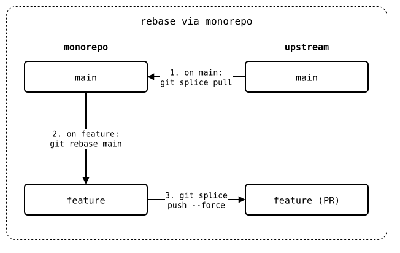
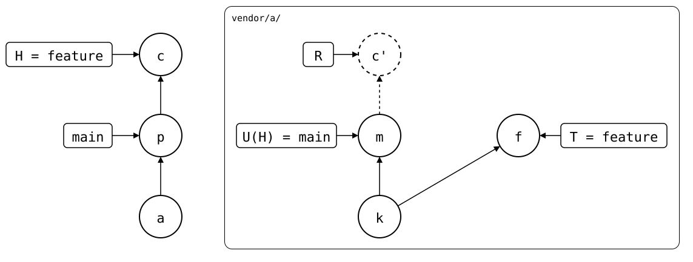

# Rebase via monorepo

In the [same state](README.md), `feature` is rebased onto `main` in the
monorepo, and the result replaces the PR:

1. On `main`: `git splice pull`. Done already: *p* brought in *m*.
2. On `feature`: `git rebase main`.
3. `git splice push --force`.

<div align="center">



</div>

The PR ends up as "Update branch" with a rebase on GitHub would leave
it. `--force` overwrites whatever upstream's `feature` has, so it's for
a PR nobody else pushes to.

## Output

<!--
```scrut {fail_fast: true, output_stream: combined}
$ source "$TESTDIR/../../readme-setup.sh"
```
-->

[`setup.bash`](setup.bash) builds this state:

```scrut
$ build_scenario scenario_feature_branch_behind_default_branch
```

The rebase copies *b* onto *p* as *c*:

```scrut
$ git rebase -q main
```

```scrut
$ git log --graph --format=%s
* b: feature change
* p: pull the dependency update
* a: clone vendor/a
* initial commit
```

<div align="center">



</div>

<!--
```scrut
$ check_drawing "$TESTDIR/rebased-in-the-monorepo.drawio.svg" \
>   c=HEAD f=refs/splices/a/heads/feature
ok   rebased-in-the-monorepo.drawio.svg: 7 commits, 10 arrows, 5 boxes, 1 lanes
```
-->

Ahead 2 are *m* and *c'*, behind 1 is *f*, the copy of *b* the PR still
has:

```scrut
$ git splice status
On branch feature

  ahead 2, behind 1  vendor/a
```

A plain `push` refuses: upstream has a commit this branch lacks. That
it's *f*, an old copy of *b*, is for you to know:

```scrut
$ git splice push vendor/a
!!   vendor/a: upstream has commits this branch lacks
!!   Failed: vendor/a
[1]
```

```scrut
$ git splice push --force vendor/a
ok   vendor/a: pushed 125a49b to feature
```

```scrut
$ git -C "$UPSTREAM" log --graph --format=%s feature
* b: feature change
* m: bump dep
* k: seed
```

<div align="center">


</div>

<!--
```scrut
$ check_drawing "$TESTDIR/pushed-with-force.drawio.svg" c=HEAD
ok   pushed-with-force.drawio.svg: 6 commits, 8 arrows, 4 boxes, 1 lanes
```
-->

```scrut
$ git splice status
On branch feature

  up to date  vendor/a
```
