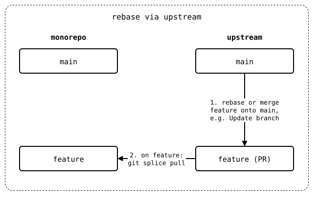
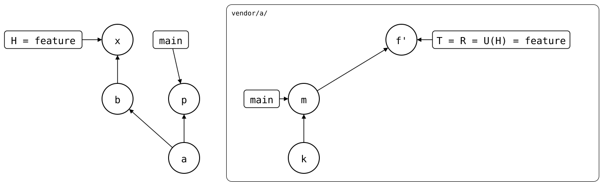
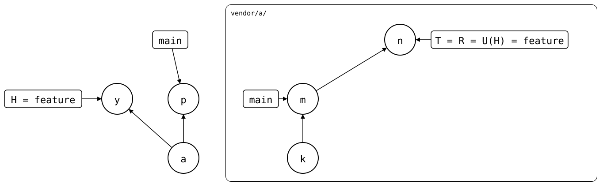

# Rebase via upstream

In the [same state](README.md), `feature` is rebased onto `main`
upstream, and the monorepo pulls the result. The monorepo's `feature`
isn't rebased:

1. Upstream: rebase `feature` onto `main`, e.g. with "Update branch" on
   GitHub. Here, it's a rebase in a clone of the upstream.
2. On `feature`: `git splice pull`, or
   [`git splice pull --rebase`](#with---rebase) for a linear history.

<div align="center">



</div>

## Output

<!--
```scrut {fail_fast: true, output_stream: combined}
$ source "$TESTDIR/../../readme-setup.sh"
```
-->

[`setup.bash`](setup.bash) builds this state:

```scrut
$ build_scenario scenario_feature_branch_behind_default_branch
```

The rebase copies *b'* onto *m* as *n*:

```scrut
$ git clone -q -b feature "$UPSTREAM" ../pr &&
>   git -C ../pr -c user.name=Maintainer -c user.email=maintainer@example.com \
>     rebase -q origin/main &&
>   git -C ../pr push -q --force origin feature
```

```scrut
$ git -C "$UPSTREAM" log --graph --format=%s feature
* b: feature change
* m: bump dep
* k: seed
```

The pull brings *m* into `feature`:

```scrut
$ git splice pull -m "x: pull the rebased PR" vendor/a
ok   vendor/a fetched (feature moved 1041672..97810bc)
ok   vendor/a: pulled 97810bc
```

```scrut
$ cat vendor/a/lock.txt
m: bump dep
```

<div align="center">



</div>

<!--
```scrut
$ check_drawing "$TESTDIR/pulled-the-rebased-pr.drawio.svg" \
>   p=main n=refs/splices/a/heads/feature
ok   pulled-the-rebased-pr.drawio.svg: 7 commits, 9 arrows, 4 boxes, 1 lanes
```
-->

A rebase upstream doesn't rewrite the monorepo's history, and nothing
is left to push:

```scrut
$ git splice status
On branch feature

  up to date  vendor/a
```

The same goes for "Update branch" with a merge: the pull brings the
merge in, and records it as the synced commit.

## With `--rebase`

`pull --rebase` keeps the monorepo's `feature` linear: it takes *n* in
on top of *a*, and drops *b*, whose change *n* has already. It rewrites
the monorepo's `feature`, so it refuses when a remote-tracking branch
has *b*, e.g. when the monorepo's own `feature` is pushed too. Here,
drop the plain pull first:

```scrut
$ git reset -q --keep HEAD~1
```

```scrut
$ git splice pull --rebase -m "y: pull the rebased PR" vendor/a
ok   vendor/a fetched
dropping 1f2e21664cfc9ac0b2d716f25237521692a29c2f b: feature change -- patch contents already upstream
ok   vendor/a: pulled 97810bc, and rebased 1 commit onto it
```

```scrut
$ git log --format=%s
y: pull the rebased PR
a: clone vendor/a
initial commit
```

<div align="center">



</div>

<!--
```scrut
$ check_drawing "$TESTDIR/pulled-the-rebased-pr-with-rebase.drawio.svg" \
>   p=main n=refs/splices/a/heads/feature
ok   pulled-the-rebased-pr-with-rebase.drawio.svg: 6 commits, 8 arrows, 4 boxes, 1 lanes
```
-->

```scrut
$ git splice status
On branch feature

  up to date  vendor/a
```
