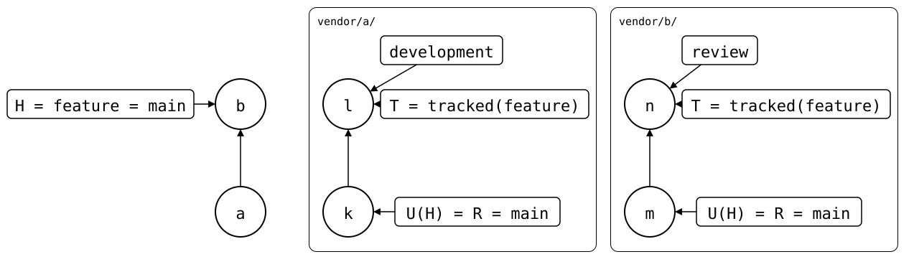

# Scenario: tracked-branch

The monorepo is on `feature`. Each splice should sync with another
upstream branch than `feature`: `vendor/a/` with `development`, where
its upstream's team works, `vendor/b/` with `review`.

- **Monorepo**: *a* clones `vendor/a/` at *k*, *b* clones `vendor/b/`
  at *m*, both on `main`, then the branch `feature`, with no changes.
- **Upstream of `vendor/a/`**: *k* on `main`, and *l* on `development`.
- **Upstream of `vendor/b/`**: *m* on `main`, and *n* on `review`.

<div align="center">



</div>

tracked(X) is the upstream branch a splice tracks on the monorepo
branch X, if any: here tracked(feature) is `development` for
`vendor/a/` and `review` for `vendor/b/`. T is the fetched tracked
branch where there is one, else the branch named like X.

`--branch` names another upstream branch for one command; `--track`
also keeps it, as `git push -u` does: on this monorepo branch, every
command syncs the splice with it from then on. `git splice fetch
--track` sets it without a pull or a push, so `status` can show the
result before anything changes.

## Output

<!--
```scrut {fail_fast: true, output_stream: combined}
$ source "$TESTDIR/../../readme-setup.sh"
```
-->

[`setup.bash`](setup.bash) builds this state:

```scrut
$ build_scenario scenario_tracked_branch
```

Neither upstream has a `feature` branch, so both splices compare with
`main`, as a PR would:

```scrut
$ git splice status
On branch feature

  unchanged, no upstream branch  vendor/a
  unchanged, no upstream branch  vendor/b
```

Track `development` for `vendor/a/`:

```scrut
$ git splice fetch --branch development --track vendor/a
ok   vendor/a fetched
ok   vendor/a: 'feature' tracks 'development' from now on
```

```scrut
$ git splice status
On branch feature

  behind 1                       vendor/a -> development  tracked on feature, local

  unchanged, no upstream branch  vendor/b
```

`vendor/a/` now compares with `development`, which has a commit to
pull. The hint says it's tracked on `feature`, and only in this clone.
Track `review` for `vendor/b/`:

```scrut
$ git splice fetch --branch review --track vendor/b
ok   vendor/b fetched
ok   vendor/b: 'feature' tracks 'review' from now on
```

Each upstream has its own tracked branch, by its key, in the monorepo's
`branch.feature.splice`, as drawn above:

<!--
```scrut
$ check_drawing "$TESTDIR/tracked-branch.drawio.svg"
ok   tracked-branch.drawio.svg: 6 commits, 10 arrows, 7 boxes, 2 lanes
```
-->

```scrut
$ git config --get-all branch.feature.splice
a:development
b:review
```

```scrut
$ git splice status
On branch feature

  behind 1  vendor/a -> development  tracked on feature, local
  behind 1  vendor/b -> review       tracked on feature, local
```

From here, `git splice pull vendor/a` pulls `development`, and `push`
goes there too. To undo it, `--no-track` stops tracking, and the splice
compares with `main` again:

```scrut
$ git splice fetch --no-track vendor/b
ok   vendor/b fetched
ok   vendor/b: 'feature' no longer tracks 'review'
```

```scrut
$ git splice status
On branch feature

  behind 1                       vendor/a -> development  tracked on feature, local

  unchanged, no upstream branch  vendor/b
```

- `push`, `pull` and `merge` take `--branch <name> --track` too, and
  track the branch once they succeed.
- A tracked branch is a name in the monorepo's config, no ref, unlike
  Git's remote-tracking branches. It belongs to the monorepo branch:
  `git branch -m` takes it along, `git branch -d` removes it, and
  `git splice key` renames the key in it.
